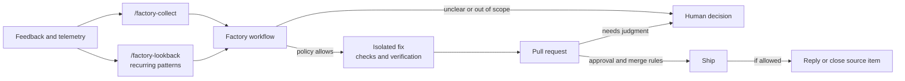
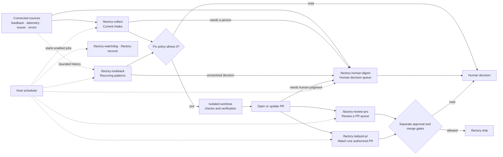

---
source_urls:
  - https://github.com/BuilderIO/skills
collected: 2026-09-26
published: Unknown (rolling repo; captured at commit a74a3a0, 2026-09-25)
authors: Builder.io
publication: BuilderIO/skills — "Skills for agents" (GitHub, MIT); plugin `builder-skills`, installer `@agent-native/skills`
---

# BuilderIO/skills — small, composable skills for your favorite agent, including the experimental Factory

> Source assembly (2026-09-26), shallow clone of `main` at `a74a3a0`: `.claude-plugin/marketplace.json` and `plugin.json`, `README.md`, the Factory guide `docs/factory/README.md` and `docs/factory/configuration.md`, **every Factory SKILL.md verbatim** (nine skills), every other SKILL.md verbatim **except** the five long host-integration skills (`visual-plan`, `visual-recap`, `visual-edit`, `turn-into-app`, `webmcp`), which are reproduced as frontmatter plus their opening sections and marked `[… truncated …]`. `commands/an.md`, the `agents/openai.yaml` interface stubs, and the file tree are included. Reference files under `skills/*/references/`, scripts, and media are named in the tree but not reproduced.

---

## File tree

```
.
├── .agents
│   └── skills
│       └── adding-a-skill
│           ├── agents
│           │   └── openai.yaml
│           └── SKILL.md
├── .claude-plugin
│   ├── marketplace.json
│   └── plugin.json
├── .codex-plugin
│   └── plugin.json
├── .github
│   └── workflows
│       ├── ci.yml
│       ├── pr-visual-recap.yml
│       └── update-agent-native-plan-skills.yml
├── .mcp.json
├── .vscode
│   └── mcp.json
├── commands
│   └── an.md
├── CONTRIBUTING.md
├── docs
│   └── factory
│       ├── configuration.md
│       └── README.md
├── LICENSE
├── media
│   ├── visual-plan.png
│   └── visual-recap.gif
├── package.json
├── README.md
├── scripts
│   ├── check-skill-frontmatter.mjs
│   └── sync-agent-native-skills.mjs
└── skills
    ├── agent-watchdog
    │   ├── agents
    │   │   └── openai.yaml
    │   ├── README.md
    │   └── SKILL.md
    ├── an
    │   └── SKILL.md
    ├── efficient-fable
    │   ├── assets
    │   │   ├── fable-orchestrator-dark.png
    │   │   ├── fable-orchestrator.excalidraw
    │   │   └── fable-orchestrator.png
    │   ├── README.md
    │   └── SKILL.md
    ├── efficient-frontier
    │   ├── README.md
    │   └── SKILL.md
    ├── factory
    │   └── SKILL.md
    ├── factory-babysit-pr
    │   ├── README.md
    │   └── SKILL.md
    ├── factory-collect
    │   └── SKILL.md
    ├── factory-human-digest
    │   └── SKILL.md
    ├── factory-lookback
    │   └── SKILL.md
    ├── factory-recover
    │   └── SKILL.md
    ├── factory-review-prs
    │   └── SKILL.md
    ├── factory-ship
    │   └── SKILL.md
    ├── factory-watchdog
    │   └── SKILL.md
    ├── plan-arbiter
    │   ├── agents
    │   │   └── openai.yaml
    │   ├── README.md
    │   └── SKILL.md
    ├── plow-ahead
    │   ├── agents
    │   │   └── openai.yaml
    │   ├── README.md
    │   └── SKILL.md
    ├── quick-recap
    │   ├── README.md
    │   └── SKILL.md
    ├── read-the-damn-docs
    │   ├── agents
    │   │   └── openai.yaml
    │   ├── README.md
    │   └── SKILL.md
    ├── rewind
    │   ├── README.md
    │   └── SKILL.md
    ├── stay-within-limits
    │   ├── README.md
    │   └── SKILL.md
    ├── turn-into-app
    │   ├── agents
    │   │   └── openai.yaml
    │   ├── README.md
    │   ├── references
    │   │   ├── attachments.md
    │   │   ├── fresh-project.md
    │   │   └── spreadsheet-source.md
    │   └── SKILL.md
    ├── visual-edit
    │   ├── README.md
    │   └── SKILL.md
    ├── visual-plan
    │   ├── README.md
    │   ├── references
    │   │   ├── canvas.md
    │   │   ├── connection.md
    │   │   ├── document-quality.md
    │   │   ├── exemplar.md
    │   │   ├── local-files.md
    │   │   └── wireframe.md
    │   └── SKILL.md
    ├── visual-recap
    │   ├── README.md
    │   ├── references
    │   │   ├── connection.md
    │   │   ├── local-files.md
    │   │   └── wireframe.md
    │   └── SKILL.md
    └── webmcp
        ├── agents
        │   └── openai.yaml
        ├── README.md
        └── SKILL.md
```

## .claude-plugin/marketplace.json

```json
{
  "name": "builder-skills",
  "owner": {
    "name": "Builder.io",
    "url": "https://www.builder.io"
  },
  "description": "Public Builder skills for docs-first discipline, autonomous execution, cross-agent review, local-first Rewind memory, efficient agent workflows, clear status recaps, Agent-Native workflow apps, and experimental configurable software factory workflows.",
  "plugins": [
    {
      "name": "builder-skills",
      "source": "./",
      "displayName": "Builder Skills",
      "description": "Public Builder skills for docs-first discipline, autonomous execution, cross-agent review, local-first Rewind memory, efficient agent workflows, clear status recaps, Agent-Native workflow apps, and experimental configurable software factory workflows.",
      "author": {
        "name": "Builder.io",
        "url": "https://www.builder.io"
      },
      "homepage": "https://github.com/BuilderIO/skills",
      "repository": "https://github.com/BuilderIO/skills",
      "license": "MIT",
      "keywords": ["builder", "skills", "agent-workflows", "subagents"]
    }
  ]
}
```

## .claude-plugin/plugin.json

```json
{
  "name": "builder-skills",
  "displayName": "Builder Skills",
  "description": "Public Builder skills for docs-first discipline, autonomous execution, cross-agent review, local-first Rewind memory, efficient agent workflows, clear status recaps, Agent-Native workflow apps, and experimental configurable software factory workflows.",
  "author": {
    "name": "Builder.io",
    "url": "https://www.builder.io"
  },
  "homepage": "https://github.com/BuilderIO/skills",
  "repository": "https://github.com/BuilderIO/skills",
  "license": "MIT",
  "keywords": ["builder", "skills", "agent-workflows", "subagents"],
  "skills": "./skills/",
  "mcpServers": "./.mcp.json"
}
```

## README.md

# Skills for agents

Small, composable skills for your favorite agent.

### Quick install recommended skills

```sh
npx @agent-native/skills@latest add
```

See the [full CLI docs below](#install).

## Skills At A Glance

- [`/factory`](#factory) (experimental) - Configure connected
  sources, prompts, schedules, and delivery policies.
  - [`/factory-collect`](#factory-collect) - Collect
  feedback, product telemetry, errors, and issues.
  - [`/factory-babysit-pr`](#factory-babysit-pr) -
  Follow one authorized PR through checks and review.
  - [`/factory-review-prs`](#factory-review-prs) -
  Review a PR queue with separate reply, approval, and merge criteria.
  - [`/factory-ship`](#factory-ship) - Publish
  delivery work under configured verification and merge policies.
  - [`/factory-lookback`](#factory-lookback) - Find
  recurring signals and systemic fixes across a chosen time window.
  - [`/factory-human-digest`](#factory-human-digest) (experimental) - Summarize
  work that still needs human judgment across configured sources.
  - [`/factory-watchdog`](#factory-watchdog) - Find
  stalled delivery work and notify when a concrete next step is due.
  - [`/factory-recover`](#factory-recover) - Resume
  interrupted work when its authorization and worktree are still valid.
- [`/an`](#an) - Open and operate Agent-Native apps beside the conversation.
- [`/webmcp`](#webmcp) - Open web apps in the built-in browser and use MCP tools first.
- [`/visual-plan`](#visual-plan) - Turn text plans into rich visual plans.
- [`/visual-recap`](#visual-recap) - Turn diffs into interactive visual recaps.
- [`/visual-edit`](#visual-edit) - Open a running local app for visual editing.
- [`/rewind`](#rewind) - Recover recent local screen context through Clips Desktop.
- [`/agent-watchdog`](#agent-watchdog) - Audit another agent's work.
- [`/plan-arbiter`](#plan-arbiter) - Compare competing plans and choose a direction.
- [`/plow-ahead`](#plow-ahead) - Keep working through ordinary ambiguity.
- [`/efficient-fable`](#efficient-fable) - Orchestrate Fable with cheaper helper agents.
- [`/efficient-frontier`](#efficient-frontier) - Preserve high-cost models for judgment.
- [`/stay-within-limits`](#stay-within-limits) - Track usage limits before long-running work.
- [`/quick-recap`](#quick-recap) - End work with a clear status signal.
- [`/read-the-damn-docs`](#read-the-damn-docs) - Check authoritative docs before guessing.
- [`/turn-into-app`](#turn-into-app) - Turn the current thread or a skill into a runnable Agent-Native app.

## Skill Details

### /factory

**Experimental.** Start with the [Factory guide](docs/factory/README.md), then
open the [full Factory skill](skills/factory/SKILL.md) for agent instructions.

Factory is an experimental set of agent skills for turning feedback, product
telemetry, errors, and delivery signals into policy-gated software changes.
The modules can collect current reports, look back for recurring failures, and
review or ship changes. Configure schedules and separate rules for fixing,
replying, reviewing, approving, merging, deploying, and closing.



#### Configuration at a glance

This abbreviated example uses placeholder scopes and connected tools. Factory
does not install these integrations or create the schedule for you.

```yaml
version: 1
timezone: UTC

sources:
  - id: support
    provider: slack
    scope: channel-id
  - id: errors
    provider: sentry
    scope: organization/project

repositories:
  - id: app
    provider: github
    remote: example/project

workflows:
  collect:
    enabled: true
    sources: [support, errors]
    reply:
      mode: criteria
      require: [one missing detail blocks triage or verification]
      tone: warm and direct
      guidance: Ask one targeted question, then re-triage when an answer arrives.
  lookback:
    enabled: true
    schedule: monthly
    window: last 30 days
    sources: [support, errors]
    implement:
      mode: manual
  human-digest:
    enabled: true
    schedule: weekly
    window: last 7 days
    repositories: [app]
    sources: [support, errors]
    include: [pull-requests, issues, feedback, errors]
    granularity: balanced

skill_prompts:
  factory-ship: |
    Keep release summaries concise and link the verified change.
  factory-human-digest: |
    Group repeated UX concerns, but include a link to every source item.
```

Each Factory skill reads its own optional prompt entry as additional project
guidance. Prompt text cannot authorize an action that its separate policy
blocks.

The [configuration reference](docs/factory/configuration.md) explains the
available YAML fields, source patterns, policies, and host limitations.

### /factory-collect

Start with the [Factory guide](docs/factory/README.md), then read the
[full collect skill](skills/factory-collect/SKILL.md).

### /factory-babysit-pr

Start with the [Factory guide](docs/factory/README.md), then read the
[full PR babysitting skill](skills/factory-babysit-pr/SKILL.md).

### /factory-review-prs

Start with the [Factory guide](docs/factory/README.md), then read the
[full PR review skill](skills/factory-review-prs/SKILL.md).

### /factory-ship

Start with the [Factory guide](docs/factory/README.md), then read the
[full shipping skill](skills/factory-ship/SKILL.md).

### /factory-lookback

Start with the [Factory guide](docs/factory/README.md), then read the
[full lookback skill](skills/factory-lookback/SKILL.md).

### /factory-human-digest

**Experimental.** Start with the [Factory guide](docs/factory/README.md), then
read the [full human digest skill](skills/factory-human-digest/SKILL.md). It
defaults to all configured human-pending work from the last 7 days at balanced
detail; ask for a narrower source type, another date range, or brief or detailed
output.

### /factory-watchdog

Start with the [Factory guide](docs/factory/README.md), then read the
[full watchdog skill](skills/factory-watchdog/SKILL.md).

### /factory-recover

Start with the [Factory guide](docs/factory/README.md), then read the
[full recovery skill](skills/factory-recover/SKILL.md).

### [`/an`](skills/an/SKILL.md)

Open a granted Agent-Native app in the host's inline MCP App or built-in browser
surface, then keep the agent connected to the app's live UI and screen state.
For example, run `/an slides` to open Slides, sign in in that browser
surface, and then ask the agent to create or update the deck. Focused requests
such as `make this bigger` use the Slides selection state and a bounded
readback-verified edit.

The plugin registers Dispatch MCP automatically for Claude and Codex at
`https://dispatch.agent-native.com/mcp`. In ChatGPT, add that same URL as
an OAuth custom connector. The host may need a reload or connector rescan after
installation.

### [`/webmcp`](skills/webmcp/README.md)

Open a requested URL in the host's built-in browser and use the page's MCP or
WebMCP tools before browser UI automation for app communication or edits. For
example, run `/webmcp slides.agent-native.com make me a new deck about onboarding`
to open Slides and complete the request in that tab. The skill waits for the
user to sign in when needed, then calls the page's `window.__agentNativeWebMcp`
helper from the host's JavaScript evaluator (or a host WebMCP bridge when one
is exposed): one screen read, one smallest mutation, one readback. If neither
is available, it stops before a state-changing click or type fallback and
reports the limitation.

### [`/visual-edit`](skills/visual-edit/README.md)

Open a running local app in Design as URL-backed iframe screens for visual
inspection, route-state exploration, and source-backed editing.

Unlike a static mockup, the canvas stays connected to the app's real routes and
the local bridge. Use `/visual-edit` when a UI needs to be reviewed or changed
in context, including responsive states and multi-screen flows.

### [`/rewind`](skills/rewind/README.md)

Use local Clips Rewind screen memory to recover a recent moment: what was said,
what appeared on screen, or what happened just before the current task. It
searches bounded local chapters, transcripts, OCR, and frames first; it is not a
hosted recording archive and does not upload raw local media by default.

Rewind requires macOS, the signed
[Clips Desktop app](https://clips.agent-native.com/download), and a compatible
agent with the local `clips-screen-memory` MCP connection. If you invoke Rewind
before installing Clips, the skill asks permission to open the official install
flow instead of silently installing capture software. Follow the [Rewind setup
and first-test guide](skills/rewind/README.md).

### [`/visual-plan`](skills/visual-plan/README.md)

Turn ordinary text plans into rich interactive visual plans with diagrams, file
maps, annotated code, open questions, and UI/prototype review when useful.

Solves for plans that are too important to bury in chat. The output is
scannable, commentable, and intuitive enough for a human to approve before code
changes start.

<picture>
  
</picture>

Visual plans are MDX, customizable with your own components, and are viewed with the [Agent-Native plans app](https://www.agent-native.com/docs/template-plan). In local-files mode, `/visual-plan` writes and serves MDX locally through a localhost bridge instead of uploading plan content to the hosted database. [Source here](https://github.com/BuilderIO/agent-native/)

### [`/visual-recap`](skills/visual-recap/README.md)

Turn a branch, commit, or PR diff into an interactive visual recap with
annotated diffs, diagrams, API/schema summaries, file maps, UI state summaries,
and focused review notes.

Solves for diffs that hide the shape of the change. Reviewers can understand
contracts, architecture moves, schema changes, and UI impact before diving into
raw line-by-line review.

<picture>
  
</picture>

Visual recaps are MDX, customizable with your own components, and are viewed with the [Agent-Native plans app](https://www.agent-native.com/docs/template-plan). [Source here](https://github.com/BuilderIO/agent-native/)

You can also install a GitHub action for these to be automatically generated for every PR with

```sh
npx @agent-native/skills@latest add
```


### [`/agent-watchdog`](skills/agent-watchdog/README.md)

Audit another agent's work from a Codex session, Claude Code transcript, PR,
branch, or run summary.

Solves for cross-agent handoffs: watch until done, reconstruct what was asked,
check what actually changed and verified, report gaps, and optionally make
narrow fixes.

### [`/plan-arbiter`](skills/plan-arbiter/README.md)

Compare competing agent plans and choose one executable direction.

Solves for multi-agent planning loops where Codex, Claude Code, or other agents
produce separate strategies. The output is a decision memo with the winning or
hybrid plan, rejected alternatives, verification gates, and executor
recommendation.

### [`/plow-ahead`](skills/plow-ahead/README.md)

Keep working through ordinary ambiguity and finish with a clear decision recap.

Solves for explicit autonomy requests: the agent converts routine questions into
assumptions, proceeds with conservative choices, validates the work, and recaps
the decisions it made without stopping.

### [`/efficient-fable`](skills/efficient-fable/README.md)

Use Claude Fable as the orchestrator, architect, synthesizer, and final judge
while lighter agents handle token-heavy research, coding, testing, and log
reduction.

Solves for expensive-model waste: Fable should spend tokens on judgment, not on
reading every file, reducing every log, or manually running every browser check.

<picture>
  <source media="(prefers-color-scheme: dark)" srcset="skills/efficient-fable/assets/fable-orchestrator-dark.png">
  <source media="(prefers-color-scheme: light)" srcset="skills/efficient-fable/assets/fable-orchestrator.png">
  
</picture>

### [`/efficient-frontier`](skills/efficient-frontier/README.md)

Apply the same orchestration as `/efficient-fable` to any high-cost frontier
model: preserve the expensive model for planning, tradeoffs, integration,
validation strategy, and final review; use cheaper agents for bounded heavy
lifting.

Solves for broad work that can be parallelized without asking the most expensive
model to do every scan and every edit itself.

### [`/stay-within-limits`](skills/stay-within-limits/README.md)

Check current 5-hour and weekly usage before substantial work and between
parallel waves, then pause new execution at 95% until the active window is clear
enough to continue.

Solves for long-running agent sessions that accidentally exhaust the current
budget window mid-task instead of pausing cleanly and resuming with a
self-contained plan.

### [`/quick-recap`](skills/quick-recap/README.md)

Add a concise final status block convention so every completed response ends
with a clear green, yellow, or red work-state signal.

Solves for ambiguity at the end of agent work: done, pending a specific
non-routine step, or blocked on the user.

Example green status:

```md
🟢 Updated quick recap docs with output examples
```

Example yellow status:

```md
🟡 Code updated, set PROVIDER_WEBHOOK_SECRET before testing webhooks
```

### [`/read-the-damn-docs`](skills/read-the-damn-docs/README.md)

Make agents web-search for authoritative docs before they guess from stale model
memory.

Solves for version drift and API folklore: package installs, framework config,
SDK imports, provider limits, auth, security, billing, data, migrations, deploys,
and repo-specific contracts all require a docs pass before implementation. For
external APIs and current product behavior, web search for official docs is
usually the first move.

### [`/turn-into-app`](skills/turn-into-app/README.md)

At the end of a thread, turn the current workflow into a fresh Agent-Native app
with clear buttons, visible agent steps, a running local preview, and a concise
deployment handoff. At the beginning of a thread, pass a skill name or workflow
path, such as `/turn-into-app /some-skill`, to use that source immediately.
Codex threads and local transcript exports work today; ChatGPT shared links and
Claude web/project imports are marked coming soon. The result should be the
concrete workflow app, not a generic app-builder intake form. Local previews can
use ignored `.env` setting `AUTH_DISABLED=1` so they open without an account.

## Install

Run the installer:

```sh
npx @agent-native/skills@latest add
```

The picker shows the full catalog, with the recommended skills preselected.
Toggle any additional skills you want.

The installer walks you through the choices:

- Which skills to install.
- Where visual plans and recaps should live: hosted shareable links
  (recommended), local files only, or a self-hosted/custom Plan app.
- Agent Skills through the shared `.agents` path for Codex, Pi, Cursor,
  OpenCode, GitHub Copilot / VS Code, and similar agents, plus Claude Code's
  native skills path when selected.
- User-level or project-level install.
- Whether to add managed `AGENTS.md` / `CLAUDE.md` instruction blocks when the
  selected skills have always-on guidance.
- Whether to add the PR Visual Recap GitHub Action when `/visual-recap` is
  selected.
- Whether to configure a compatible local agent connection when `/rewind` is
  selected. The installer does not install Clips Desktop. If it is missing,
  invoking Rewind asks permission to open the official download flow; capture
  remains disabled until you turn it on in the Clips tray.

Skip the picker with `--skill`:

```sh
npx @agent-native/skills@latest add --skill quick-recap
npx @agent-native/skills@latest add --skill visual-recap --with-github-action
npx @agent-native/skills@latest add --skill rewind
npx @agent-native/skills@latest add --skill webmcp
```

You can also use Vercel's `skills` CLI for a plain skill-folder copy:

```sh
npx skills@latest add BuilderIO/skills --skill quick-recap
```

Do not use the plain-copy installer for Rewind: it cannot configure the local
`clips-screen-memory` connection. Use `@agent-native/skills` or
`@agent-native/core` for a complete Rewind setup.

That installer is useful for quick copying, but it does not add the managed
`AGENTS.md` / `CLAUDE.md` instruction blocks or the PR Visual Recap GitHub
Action that pair well with these skills.

### Install in Claude Cowork

This repo is also a Claude plugin marketplace for Cowork. To install the
shareable, updatable plugin in Cowork:

1. Open `Customize` > `Plugins` > `Add marketplace`.
2. Enter `BuilderIO/skills` (or `https://github.com/BuilderIO/skills`).
3. Install `Builder Skills` and enable the `webmcp` skill.

Invoke the installed skill with its plugin namespace:

```text
/builder-skills:webmcp slides inspect the current screen without editing
```

For Team and Enterprise workspaces, an organization admin can provision the
marketplace or plugin for everyone. Cowork does not currently expose a
supported CLI command for installing an account-level plugin; the marketplace
is shared through Git, while each Cowork user installs it from `Customize`.

### Install in Claude Code

This repo is also a [Claude Code plugin
marketplace](https://code.claude.com/docs/en/plugin-marketplaces). To install
all of the skills as a managed, updatable plugin, run these inside Claude Code:

```sh
/plugin marketplace add BuilderIO/skills
/plugin install builder-skills@builder-skills
```

The skills are then namespaced under the plugin (for example,
`/builder-skills:quick-recap`). Pull future updates with:

```sh
/plugin marketplace update builder-skills
```

The plugin installs Rewind's instructions only; it cannot configure the local
Clips Screen Memory MCP connection. When invoked, Rewind can ask permission to
open the official Clips Desktop installer, but it must not install or enable
capture silently. After Clips is installed and Rewind is enabled, also run:

```sh
npx @agent-native/core@latest skills add rewind --client claude-code --scope user --yes
```

Treat Rewind as unavailable until `screen_memory_status` succeeds.

This path does not add the managed `AGENTS.md` / `CLAUDE.md` instruction blocks
or the PR Visual Recap GitHub Action; use the `npx @agent-native/skills`
installer above if you want those.

## docs/factory/README.md

# Experimental software factory

> **Experimental:** Factory skills install agent instructions. They do not add
> integrations, credentials, scheduled jobs, or permission grants. Host support
> and the configuration conventions can change.

Factory is a set of composable skills for turning configured product and
maintenance signals into reviewed software changes. Each action has its own
autonomy policy: fixing an issue does not automatically authorize a reply,
approval, merge, deployment, or issue closure.

## Workflow at a glance

Factory uses the read-capable integrations and scheduler already available in
your agent host. The source names below are examples; there is no fixed Factory
connector catalog.



The diagram shows possible handoffs, not automatic permissions. Every recurring
job must be created and verified in the host scheduler.

## Install

Run the interactive installer and select **Factory** to preselect the group.
You can remove individual skills, then choose clients and install scope:

```sh
npx @agent-native/skills@latest add
```

Every Factory skill is marked experimental in the installer and skills list.

## Skills

| Skill | Use it for |
| --- | --- |
| `/factory`| Choose sources, policies, schedules, worktrees, and host automations. |
| `/factory-collect`| Collect and triage configured feedback, product telemetry, errors, and issues. |
| `/factory-lookback`| Look across a bounded history for recurring symptoms and systemic fixes. |
| `/factory-human-digest`| Aggregate PRs, issues, feedback, errors, and delivery work still waiting for human judgment. |
| `/factory-review-prs`| Review a filtered queue of PRs; apply separate reply, approval, and merge rules. |
| `/factory-babysit-pr`| Follow one explicitly authorized PR, fix in-scope findings, and apply separate publish, reply, approval, merge, and soak rules. |
| `/factory-ship`| Publish and complete delivery work under the project's policy. |
| `/factory-watchdog`| Find stalled, explicitly authorized delivery work and notify only when a concrete next step is due. |
| `/factory-recover`| Resume an interrupted run only when its original authorization and worktree are still valid. |

`/factory-collect` handles current items. `/factory-lookback` compares history
to find patterns the normal item-by-item flow has missed or only fixed
temporarily. `/factory-human-digest` gathers the work held for a person across
those flows. `/factory-review-prs` is a queue sweep, while
`/factory-babysit-pr` follows one PR. `/factory-watchdog` looks for stopped
delivery work and `/factory-recover` handles eligible interrupted runs. Use
`/agent-watchdog` for a general audit of another agent's session or diff; it
does not replace these Factory workflows.

## Human decision digest

Run `/factory-human-digest` to see the work that did not enter an agent-handled
path or still needs human judgment. With no narrower request, it reads all
configured categories for the last 7 days and uses balanced detail. Narrow it
in ordinary language, such as “PRs only, last 30 days, detailed,” “issues only,
this month,” or “everything this week, brief.” A filter cannot expand the
repositories, source scopes, or tools in the project config.

The digest groups related feedback and errors when their evidence points to the
same underlying UX or system problem. It keeps each source link and distinguishes
the count of reports from the number of affected people. It includes PRs waiting
for human review or a merge decision, issues and feedback held for clarification
or policy, new answers that have not been re-triaged, and failed or stalled
delivery work without a safe authorized next step. It does not take actions;
use the owning Factory workflow when a decision leads to a reply, approval,
merge, status change, or other write.

`/factory-collect` may ask one targeted follow-up question when the configured
reply policy allows it. Later collection runs check for answers and re-triage
the original report with the new details under the same fix criteria.
`/factory-lookback` also reads those follow-up threads to see whether the new
information explains a repeated pattern or supports a systemic fix. An answer
does not mark the report fixed or authorize a separate action.

## Configuration at a glance

This example separates frequent intake from a slower retrospective and shows
how to add project-specific prompt guidance to a skill. Replace every scope
and tool name with a connection your host actually exposes.

```yaml
version: 1
timezone: UTC

sources:
  - id: support
    provider: slack
    scope: channel-id
  - id: product-events
    provider: custom
    scope: product-name
    integration: analytics-mcp
    read_tool: query_events
  - id: runtime-errors
    provider: sentry
    scope: organization/project

repositories:
  - id: app
    provider: github
    remote: example/project

workflows:
  collect:
    enabled: true
    schedule: every 4 hours
    sources: [support, product-events, runtime-errors]
    implement:
      mode: criteria
      allow: [verified defects in owned code]
      stop: [unclear product intent, security-sensitive changes]
    reply:
      mode: criteria
      require: [one missing detail blocks triage or verification]
      tone: warm and direct
      guidance: Ask one targeted question, then re-triage when an answer arrives.
  lookback:
    enabled: true
    schedule: monthly
    window: last 30 days
    compare_with: previous 30 days
    sources: [support, product-events, runtime-errors]
    implement:
      mode: manual
  human-digest:
    enabled: true
    schedule: weekly
    window: last 7 days
    repositories: [app]
    sources: [support, product-events, runtime-errors]
    include: [pull-requests, issues, feedback, errors, telemetry]
    granularity: balanced

skill_prompts:
  factory-ship: |
    Keep release summaries concise and link the verified change.
  factory-human-digest: |
    Group repeated UX concerns while keeping every item link available.
```

`skill_prompts` is an open map: each Factory skill reads the entry matching
its name and layers that text onto its normal instructions. Replace or remove a
key to change the project-specific prompt. It cannot override a user's current
request, grant permission, or weaken repository and host safeguards.

## Run a systemic lookback

Use `/factory-collect` for a current sweep. Use `/factory-lookback` when you
want to compare a bounded history across feedback, telemetry, errors, or
delivery records and ask why the same class of issue keeps returning.

For each cluster, connect the original reports to prior dispositions and
verified changes. A useful lookback distinguishes a symptom that reappeared
after a fix from a genuinely new issue that only shares similar wording. Check
representative cases and sibling paths before deciding whether the cause
belongs at a shared boundary.

The output should make the evidence and remaining uncertainty reviewable:

| Include | Why |
| --- | --- |
| Source links, time window, filters, pages, and unavailable sources | Shows what the lookback actually covered. |
| Counts and impact with identity assumptions stated | Separates event volume from affected users or sessions. |
| Prior fixes, shipped claims, and recurrence evidence | Explains why the ordinary flow did not stop the pattern. |
| Confirmed cause, sibling paths, and alternatives still uncertain | Keeps systemic fixes grounded in observed behavior. |
| Proposed or completed fix, regression proof, and independent action gates | Separates implementation from replies, closure, merge, and live verification. |

Missing history, incomplete pagination, or a disconnected source limits the
conclusion. Keep the lookback manual until its queries, schedule, worktree, and
fix criteria have been verified in the host.

## Configure

Run `/factory` in the project where the workflows should operate. It reads the
project's `.agent-factory/config.yaml`, shows the read-capable integrations
available in the host, and asks about missing scopes and policies. You can use
Slack, GitHub Issues, Jira, Sentry, or another source if the host exposes a
read-capable connector or MCP/API tool for it. Add your own source by describing
that tool, its query arguments, filters, and pagination in the config; the
Factory skills cannot connect a provider that the host does not expose.

The [configuration reference](configuration.md) contains a starter config and
describes every documented property, policy, custom-source field, and host
limitation.

The setup flow is:

1. **Choose sources and scope.** Name the connected tool and exact channel,
   repository, project, metric, or other boundary.
2. **Set action policies separately.** Choose when the agent may fix, reply,
   close, review, approve, publish, merge, deploy, recover, or notify.
3. **Add optional skill prompts.** Write a project-specific string for each
   Factory skill that needs extra guidance.
4. **Choose schedules and isolation.** Use host-supported schedules and a clean,
   automation-owned worktree for code-changing jobs.
5. **Create and verify host automations.** A YAML schedule is only a request;
   `/factory` must read the saved job settings back and report anything the host
   could not configure.

The config is an agent-readable convention, not a validated schema. Unknown
fields do not install connectors or create jobs. Provider-specific fields must
be explained clearly and confirmed with the host.

## Start with low autonomy

- Begin with manual runs or read-only source enumeration.
- Confirm source scope, pagination, counts, and unavailable integrations.
- Try one low-risk fix and verify it with the project's checks.
- Review sample replies and notifications before enabling them.
- Enable PR approval, merge, or deployment only with explicit criteria and
  live-state checks. Keep production deployment independent from merge.

Missing, partial, stale, or unreadable evidence is a hold for a person. The
skills never infer permission for one action from another.

## Limits

- Integrations, credentials, scheduler features, and worktree support come from
  the agent host and connected tools.
- Config values such as schedules, filters, and policy text may need host- or
  project-specific syntax.
- A configured job can still fail to run. Verify its saved schedule and review
  run history before relying on it.

## docs/factory/configuration.md

# Factory configuration reference

[Back to the Factory guide](README.md).

> **Experimental:** This is an agent-readable configuration convention, not a
> schema or parser. The Factory skills read the file as project policy. A field
> cannot create an integration, grant permission, or prove a host automation was
> saved.

Keep the file at `.agent-factory/config.yaml` in the project the workflows
should operate on. Run `/factory` to configure it interactively; it preserves
existing choices and asks about missing ones.

## Quick start

This example reads from several common source types and only permits fixes that
match the stated criteria. Replace the scopes and policies with your own.

```yaml
version: 1
timezone: UTC

repositories:
  - id: app
    provider: github
    remote: example/project
    worktree:
      mode: fresh-per-run
      base: origin/main

sources:
  - id: chat-feedback
    provider: slack
    type: feedback
    scope: channel-id
  - id: code-issues
    provider: github
    type: issue
    scope: example/project
  - id: tracker-issues
    provider: jira
    type: issue
    scope: PROJECT
  - id: error-reports
    provider: sentry
    type: error
    scope: organization/project
  - id: product-events
    provider: custom
    type: telemetry
    scope: example/project
    integration: analytics-mcp
    read_tool: query_events
    arguments:
      project: example
      since: last 30 days

workflows:
  collect:
    enabled: true
    schedule: every 4 hours
    sources: [chat-feedback, code-issues, tracker-issues, error-reports, product-events]
    implement:
      mode: criteria
      allow: [verified defects in owned code]
      stop: [security-sensitive changes, unclear product intent]
    reply:
      mode: criteria
      require: [one missing detail blocks triage or verification]
      tone: warm, clear, and concise
      guidance: Ask one targeted question, then re-triage when an answer arrives.
    close:
      mode: never
  lookback:
    enabled: true
    schedule: monthly
    window: last 30 days
    compare_with: previous 30 days
    sources: [chat-feedback, product-events, error-reports]
    implement:
      mode: manual
  human-digest:
    enabled: true
    schedule: weekly
    window: last 7 days
    repositories: [app]
    sources: [chat-feedback, code-issues, error-reports, product-events]
    include: [pull-requests, issues, feedback, errors, telemetry]
    granularity: balanced

skill_prompts:
  factory-ship: |
    Keep release summaries concise and link the verified change.
```

`slack`, `github`, `jira`, and `sentry` are examples, not bundled Factory
connectors. The actual source choices depend on tools your agent host exposes.
See [Add a source](#add-a-source) before configuring another provider.
The `product-events` entry is a placeholder for a connected analytics tool;
replace its integration, query, and scope with the names your host provides.

## Add a source

Factory has no fixed or exhaustive provider list. It can read any source the
host already exposes through a connected integration or MCP/API tool, provided
the tool can enumerate the items and scope you need.

Examples shown in this guide:

| Source type | Example provider | Example scope |
| --- | --- | --- |
| Team feedback | Slack | Channel ID |
| Code issues | GitHub | Repository |
| Work tracking | Jira | Project key |
| Error monitoring | Sentry | Organization and project |
| Product telemetry | Connected analytics or event-query tool | Product, project, and time window |
| Stalled delivery work | Connected task or workflow host | Project, job, or run |
| Custom product feedback | Any connected MCP/API tool | The tool's project, workspace, or query boundary |

To add a custom source, add a `sources[]` entry. Record enough detail to tell
the agent which connected tool to call, what to query, and how to finish
pagination:

```yaml
sources:
  - id: customer-ideas
    provider: custom
    scope: demo-project
    integration: feedback-mcp
    read_tool: search_feedback
    arguments:
      project_id: demo-project
      status: open
    pagination: follow the tool's next-page cursor until exhausted
```

`integration`, `read_tool`, `arguments`, and `pagination` are descriptive
custom fields, not a required schema. Use the names and argument shape exposed
by your connected tool. If the host cannot read a source, connect or build that
integration first; adding YAML or installing Factory will not make the source
available.

Keep secrets in the host's connection or secret store. Config may name a
connection or contain an opaque reference, but never put tokens, passwords,
private URLs, or copied customer records in it. A missing or unreadable source
must be reported as unavailable, not as empty.

## Property reference

The tables below cover the documented v1 convention and the examples in this
page. Properties outside this reference can be used as human-readable,
project-specific policy, but they have no universal meaning until `/factory`
confirms how the host and skills will use them.

### Top level

| Property | Meaning |
| --- | --- |
| `version` | Convention version. Use `1` for this guide. |
| `timezone` | IANA time zone used to interpret schedule text, for example `America/Los_Angeles`. |
| `repositories` | Repositories the configured workflows may inspect or change. |
| `sources` | Feedback, issue, error, or telemetry sources available to workflows. |
| `workflows` | Map of named workflow settings. Each workflow has its own schedule and action policies. |

### `repositories[]`

| Property | Meaning |
| --- | --- |
| `repositories[].id` | Short, unique config name referenced by workflow policy. |
| `repositories[].provider` | Code host or provider label, such as `github`. The agent must already have access to it. |
| `repositories[].remote` | Provider's repository identifier, commonly `owner/repository`. |
| `repositories[].worktree.mode` | Isolation strategy. `fresh-per-run` requests a clean, automation-owned worktree for each code-changing run. Other values are host-specific; don't assume support. |
| `repositories[].worktree.base` | Git ref used to create the worktree, such as `origin/main`. |

Use a clean, automation-owned worktree for code-changing schedules. If the host
cannot provide one, keep the workflow manual rather than borrowing a shared
checkout.

### `sources[]`

| Property | Meaning |
| --- | --- |
| `sources[].id` | Short, unique name referenced by a workflow's `sources` list. |
| `sources[].provider` | Connected provider label, such as `slack`, `github`, `jira`, or `sentry`. Use `custom` for another connected tool. This label does not connect the provider. |
| `sources[].type` | Optional interpretation hint, such as `feedback`, `issue`, `error`, `telemetry`, or `delivery`. It is descriptive policy, not a connector type checked by a parser. |
| `sources[].scope` | Exact channel, repository, project, organization/project, or other boundary to read. Prefer stable IDs when available. |
| `sources[].integration` | Optional custom field naming the connected MCP/API integration. |
| `sources[].read_tool` | Optional custom field naming the read/list operation. |
| `sources[].arguments` | Optional custom map of the exact query arguments or filters. Its child keys depend on the provider tool. |
| `sources[].pagination` | Optional custom description of the cursor or pagination procedure. Read every page before reporting a complete result. |

### Common workflow fields

`workflows` is a map. The documented workflow names are `collect`, `lookback`,
`human-digest`, `pull-requests`, `pr-babysitting`, `ship-watchdog`, and
`recovery`.

| Property | Meaning |
| --- | --- |
| `workflows.<name>.enabled` | Whether the workflow should be active. `false` keeps it disabled. This does not grant permission for any individual action. |
| `workflows.<name>.schedule` | Desired cadence, written in natural language or the host's supported format. `/factory` must report what was actually saved. Without a schedule, do not create a recurring job. |

Schedules vary by host. A cron schedule and a thread heartbeat are different
kinds of automation; `/factory` must preserve the host's semantics and verify
the persisted target, runtime, schedule, and notification settings.

### `workflows.collect`

| Property | Meaning |
| --- | --- |
| `workflows.collect.sources` | IDs from the top-level `sources` list to read for current feedback, telemetry, errors, and issues. |
| `workflows.collect.implement.mode` | Policy for making a fix. `criteria` needs explicit allow and stop conditions; `never` or `manual` keeps fixes human-directed. |
| `workflows.collect.implement.allow` | Conditions that permit implementation, such as confirmed defects in named code areas. |
| `workflows.collect.implement.stop` | Conditions that hold a change for a person, such as security-sensitive work or unclear product intent. |
| `workflows.collect.reply.mode` | Independent policy for public replies. `never` disables replies; a milestone such as `after-fix` means wait for that proof point. |
| `workflows.collect.reply.require` | Conditions that allow a reply, such as when one missing detail blocks triage or verification. |
| `workflows.collect.reply.tone` | Optional voice for enabled replies. |
| `workflows.collect.reply.guidance` | Optional content instructions, such as whether to link the fix. |
| `workflows.collect.close.mode` | Independent issue-closing policy. Example: `after-merge` closes only after the configured merge point; `never` leaves the issue open. |

If an earlier experimental config uses `workflows.feedback`, rename that key
and its nested fields to `workflows.collect`; the skills do not run a config
migration.

### `workflows.lookback`

Use this workflow for a bounded retrospective across sources. It complements
current intake: it compares recurring symptoms, telemetry, error patterns, and
prior fixes to find shared causes the normal item-by-item flow did not resolve.

| Property | Meaning |
| --- | --- |
| `workflows.lookback.sources` | IDs from the top-level source list to compare. Use only connected sources with the required history. |
| `workflows.lookback.window` | Time range to inspect, such as `last 30 days`. State the dates the host actually queried. |
| `workflows.lookback.compare_with` | Optional baseline, such as the previous 30 days, used to distinguish a new increase from a recurring level. |
| `workflows.lookback.focus` | Optional text naming patterns to prioritize, such as reports marked fixed that later recur. |
| `workflows.lookback.implement.mode` | Whether the run may make a systemic fix. Use `manual` for recommendations only; `criteria` needs explicit allow and stop conditions. |
| `workflows.lookback.implement.allow` | Conditions under which a confirmed systemic cause may be fixed. |
| `workflows.lookback.implement.stop` | Conditions requiring a human decision. |
| `workflows.lookback.reply.mode` | Independent policy for source replies. It does not authorize issue closure or delivery. |

An incomplete history or unavailable source limits the conclusion. Never report
“no recurring issues” when coverage is partial.

### `workflows.human-digest`

This is a read-only queue of configured work that still needs a person's
judgment. A direct run defaults to the last 7 days, all configured categories,
and balanced detail unless the user requests another window, category, or level.
The workflow never replies, approves, merges, closes, assigns, changes status,
or notifies people.

| Property | Meaning |
| --- | --- |
| `workflows.human-digest.repositories` | IDs from `repositories` to inspect for pull requests and code-host issues. Omit to use all configured repositories. |
| `workflows.human-digest.sources` | IDs from `sources` to inspect for feedback, issues, errors, telemetry, or custom records. Omit to use all configured sources. |
| `workflows.human-digest.include` | Optional categories: `pull-requests`, `issues`, `feedback`, `errors`, `telemetry`, and `delivery`. Omit it to include every category available from the configured repositories and sources. |
| `workflows.human-digest.window` | Time range for each digest, such as `last 7 days`. Manual runs use the same default when no range is requested. |
| `workflows.human-digest.granularity` | `brief`, `balanced`, or `detailed`. Defaults to `balanced`. |

Group repeated reports only when their evidence points to the same issue.
Include every source link and report partial coverage, unavailable connectors,
and uncertain status rather than treating them as empty or resolved.

### `skill_prompts`

This top-level map adds project-specific prompt text to individual Factory
skills. Keys are skill names without a slash; values are arbitrary multiline
strings. Add only the keys you need, and replace or remove a key to update the
project's custom prompt.

~~~yaml
skill_prompts:
  factory-ship: |
    Keep release summaries concise and link the verified change.
  factory-babysit-pr: |
    Report check failures with the failing job name and exact next action.
  factory-collect: |
    Ask for the smallest missing detail that would let us verify the report.
  factory-human-digest: |
    Group repeated UX concerns but include every source link and required decision.
~~~

Each Factory skill reads and applies its matching entry on direct runs and
includes it in saved automation prompts when scheduling that workflow. The
overlay is additional guidance, not a replacement for the skill. It cannot
override the user's current instruction, repository or host safeguards, or a
separate action policy. A prompt does not create a schedule or integration.

### `workflows.pull-requests`

This is the queue-review workflow. It can select many PRs; use
`pr-babysitting` for one explicitly authorized PR.

| Property | Meaning |
| --- | --- |
| `workflows.pull-requests.filters` | Host-specific conditions for which PRs to inspect. |
| `workflows.pull-requests.filters.state` | PR state filter. The example uses `open`. |
| `workflows.pull-requests.filters.drafts` | Whether drafts are included. The example uses `exclude`. |
| `workflows.pull-requests.approve.mode` | Separate policy for submitting approvals. Approval is disabled unless explicitly enabled. |
| `workflows.pull-requests.approve.require` | Every author, head, check, ownership, and review condition required before approval. |
| `workflows.pull-requests.merge.mode` | Separate merge policy. Approval does not imply merge permission. |
| `workflows.pull-requests.merge.require` | Live merge conditions, such as current head, required checks, review state, and an unchanged soak. |

Add other filter keys only when their meaning is supported by the connected
code host. Unknown filters are not evidence that a PR was excluded or checked.

### `workflows.pr-babysitting`

This workflow follows one PR or merge request, not a queue. The target and
schedule do not authorize changes or external actions; the run must verify the
user's original authorization and live PR state on every pass.

| Property | Meaning |
| --- | --- |
| `workflows.pr-babysitting.target.host` | Connected code-host integration with the required PR read/check/review capabilities. |
| `workflows.pr-babysitting.target.repository` | Exact repository identifier on that host. |
| `workflows.pr-babysitting.target.id` | Exact PR identity. Keep it a string to support non-numeric IDs. |
| `workflows.pr-babysitting.authorization` | How authorization is established. `explicit-user-request` requires checking the actual user request; this value alone does not grant permission. |
| `workflows.pr-babysitting.fix.mode` | Whether the run may edit code. `criteria` requires all configured fix conditions; `never` disables edits. |
| `workflows.pr-babysitting.fix.allow` | Actionability, path, and risk conditions that bound eligible fixes. |
| `workflows.pr-babysitting.publish.mode` | Whether the run may push an update to the authorized PR branch. This is separate from permission to edit. |
| `workflows.pr-babysitting.reply.mode` | Whether the run may send PR replies. |
| `workflows.pr-babysitting.reply.tone` | Optional voice for enabled replies. |
| `workflows.pr-babysitting.reply.guidance` | Optional wording or content requirements for enabled replies. |
| `workflows.pr-babysitting.approve.mode` | Whether the run may submit an approval, separately from review or fixes. |
| `workflows.pr-babysitting.approve.require` | Live current-head conditions required before approval. |
| `workflows.pr-babysitting.merge.mode` | Whether the run may merge, separately from publishing or approval. |
| `workflows.pr-babysitting.merge.require` | Live checks, review state, current-head, and other merge conditions. |
| `workflows.pr-babysitting.soak` | Required unchanged interval, such as `10 minutes`, or `none` if no soak is needed. Any head or gate change restarts it. |

Use `never` for each action you want disabled. Keep approval and merge disabled
unless their independent criteria are complete. If the host cannot read the
full review/check state or condition the merge on the checked head, keep the
related action disabled.

### `workflows.ship-watchdog` and `workflows.recovery`

| Property | Meaning |
| --- | --- |
| `workflows.ship-watchdog.notify.mode` | When reminders are allowed. `meaningful-change-only` sends nothing unless live state shows a new, actionable next step. |
| `workflows.recovery.enabled` | Whether recovery sweeps are enabled. Recovery resumes only interrupted work whose original authorization and worktree remain valid. |

Both can use the common `enabled` and `schedule` fields. Schedule recovery only
when the host can identify interrupted runs reliably.

## Policy values

These values are written as agent instructions, not checked against an enum.
Use explicit conditions instead of relying on a label alone.

| Policy | Meaning |
| --- | --- |
| `never` | Do not take this action. |
| `manual` | Hold for a person to invoke or approve. |
| `criteria` | Act only when all stated allow conditions pass and no stop condition applies. |
| `after-fix` / `after-merge` | Wait until that named proof point before taking the action. |

Missing, unclear, or unavailable evidence means hold. Fix, reply, close, review,
approve, publish, merge, deploy, recover, and notify are independent decisions.

## skills/factory/SKILL.md

---
name: factory
installer-group: factory
description: >-
  Experimental workflow for configuring an autonomous software delivery
  factory. Use when choosing feedback sources, schedules, worktree behavior,
  autonomy gates, or host automations.
---

# Factory

> Start with the [Factory guide](../../docs/factory/README.md) for workflow
> setup and configuration.

Read `.agent-factory/config.yaml` and apply the optional
`skill_prompts.factory` entry as additional project guidance. Configure the
current project to turn selected product or maintenance signals
into verified, reviewed changes. Factory coordinates the other modules; it
does not assume a provider, repository, schedule, or autonomy level.

## Set up

Use the [Factory configuration reference](https://github.com/BuilderIO/skills/blob/main/docs/factory/configuration.md) for field meanings, examples, and host limitations.

1. Read `.agent-factory/config.yaml` if it exists. Preserve explicit choices.
2. Show the read-capable integrations this host exposes. There is no built-in
   Factory source catalog. Confirm the source scope; add a custom source only
   when a connected tool can read it.
3. Set each action policy independently: implement, reply, close, review,
   approve, publish, merge, deploy, recover, and notify.
4. Add optional per-skill prompts under `skill_prompts` when you want
   project-specific rules layered onto a module.
5. Choose schedules, time zone, worktree ownership, runtime, and notifications
   only where the host supports them.
6. Write the agreed config. Never put credentials or tokens in it.
7. If asked to create automations, create one job per enabled workflow, then
   read back its saved schedule, target, runtime, and notification settings.
   Report fields the host could not honor.

A config entry or written prompt does not prove a job exists. Treat unavailable
or partial reads as unknown, not empty or successful.

## Safe defaults

- Keep replies, issue closure, approvals, merges, production deploys, and
  recovery disabled unless their own policy is explicit.
- For criteria-based actions, record both conditions that allow the action and
  conditions that require a human.
- Missing or unclear policy means hold. Permission to fix does not authorize
  publication or another external action.

## Modules

| Skill | Scope |
| --- | --- |
| `factory-collect` | Collect and triage configured feedback, telemetry, errors, and issues. |
| `factory-lookback` | Find recurring signals and brittle paths that need systemic fixes. |
| `factory-human-digest` | Aggregate work that still needs a human decision. |
| `factory-review-prs` | Review a filtered PR queue. |
| `factory-babysit-pr` | Follow one explicitly authorized PR. |
| `factory-ship` | Publish and complete a delivery lifecycle. |
| `factory-watchdog` | Find stopped, authorized delivery work. |
| `factory-recover` | Resume valid interrupted runs. |

Modules can run independently. Each reads the same project config and must not
borrow permissions from another workflow.

## Prompt overlays

`skill_prompts` is an open map from a skill name to a multiline prompt. Each
Factory module reads its matching entry, such as
`skill_prompts.factory-babysit-pr`, and treats it as additional project
guidance. Editing or removing that value replaces or removes the project
overlay; it never replaces the installed skill instructions.

For scheduled runs, include the matching overlay in the saved automation
prompt and verify the host retained it. A prompt cannot grant a permission,
weaken repository or host safeguards, or override the user's current request.
If it conflicts with those rules, follow the more restrictive requirement and
surface the conflict.

## Report

State which sources and host capabilities were verified, which policies and
jobs were configured, what remains manual, and any unavailable evidence. Never
claim that a schedule, integration, merge, or deployment exists without reading
back its live state.

## skills/factory-collect/SKILL.md

---
name: factory-collect
installer-group: factory
description: >-
  Experimental workflow for collecting and triaging product feedback,
  product telemetry, runtime errors, and issue reports. Use when scanning
  configured signal sources and applying separate fix, reply, or close rules.
---

# Factory Collect

Read `.agent-factory/config.yaml` and apply the optional
`skill_prompts.factory-collect` entry as additional project guidance. Collect
only the sources named by `workflows.collect.sources`. For repeated patterns
across time or sources, use `factory-lookback`.

## Collect and verify coverage

- Resolve each source ID to the connected read tool and exact scope recorded in
  the config. Sources may include support or chat feedback, issue trackers,
  product analytics or telemetry, and error monitoring.
- Use the configured time range or source cursor. Follow pagination to the
  end and record the filters, range, cursor/page coverage, and source counts.
- Keep `empty`, `unavailable`, and `truncated` distinct. A missing connector,
  partial page, or failed query is not an empty source.
- Preserve source links, timestamps, useful version or environment dimensions,
  and relevant discussion. Avoid copying secrets or unnecessary personal data.
- For telemetry, report the metric and aggregation window. Distinguish event
  counts from unique users or affected sessions unless the source provides a
  reliable identity definition.

## Triage and act

Classify each item as a verified defect, repeated symptom, feature request,
subjective feedback, duplicate, out of scope, or needing more evidence. Group
related reports while retaining each source record and reporter.

Implement only when `workflows.collect.implement` allows the change and the
repository is in scope. Stop for configured risk conditions, unclear product
intent, or evidence that cannot be reproduced. Verify the changed behavior
with the configured checks and a representative reproduction.

| Action | Gate |
| --- | --- |
| Reply | When missing information blocks triage or verification, ask one targeted question only if `workflows.collect.reply` allows it; follow configured tone and guidance. `never` means no public reply. |
| Close or mark fixed | Follow `workflows.collect.close` and wait for its proof point. Do not imply an unverified release. |
| Publish, approve, merge, or deploy | Requires its own workflow authorization; collection does not grant it. |

When an item needs more information, keep it unresolved and retain the source
thread link and the exact question. If replies are disabled, include that
question in the report for a person to send. On later collection runs, check
whether an answer arrived. Re-triage the original report together with the
answer, then apply the implementation and verification rules again; receiving
an answer does not itself authorize a fix or external action. Use
`factory-lookback` to compare these follow-ups with prior reports and fixes.

## Report

Summarize coverage by source, including unavailable or truncated reads. For each
item or related group, give its links, classification, evidence, disposition,
checks, any external action, and the exact human decision still needed.

## skills/factory-lookback/SKILL.md

---
name: factory-lookback
installer-group: factory
description: >-
  Experimental workflow for auditing recurring feedback, telemetry, errors,
  and brittle delivery paths to find systemic fixes. Use for periodic or
  requested cross-source lookbacks, not routine single-item intake.
---

# Factory Lookback

Read `.agent-factory/config.yaml` and apply the optional
`skill_prompts.factory-lookback` entry as additional project guidance. Use this
workflow when asked to look back across a bounded period or when an enabled
`workflows.lookback` automation runs. Its purpose is to find patterns that
normal item-by-item flows keep missing or fixing only temporarily.

## Build a bounded evidence set

1. Confirm the configured sources, scope, time window, comparison period, and
   output policy before querying. Use only connected sources the host can read.
2. Enumerate the full configured range, follow every page or cursor, and record
   source filters, dates, counts, and unavailable or truncated sources. Do not
   report a complete lookback when coverage is partial.
3. Include relevant feedback, analytics or telemetry, runtime errors,
   recurring CI or review failures, repeated recovery attempts, replies to
   earlier information requests, and prior fixes marked shipped or verified
   when those records are available.
4. Cluster records by underlying symptom and affected boundary, not wording
   alone. Keep event counts, affected users or sessions, time range, versions,
   and distinct source links separate; do not infer identity or impact from
   unstable identifiers.

## Find the systemic cause

For each recurring cluster, trace representative reports to their original
source and inspect prior dispositions, commits, tests, and release evidence.
Check whether the symptom recurred after a claimed fix, appeared through a
sibling caller, or escaped because the normal workflow lacked a signal, owner,
verification step, or recovery path.

For a report previously held for more information, inspect the full source
thread for new replies. Re-triage the original report with the new details and
check whether the normal fix flow now has enough evidence to proceed. Keep the
item open when the answer is still incomplete; do not treat a reply as a fix or
as permission for another action.

Reproduce a representative current case when possible. Trace related callers
and surfaces to the shared boundary that can explain the evidence. Prefer one
verified correction at that boundary over a pile of caller-specific patches.
Separate confirmed causes from hypotheses, and state what evidence would
disprove each proposed explanation.

## Change and verify

Use `workflows.lookback.implement` to decide whether to recommend only, prepare
a fix, or publish an authorized change. A recurring pattern is evidence for
investigation, not automatic permission to edit code or take an external
action. Keep reply, issue closure, PR approval, merge, deployment, and
notification under their own configured policies.

When implementation is allowed, make the smallest systemic fix that addresses
the confirmed cause. Add or update a regression check at the boundary, exercise
the representative failure and relevant sibling paths, and inspect the same
signals again after the fix. A test, merge, or “fixed” label alone does not
prove that the live recurrence stopped.

## Report

For each pattern, report:

- the source links, date range, query coverage, counts, and impact evidence;
- prior fixes or dispositions and whether the symptom returned;
- information requests, answers received, and whether they changed the
  evidence or next step;
- confirmed cause, alternatives still uncertain, and the shared boundary;
- recommended or completed systemic change, regression proof, and remaining
  rollout or live-verification work;
- independent reply, close, publish, approval, merge, deployment, and notify
  decisions, plus any exact human decision required.

Do not treat unavailable telemetry or an incomplete history as evidence that a
pattern does not exist.

## skills/factory-human-digest/SKILL.md

---
name: factory-human-digest
installer-group: factory
description: >-
  Experimental workflow for summarizing work that still needs human judgment
  across configured pull requests, issues, feedback, errors, and delivery
  signals. Use for a human decision queue or bounded review.
---

# Factory Human Digest

> Start with the [Factory guide](../../docs/factory/README.md) for workflow
> setup and configuration.

Read `.agent-factory/config.yaml` and apply the optional
`skill_prompts.factory-human-digest` entry as additional project guidance.
Inspect only the repositories and sources it authorizes.

## Choose the scope

For a manual run with no narrower request or workflow settings, include all
configured source categories, use the **last 7 days**, and report at **balanced**
granularity. A user can narrow or expand the request in ordinary language, for
example, “PRs only, last 30 days, detailed” or “everything from this week, brief.”
Use configured repository and source boundaries even when the requested time
window or category changes. For scheduled runs, use
`workflows.human-digest` from the config.

Categories can include pull requests, issues, feedback, errors, telemetry, and
stalled or failed delivery work. A category filter selects records to inspect;
it does not expand access to another project or integration.

## Find items that need a person

Read configured sources and repositories completely for the selected window.
Follow pagination and record the actual dates, filters, counts, and any source
that was unavailable or truncated. Include items held outside the normal
agent-handled flows, such as:

- pull requests waiting for human review, approval, a merge decision, or product
  judgment;
- issues, feedback, or errors held for missing context, unclear intent, risk,
  conflicting evidence, or a decision outside the configured automation rules;
- new answers to information requests that have not yet been re-triaged;
- recurring incidents, UX concerns, or delivery work that stopped without a
  verified resolution or safe authorized next step.

Exclude work that has a verified terminal outcome unless it reopened, recurred,
or received new information during the window. A label or agent summary alone
does not prove an item is resolved. If the source cannot distinguish pending
from resolved, report that uncertainty instead of guessing.

## Group patterns and preserve evidence

Group related items by the underlying user impact or failure pattern, not by
similar words alone. For each group, preserve the date range, count of distinct
records, source links, representative evidence, and the human decision needed.
Separate event volume from affected people or sessions unless the source has a
reliable identity definition. Keep unrelated reports separate even when one
summary would be shorter.

Use the configured granularity, or **balanced** by default:

- **Brief:** top groups, why each needs a person, and links to the source items.
- **Balanced:** grouped summaries, representative evidence, and a linked list
  of each item needing a decision.
- **Detailed:** one entry per item with relevant context, prior handling,
  evidence, and the exact decision or next step.

## Report; do not take the actions

Start with coverage: window, categories, repositories, sources, filters, and
pagination status. Then report recurring themes and the decision queue. For each
entry include links, why the normal flow did not handle it, prior replies or
dispositions, the decision required, and an owner or due date only when the
source provides one.

This workflow is read-only. Do not reply, approve, merge, assign, close, change
status, or notify people from the digest. Route any requested action through
its owning Factory workflow and its separate configured policy. Missing or
partial source data must remain visible in the report; it is never evidence of
an empty queue.

## skills/factory-review-prs/SKILL.md

---
name: factory-review-prs
installer-group: factory
description: >-
  Experimental workflow for reviewing configured repositories' pull requests.
  Use for manual or scheduled PR triage, approval, or merge decisions.
---

# Factory Review PRs

> Start with the [Factory guide](../../docs/factory/README.md) for workflow
> setup and configuration.

This skill reviews a filtered queue. For one long-lived, explicitly authorized
PR, use `factory-babysit-pr`. Read the filters and independent action policies
from `.agent-factory/config.yaml`; see the [configuration reference](https://github.com/BuilderIO/skills/blob/main/docs/factory/configuration.md).
Apply the optional `skill_prompts.factory-review-prs` entry as additional
project guidance; it does not replace this skill or authorize an action
disabled by policy.

## Review the queue

For each candidate PR:

1. Read live state from the configured host. Exclude drafts and PRs outside the
   configured filters. Skip a PR with a current review unless re-review is
   requested by policy.
2. Inspect the diff, linked issues, required checks, review threads, author
   eligibility, and exact head revision. Treat bot findings as leads and
   preserve human review direction unless source evidence disproves it.
3. Report actionable findings with file, line, impact, and a concrete fix. If
   none exist, record that outcome without inventing a comment.

Unavailable or partial state is unknown, never a clean result.

## Apply separate action gates

| Action | Proceed only when |
| --- | --- |
| Review | The PR matches configured filters and has not already had the required current review. |
| Reply or other PR write | That action is enabled and its conditions hold. Use configured wording; do not tag, assign, or message otherwise. |
| Approve | Approval is enabled and author, risk, ownership, current-head, check, and review conditions are verified. |
| Merge | Merge is separately enabled; every live merge condition and any soak hold on the unchanged head. |

Host-level mergeability, one green check, or a bot approval does not prove all
gates passed. Re-read the exact head and live state immediately before an
approval or merge. Restart a configured soak if the head or a gate changes.

## Report

For each PR, state the decision and evidence. List skipped, unavailable, and
held PRs with the reason. Keep review findings separate from approvals, replies,
and merge decisions.

## skills/factory-babysit-pr/SKILL.md

---
name: factory-babysit-pr
installer-group: factory
description: >-
  Experimental workflow for babysitting one explicitly authorized pull or
  merge request. Use to monitor its live review state and checks, fix actionable
  in-scope findings, and apply separate reply, approval, merge, and soak gates.
---

# Factory Babysit PR

> Start with the [Factory guide](../../docs/factory/README.md) for workflow
> setup and configuration.

Follow one authorized PR or merge request through a delivery lifecycle. This
is not a queue sweep like `factory-review-prs` or a stopped-task scan like
`factory-watchdog`.

Read `.agent-factory/config.yaml`, the optional
`skill_prompts.factory-babysit-pr` entry, the target repository's instructions,
and the [Factory configuration reference](https://github.com/BuilderIO/skills/blob/main/docs/factory/configuration.md#workflowspr-babysitting).
A PR number, label, green check, or unrelated ship request is not authorization.
The prompt is additional project guidance, not PR authorization.

## Each pass

1. **Confirm authority and ownership.** Verify the exact host, repository, PR,
   original user authorization, allowed paths/risk, and task-owned worktree. If
   anything is missing or stale, stop before writing.
2. **Read a complete live snapshot.** Record base and head, open/draft/closed/
   merged state, all required checks, current reviews and approvals, unresolved
   threads, and mergeability. Partial or unavailable data is unknown, not clean.
3. **Disposition feedback.** Compare each new finding with the exact diff and
   source. Preserve human direction unless evidence disproves it. Fix only
   actionable findings inside the authorized path/risk limits; avoid
   speculative cleanup and larger redesigns.
4. **Verify and re-read.** Run configured checks for each fix. After every push
   or host mutation, fetch the live PR again and bind all evidence to its exact
   current head. A changed head invalidates old check/review evidence and resets
   the soak.
5. **Apply action gates separately.** A review or fix does not authorize a
   reply, push, approval, or merge.

## Action gates

| Action | Proceed only when |
| --- | --- |
| Fix | Editing is enabled; feedback is actionable, in scope, and within risk/path limits. |
| Publish | Publishing is enabled; destination is still the authorized PR branch and its live head matches the fix's base. Never force-push or overwrite a concurrent update. |
| Reply | Replies are enabled and their conditions hold. Follow configured wording/tone; otherwise do not message. |
| Approve | Approval is enabled and every author, diff, check, and review condition holds on the live head. |
| Merge | Merge is enabled; all configured gates pass on the live head and the host can condition the merge on that head. |
| Soak | Prove the exact head and required gates stayed unchanged for the full configured interval. Missing history does not satisfy it. |

Use the configured code-host abstraction for reads and writes. Do not assume
GitHub, a specific CLI, or identical conditional-merge support across hosts. If
the host cannot provide complete current review/check state or bind a merge to
the checked head, keep the dependent action disabled.

## Stop and report

Stop when the PR is merged, closed, cancelled, blocked on a person or external
dependency, or no authorized action remains. Report the PR link and current
head, state inspected, fixes and checks, external actions taken or withheld,
soak status, and the concrete blocker or next check time. Distinguish read state
from unavailable or inferred state.

## skills/factory-ship/SKILL.md

---
name: factory-ship
installer-group: factory
description: >-
  Experimental workflow for publishing and completing configured software
  delivery work. Use when the user or an enabled factory policy asks to ship.
---

# Factory Ship

> Start with the [Factory guide](../../docs/factory/README.md) for workflow
> setup and configuration.

Read `.agent-factory/config.yaml`, the optional
`skill_prompts.factory-ship` entry, and the repository's instructions before
publishing. See the [Factory configuration reference](https://github.com/BuilderIO/skills/blob/main/docs/factory/configuration.md). The prompt adds project guidance; editing code does not by itself authorize a PR update, approval, merge, or deployment.

## Delivery steps

1. **Confirm ownership.** Identify the target repository, task-owned worktree,
   branch, and complete task-related change set. Preserve unrelated changes.
   Use a clean automation-owned worktree when the scheduler provides one; never
   take over a peer's checkout.
2. **Verify changes.** Run the configured formatter, tests, and release checks.
   Report checks that were skipped or unavailable.
3. **Publish when enabled.** Open or update a PR only when authorized. Apply
   configured title, body, draft status, labels, and communication rules. Do
   not tag or message people unless enabled.
4. **Resolve feedback.** Compare comments with the code and current human
   direction. Make one coherent update, then rerun affected checks.
5. **Apply merge gates.** Merge only under its own enabled policy and while all
   criteria hold on the unchanged live head. Use a head-match guard when the
   host supports it. A head change invalidates tied evidence and resets the
   soak.
6. **Verify and close out.** Confirm the merge in the current base branch.
   Verify deployment only when configured; a merge is not live proof. Close
   issues, rotate worktrees, and notify only at their configured proof points.

## Stop conditions

Hold the work when ownership, authorization, a required check, or live host
state is missing or unclear. State the exact next step; do not turn an
inconclusive result into success.

## skills/factory-watchdog/SKILL.md

---
name: factory-watchdog
installer-group: factory
description: >-
  Experimental workflow for monitoring explicitly authorized delivery tasks
  and reporting stalled work. Use for scheduled ship follow-through.
---

# Factory Watchdog

> Start with the [Factory guide](../../docs/factory/README.md) for workflow
> setup and configuration.

Read `.agent-factory/config.yaml`, the optional
`skill_prompts.factory-watchdog` entry, and the [Factory configuration reference](https://github.com/BuilderIO/skills/blob/main/docs/factory/configuration.md). Monitor only configured projects and authorized delivery handoffs. The prompt cannot grant notification or delivery authority. A task title, branch, PR, green check, or agent summary is not authorization.

## Find actionable stopped work

- Find candidates through the configured host and read enough user-authored
  history to confirm the request and any later cancellation or scope change.
- Skip active work, explicit waits, completed or cancelled tasks, ambiguous
  ownership, and tasks without configured delivery authorization.
- For stopped work, identify its task-owned PR, branch, or worktree. Check live
  host state immediately before acting and verify the PR is still open and its
  head matches, or that the named worktree still contains task-owned work.

## Notify only on a verified next step

Send a reminder only when the notification policy permits it and current live
evidence shows a concrete next step is due. Check task history for an unchanged
reminder. Use the configured destination, cadence, wording, and rate limit.

Keep the task owner responsible for merge, post-merge verification, and cleanup
unless the config explicitly assigns those actions elsewhere. If target or
state cannot be proven, do not message. Report `DONT_NOTIFY` when nothing
meaningful changed.

## skills/factory-recover/SKILL.md

---
name: factory-recover
installer-group: factory
description: >-
  Experimental workflow for finding and resuming interrupted coding runs. Use
  after an agent host restart or an interrupted automation.
---

# Factory Recover

> Start with the [Factory guide](../../docs/factory/README.md) for workflow
> setup and configuration.

Read `.agent-factory/config.yaml`, the optional
`skill_prompts.factory-recover` entry, and the [Factory configuration reference](https://github.com/BuilderIO/skills/blob/main/docs/factory/configuration.md). Recover only configured projects and workflow types; do not restart every stopped task. The prompt cannot restore canceled work or grant new authorization.

## Check a candidate run

1. Find runs the host identifies as interrupted or incomplete. Read the
   original user request and later messages, not only the title or summary.
2. Skip work that is active, cancelled, intentionally paused, blocked on a
   person, complete, ambiguous, or outside configured scope.
3. Confirm the worktree still belongs to that run. Inspect its branch, status,
   and unpublished changes. Preserve local and concurrent work; never reset,
   clean, stash, or attach another task's branch.
4. Recheck external state before retrying an uncertain action. Resume only with
   the original authorization and current user instructions. Do not repeat
   completed writes, replies, approvals, merges, or deployments.
5. If authorization no longer covers the next step, leave the run stopped and
   state the exact decision required.

## Report

List runs resumed, skipped, or held and the evidence for each decision. Follow
the separate configured notification policy.

## skills/agent-watchdog/SKILL.md

---
name: agent-watchdog
description: Use when asked to watch, babysit, audit, review, compare, or fix another agent's work from a Codex session ID, Claude Code session/transcript, chat/thread link, PR, branch, log, or pasted run summary. Monitor until the other agent is done or blocked, reconstruct what the user asked, independently investigate the same problem to form your own hypotheses and approach, inspect what the agent actually changed and verified, compare the two investigations, report gaps and add-on directions, and optionally make scoped fixes when the user authorizes repair.
---

# Agent Watchdog

Watch another agent's work like a reviewer with a pager who is also a second
investigator: wait for completion when needed, reconstruct the request, run
your own independent investigation of the same problem, verify the evidence,
and close the gap between what was asked and what actually happened. You are
not just grading their homework — you are a second solver whose findings get
diffed against theirs so nothing is missed.

## Choose The Mode

Infer the mode from the user's wording:

- **Watch only:** monitor a session, PR, branch, CI run, or transcript until it
  reaches a terminal state. Do not edit files.
- **Audit:** read the prompt, transcript, diff, tests, CI, comments, screenshots,
  or final claims, run the independent investigation below, and return a gap
  report plus add-on directions. Do not edit files.
- **Audit and fix:** audit first, then make narrow fixes for clear gaps. Avoid
  broad rewrites, branch movement, or speculative changes.
- **Compare:** when given multiple sessions or agents, compare their work against
  the same original request and reconcile the important differences.

If authority is unclear, default to audit-only and say what you would fix.

## Resolve The Target

1. Identify every artifact the user supplied: session ID, transcript path,
   thread URL, PR, branch, commit, CI run, issue, Slack link, or pasted summary.
2. Use the host's native thread/history tools, local transcript files, repo
   logs, GitHub tools, or pasted content to resolve the artifact. Prefer the
   most direct source over summaries.
3. If the artifact is still running and the user asked to watch, poll at a
   reasonable interval until it is done, blocked, stale, or clearly waiting on a
   human/external system.
4. If the artifact cannot be resolved, ask for the missing identifier or path.

## Reconstruct The Contract

Build a compact contract before judging the work:

- Original user request and any later changes in scope.
- Explicit constraints: branch rules, no-edit requests, deadlines, package
  versions, validation expectations, design requirements, or security/privacy
  limits.
- Implied acceptance criteria: user-visible behavior, tests, CI, docs, deploys,
  screenshots, review replies, or status updates.
- The other agent's final claims and any "could not do" caveats.

Treat the user's request as the source of truth, not the other agent's summary.

## Investigate Independently

Act as if the original prompt had been given to you, in parallel with auditing
the watched agent. Anchoring is the failure mode: reading their work first and
nodding along. Your value comes from a genuinely separate second pass.

1. Form your own hypotheses about root causes and the approach you would take —
   ideally before reading the watched agent's conclusions, and if you have
   already seen them, still reason from first principles rather than from
   their framing.
2. Explore the code, data, logs, production state, and docs yourself, directly
   or via subagents. While the watched agent is still running, use the wait to
   pre-map the problem domains so hypotheses are ready before their diff lands.
3. Prioritize evidence the watched agent may not have looked at: production
   run ledgers or databases, session replays, error trackers, user-supplied
   screenshots, deploy/version state, other worktrees, memory of past
   incidents in the same area.
4. Verify the watched agent's key claims against primary sources, and verify
   your own leads the same way — reopen the cited files and line refs before
   asserting either side is right. Subagent reports are leads, not facts.
5. Diff the two investigations: what they found that you missed, what you
   found that they missed, where the approaches diverge, and any product or
   design fork they took silently. Convert the diff into concrete, actionable
   add-on directions (exact files, guards, test cases) — not vague concerns —
   and offer them as a paste-ready note the user can relay.

## Relay Sparingly

Finding something is not a reason to send it yet. A watched agent that is
still building re-plans around every note it receives, so the cost of a
relay is their attention and their sequencing, not your tokens.

- Interrupt a live run only for what changes their current step: a defect in
  code they are touching now, a correction to something you told them
  earlier, or an answer they are blocked on.
- Everything else — coverage gaps, reference material, conventions, polish —
  waits for their next checkpoint and travels as one batched note.
- Never hand a mid-run agent an unranked list of what is missing. Ranked, and
  labelled as a map rather than a to-do list, or not at all: an unranked
  backlog reliably produces several half-finished surfaces instead of a few
  complete ones.
- Say what you verified as correct, not only what is wrong. It stops them
  re-litigating settled ground and keeps the relationship peer-to-peer.
- If the watched agent has not yet acted on your previous note, do not send
  another one.

## Audit The Evidence

Inspect evidence, not vibes:

- Read changed files and relevant unchanged files around the touched paths.
- Check git status/diff without reverting unrelated work.
- Compare commands the agent claimed to run with actual output when available.
- Inspect failed or skipped tests, CI logs, browser screenshots, review
  comments, deploy output, and error traces.
- For PR/review work, verify unresolved threads and CI state from the source
  system when tools are available.
- For UI work, prefer screenshots or browser checks over prose claims.

Classify each issue as:

- **Gap:** requested behavior is missing or incomplete.
- **Bug:** the implementation likely fails or regresses behavior.
- **Verification miss:** the work may be right but the evidence is weak.
- **Scope drift:** the agent changed something unrelated or skipped a constraint.
- **No issue:** the concern is already handled, with evidence.

## Fix Narrowly

When the user authorized repair:

1. Fix only gaps with clear evidence.
2. Preserve unrelated local changes and do not move branches unless explicitly
   asked for that branch operation.
3. Use existing repo patterns and targeted tests.
4. Re-run the smallest useful validation after each meaningful fix.
5. If a fix would require a product decision, credential, destructive action, or
   broad rewrite, stop and report the decision instead of guessing.

## Report

Lead with the outcome. Keep the report short enough to scan:

```md
Status
- Done, blocked, stale, or still running.

Requested
- What the user asked the watched agent to do.

Observed
- What the watched agent changed, claimed, and verified.

Gaps
- Missing behavior, bugs, weak verification, or scope drift.

Independent findings
- What your own investigation surfaced that the watched agent missed, where
  your approach would have differed, and concrete add-on directions to relay.

Fixes made
- Files changed and validation run. Omit this section for audit-only work.

Remaining risk
- Anything still unverified or waiting on CI/review/deploy/human input.
```

Name exact files, commands, PRs, or thread IDs when they matter.

## skills/plan-arbiter/SKILL.md

---
name: plan-arbiter
description: Use when asked to compare, cross-review, merge, judge, choose, or arbitrate competing plans from multiple agents such as Codex and Claude Code; when given two or more proposed plans, session IDs, transcripts, plan documents, PR descriptions, or pasted strategies; or when the user wants one recommended execution plan after agents review each other's proposals.
---

# Plan Arbiter

Turn competing plans into one executable direction. Preserve the best ideas,
reject weak assumptions, and produce a clear handoff instead of a blended mush.

## Workflow

1. Collect the source plans.
2. Normalize each plan into comparable claims.
3. Cross-review the plans against each other and the real codebase or task
   context.
4. Choose a winner, merge a better hybrid, or send the plans back for revision.
5. Produce one execution handoff with verification gates and rejected
   alternatives.

Planning is read-only unless the user explicitly asks you to implement after the
decision.

## Collect Source Plans

Accept plans as pasted text, local files, session IDs, transcript paths, PRs,
comments, visual-plan links, or chat history. Resolve the original artifacts
when possible so you can see prompt changes and assumptions that may be missing
from a final summary.

If a plan is still being written and the user asked you to wait, monitor it
until it is done or blocked. If a plan cannot be resolved, continue with the
available plan text and mark the missing source as a risk.

## Normalize

For each plan, extract:

- Objective and scope.
- Key assumptions and unresolved questions.
- Proposed files, modules, APIs, data shapes, UI states, or workflows.
- Implementation sequence.
- Validation strategy.
- Rollback or migration concerns.
- Cost, complexity, and expected executor fit.

Do not reward verbosity. Prefer plans that are concrete, grounded in real code,
and honest about tradeoffs.

## Cross-Review

Review each plan as if another capable agent wrote it:

- Check whether it satisfies the user's actual request.
- Verify claims against the repo, docs, tests, screenshots, or external systems
  when those are relevant and available.
- Identify hidden dependencies, missing tests, risky sequencing, vague steps,
  unnecessary scope, and hard-to-reverse decisions.
- Notice complementary strengths: one plan may have the better architecture
  while another has the better migration or validation path.
- Separate plan quality from executor preference. A cheaper/faster executor can
  be the right choice for implementation even when another model produced the
  best critique.

Use subagents for independent review when the plans are large, the codebase is
wide, or the decision would benefit from separate technical and product passes.

## Decide

Choose one of three outcomes:

- **Adopt:** pick one plan mostly as written.
- **Hybrid:** combine specific pieces into a stronger execution plan.
- **Revise first:** request another planning pass because both plans miss a
  key constraint or depend on an unresolved decision.

Use this tie-break order:

1. Correctness and fit to the user's request.
2. Grounding in real files, APIs, tests, data, and UI behavior.
3. Simpler first implementation that does not block the intended future.
4. Better validation and rollback story.
5. Lower token/time cost for execution once quality is acceptable.

## Handoff

Return a compact decision memo:

```md
Decision
- Adopt Plan A / Hybrid / Revise first.

Why
- The deciding evidence and tradeoffs.

Execution Plan
- Ordered steps with files or surfaces to touch.

Borrowed From Other Plans
- Useful pieces kept from non-winning plans.

Rejected
- Ideas intentionally not taking, with reasons.

Verification
- Tests, browser checks, screenshots, CI, review, or deploy checks needed.

Executor Recommendation
- Which agent/model should implement and why.
```

When the user already asked for execution and the chosen path is clear, proceed
with the selected plan after reporting the decision briefly. Otherwise stop at
the handoff and ask for approval.

## skills/plow-ahead/SKILL.md

---
name: plow-ahead
description: >-
  Use when the user explicitly wants autonomous progress without routine
  clarification stops: "plow ahead", "do not stop", "use your best judgment",
  "keep going until done", "finish while I am away", "do not ask questions
  unless truly blocked", or similar. Convert ordinary ambiguity into stated
  assumptions, proceed through implementation and validation, stop only for true
  blockers, and end with a clear recap of decisions, changes, verification, and
  residual risk.
---

# Plow Ahead

Proceed through ordinary ambiguity. Make reasonable assumptions, keep momentum,
validate as you go, and make the final recap strong enough that the user can see
what decisions were made while they were away.

## Autonomy Contract

Treat the user's instruction as permission to continue through normal
uncertainty:

- Turn routine questions into explicit assumptions.
- Prefer the smallest reversible choice that satisfies the request.
- Use repo conventions, nearby patterns, local docs, tests, and existing product
  behavior as the decision source.
- Keep working through normal test failures, missing context, implementation
  choices, and minor ambiguity.
- Use subagents for independent research, implementation, or verification when
  parallel work can reduce idle time or improve coverage.
- Do not pause merely to ask which reasonable option the user prefers. Pick one,
  record why, and keep going.

## Stop Conditions

Stop and ask only for true blockers:

- Required credentials, secrets, accounts, paid services, or private data are
  unavailable.
- The next step would be destructive, irreversible, or production-mutating.
- The task requires an explicit branch operation, history rewrite, force push, or
  deletion that the user did not directly request.
- Legal, safety, privacy, or security risk is high and cannot be reduced by a
  conservative local choice.
- The user explicitly reserved a decision for themselves.
- A verification failure repeats after reasonable investigation and the next fix
  would be speculative or broad.

If blocked, leave a self-contained handoff: what was done, what blocks progress,
what exact input is needed, and the next command or file to inspect.

## Decision Rules

When choosing without the user:

1. Reuse existing patterns before inventing new ones.
2. Prefer local, reversible, low-blast-radius changes.
3. Keep scope tight to the user's request.
4. Choose correctness and maintainability over cleverness.
5. Validate with the smallest meaningful test first, then broaden only when the
   risk justifies it.
6. If two options are close, choose the one that is easier for the user or a
   reviewer to understand later.

Maintain a lightweight decision log while working. It can live in notes, the
plan, or your final answer, but do not create a new repo artifact unless the task
needs one.

## Work Loop

1. Restate the goal internally and identify likely acceptance criteria.
2. Inspect the real files, docs, issue, PR, screenshots, or runtime behavior
   before editing.
3. Make assumptions explicit, then act on them.
4. Implement in small coherent steps.
5. Run targeted validation and fix issues found by validation.
6. Repeat until the requested work is complete or a stop condition applies.
7. Before final response, review the diff and verification evidence against the
   original request.

## Final Recap

End with a recap that makes autonomous decisions auditable:

```md
Goal
- What you completed.

Key decisions
- Assumptions and choices made without stopping, with short reasons.

Changes
- Files, behavior, docs, or configuration changed.

Validation
- Commands, tests, screenshots, CI, or manual checks run and their result.

Remaining risk
- Anything not verified, deferred, or blocked.
```

Keep the recap factual. Do not hide uncertainty, skipped validation, or judgment
calls.

## skills/efficient-fable/SKILL.md

---
name: efficient-fable
description: Use when running Claude Fable on codebase-heavy or token-heavy work and the user wants Fable to orchestrate research, coding, and testing while cheaper subagents do bounded heavy lifting.
---

# Efficient Fable

Use Claude Fable as the orchestrator, architect, synthesizer, and final judge.
Use cheaper subagents for token-heavy research, coding, testing, and
summarization that do not require Fable's full judgment.

## Where Fable Shines

Reserve Fable for:

- Decomposing ambiguous work into clean parallel slices.
- Architecture, product, and safety tradeoffs.
- Reading conflicting subagent reports and deciding what matters.
- Integrating partial implementations into one coherent plan.
- Final review, risk assessment, and user-facing synthesis.

## Delegation Pattern

1. Name the expensive-token risk: large repo search, long logs, broad docs, or
   repetitive edits.
2. Split independent work into subagents before reading everything yourself.
3. Use cheaper models for research scans, inventory, search summaries, narrow
   bug hunts, browser/testing passes, test output reduction, and bounded code
   edits.
4. Ask subagents for concise evidence: files, line references, commands run,
   diffs, uncertainties, and stop conditions they hit.
5. Spend Fable tokens on the decision layer: compare results, resolve conflicts,
   choose the implementation path, and review the final patch.

Prefer parallel subagents when the slices do not depend on each other. Keep
blocking or highly coupled work local.

## Handoff Packets

Write delegated prompts as if the subagent has no useful chat context. Include
only the context it needs:

- The repo path and exact objective.
- The files, packages, or surfaces in scope and anything explicitly out of
  scope.
- The evidence format to return: files, line refs, commands, diffs, failures,
  screenshots, and uncertainty.
- The verification commands or browser flows to run, plus what success should
  look like when that is knowable.
- Stop conditions: if the code does not match the prompt, a command fails after
  a reasonable retry, or the task needs out-of-scope files, stop and report
  instead of improvising.

## Vetting Delegated Work

Treat subagent reports as leads, not facts. Before using a high-impact finding,
opening a PR, or telling the user the work is done, Fable should reopen the
important cited files, confirm the relevant line refs or failures, and review
the final diff against the task. Let lighter agents gather signal; keep
truth-judgment with Fable.

## Common Scenarios

Treat these as soft defaults, not rigid rules:

- Research: ask lighter agents to scan docs, prior art, APIs, and repo surfaces;
  Fable decides what evidence changes the plan.
- Coding: give cheaper agents bounded edits or candidate patches; Fable owns
  shared-file coordination, integration, and final review.
- Testing: have Fable suggest the validation direction and the scripts or
  browser checks that matter. Let lighter agents run targeted tests, browser
  flows, screenshots, and log reduction, then report exact commands, failures,
  likely causes, and whether failures look flaky, environmental, or real.
- Debugging: use cheaper agents to cluster logs, reproduce issues, and try
  small fixes; Fable decides which diagnosis is most trustworthy.

If a task is tiny or the validation itself needs delicate judgment, keep it
with Fable.

## Diagram

Use `assets/fable-orchestrator.excalidraw` when a visual explanation helps.

## Claims

For codebase-heavy work, it is reasonable to describe this as up to 3-5x more
cost-efficient and 2-4x faster when independent research, coding, or testing
slices can run in parallel. Treat those as workload-dependent estimates, not
guarantees.

Good launch copy:

> Make Claude Fable more efficient by using cheaper subagents for token-heavy
> research, coding, and testing, saving Fable for judgment, architecture,
> synthesis, and final review.

## skills/efficient-frontier/SKILL.md

---
name: efficient-frontier
description: >-
  Apply the same orchestration as `/efficient-fable` to any high-cost frontier
  model: delegate research, coding, and testing to cheaper subagents while
  keeping planning, synthesis, and final review with the expensive model.
---

# Efficient Frontier

Use the expensive frontier model where its marginal judgment matters. Push
repeatable, bounded, or token-heavy work to cheaper/faster subagents.

## Workflow

1. Identify the frontier-only decisions: architecture, prioritization,
   ambiguity resolution, risk, synthesis, and final review.
2. Identify delegable work: research scans, repository inventory, search, docs
   extraction, browser/testing passes, log reduction, test failure clustering,
   narrow coding, and mechanical edits.
3. Spawn parallel subagents for independent slices with clear ownership,
   bounded scope, verification gates, and expected evidence.
4. Require compact returns: findings, changed files, commands run, residual
   risk, stop conditions hit, and anything the frontier model must decide.
5. Integrate and review centrally before presenting the result.

## Handoff Packets

Write delegated prompts as self-contained packets. Assume the receiving agent
has not seen the conversation. Include the repo path, objective, scope,
out-of-scope areas, relevant files or search targets, expected return format,
verification commands, and stop conditions.

Useful stop conditions:

- The live code does not match the assumption in the handoff.
- A verification command fails twice after a reasonable fix or retry.
- The work appears to require files outside the assigned scope.
- The agent cannot produce concrete evidence for its claim.

## Review Loop

Treat delegated output as evidence to inspect, not a verdict to forward. Reopen
important cited files, skim high-risk diffs, and rerun or spot-check the
verification that matters before claiming completion. If delegated agents
disagree, resolve the disagreement at the frontier-model layer.

## Common Scenarios

Use these as soft suggestions:

- Research: delegate broad repo scans, docs extraction, and source comparison;
  the frontier model keeps the judgment about what matters.
- Coding: delegate bounded patches, refactors, or mechanical edits when file
  ownership is clear; integrate and review centrally.
- Testing: let the frontier model choose the validation strategy and scripts,
  then use cheaper agents to run unit checks, browser flows, screenshots, and
  log reduction. Ask them to return exact commands, failures, likely causes, and
  whether the signal looks flaky, environmental, or product-relevant.
- Debugging: send independent agents after separate theories, logs, or repro
  paths; keep the final diagnosis with the frontier model.

## Guardrails

- Do not delegate the immediate blocker if your next step depends on it.
- Do not ask multiple agents to edit the same files at the same time.
- Do not trust subagent conclusions blindly when the risk is high; inspect the
  important evidence yourself.
- Do not claim universal savings. The pattern works best when exploration and
  implementation, testing, or research can be parallelized.

## Default Framing

"I will use the frontier model as the orchestrator and reviewer, and use
cheaper subagents for token-heavy research, coding, or testing so the expensive
tokens go to judgment, synthesis, and final quality."

## skills/stay-within-limits/SKILL.md

---
name: stay-within-limits
description: Use when long-running or parallel agent work must respect 5-hour and weekly usage limits by checking usage between waves, pausing near the cap, and resuming only when the window is clear.
---

# Stay Within Limits

Keep long-running agent work inside the current 5-hour and weekly usage windows.
Check usage before launching substantial work and between waves of parallel
subagents. If an active 5-hour or weekly limit is at or above 95%, pause new
work until the window is clear enough to continue safely.

## Core Loop

1. Run a bounded wave of work. Default to at most 3 parallel subagents unless
   the user or host gives a different throttle.
2. Wait for the wave to finish. Do not interrupt in-flight subagents just to
   save budget; that usually loses work.
3. Check current 5-hour and weekly usage with the host's usage/budget tool.
4. If either window is at or above 95%, stop launching work and schedule a
   self-contained resume when the relevant window should clear.
5. On resume, re-check the real window or block before continuing. Do not trust
   elapsed wall-clock time alone.

## Usage Signals

Prefer a first-party host usage tool when available. In Claude Code, use:

```sh
npx -y ccusage@latest blocks --active --json
```

Use the JSON to identify the active block start, current cost or percentage, and
time remaining. On wake, compare the active block start timestamp with the
previous one; a new timestamp is stronger evidence than "enough time passed."

If the tool reports cost instead of a direct percentage, convert through the
current account limit when known. For Claude Max-style 5-hour blocks, some users
prefer an earlier caution threshold around $500-550; treat that as a
user-configured guardrail, not a universal rule. The default stop rule is still
95% of the active 5-hour or weekly limit.

## Pausing And Resuming

When a wake/resume tool is available, schedule a wakeup for:

```txt
min(3600, secondsUntilWindowClears)
```

If the runtime clamps wake delays to 60-3600 seconds, chain wakeups for longer
waits. Each wakeup should re-check usage, reschedule if still over budget, and
continue only when the window is safely below the threshold.

Make wake prompts self-contained. Include:

- The remaining plan.
- The check-then-reschedule rule.
- The 95% threshold and wave throttle.
- The exact usage command or host usage tool to run.
- The previous block/window identifier when available.
- The next verification steps.
- The next wave's handoff packets, including scope, verification commands, and
  stop conditions, if delegation will resume.

## Choosing The Wait Mechanism

- Use a wake/resume tool when the agent needs instructions attached to the
  future resume.
- Use a background sleep or watcher for fixed timers and things a process can
  observe directly.
- Use cron or recurring schedules only for recurring fresh-session work.

Avoid short-interval polling for things the host will notify you about, such as
background task or subagent completion. For budget pauses, a prompt-cache miss
after a long sleep is acceptable; preserving the limit matters more.

## Reporting

If you pause, tell the user which window is over threshold, the observed usage,
when you scheduled or expect the next check, and what work remains. Keep enough
state in the wake prompt that the next turn can resume without relying on
conversation momentum.

## skills/quick-recap/SKILL.md

---
name: quick-recap
description: Use when adding or following the red/yellow/green final status block convention for agent responses, especially by installing managed AGENTS.md or CLAUDE.md instructions.
---

# Quick Recap

Make completion state obvious at the end of every response.

## Status Block

Every response that completes a unit of work must end with:

```md
🟢 Actual concise status sentence
```

Rules:

- Keep the status line under 100 characters.
- Use `🟢` when the requested work is finished.
- Use `🟡` when non-routine follow-up remains; name the pending item.
- Use `🔴` only when blocked on user input.
- Put the status line at the very end of the response.
- Do not add `---`, spacer lines, or any content after the status line.

## Installer Behavior

This convention is only automatic when it is present in project or user
instructions. When installing this skill, prefer adding the managed
`AGENTS.md` / `CLAUDE.md` block unless the user opts out.

If you are following the convention manually, choose the status from the user's
perspective: finished, pending a specific non-routine step, or blocked.

## Examples

Finished work:

```md
🟢 Updated quick recap docs with output examples
```

Non-routine follow-up remains:

```md
🟡 Code updated, set PROVIDER_WEBHOOK_SECRET before testing webhooks
```

Blocked on user input:

```md
🔴 Need the production API key to continue
```

## skills/read-the-damn-docs/SKILL.md

---
name: read-the-damn-docs
description: >-
  Use when implementing, integrating, upgrading, debugging, or answering
  anything involving third-party APIs, libraries, frameworks, CLIs, cloud
  services, model/provider SDKs, fast-moving product behavior, user requests for
  latest/current/official behavior, unfamiliar repo docs/specs, errors that may
  indicate API drift, or high-stakes auth, security, billing, data, migration,
  deployment, compliance, or privacy behavior. Forces Codex to web-search for
  current official docs and read primary docs before assuming from memory.
---

# Read The Damn Docs

Do not guess where authoritative docs can answer the question. The most common
right move is to web-search for the current official docs, open the relevant
pages, and read them before coding. For APIs, versions, provider behavior,
config, limits, lifecycle hooks, or security-sensitive flows, ground the answer
in what the docs actually say.

## Docs-First Triggers

Read docs before proceeding when any of these are true:

- The user asks for "latest", "current", "official", "supported", "best
  practice", "recommended", "today", "now", or "look it up".
- The needed docs are not already in the repo or supplied by the user. Search
  the web for the official docs rather than hoping model memory is current.
- The task adds, upgrades, configures, or imports a package, SDK, framework,
  plugin, CLI, model, cloud resource, or provider integration.
- The API is fast-moving or version-sensitive: AI SDKs, OpenAI/Anthropic/Google
  APIs, Next.js, React, Tailwind, Vite, Nitro, Drizzle, Prisma, Stripe, GitHub,
  Slack, Notion, browser APIs, deployment platforms, auth libraries, and similar.
- The implementation depends on auth, OAuth scopes, permissions, secrets,
  webhooks, billing, payments, PII, encryption, data retention, migrations,
  retries, rate limits, quotas, caching, deploys, or compliance.
- An error mentions deprecation, unknown options, missing exports, invalid
  config, unsupported fields, changed defaults, or version mismatch.
- A repo has local docs, ADRs, generated schemas, OpenAPI specs, route/action
  registries, design-system docs, or package-level READMEs that could define the
  contract.
- The choice is expensive to reverse: public wire formats, database schema,
  migration strategy, persistent IDs, event names, customer-visible behavior, or
  external automation contracts.
- You catch yourself about to write "usually", "probably", "I think", "from
  memory", or code copied from model memory for an external API.

## What Counts As Docs

Use the most authoritative source available:

- Local repo docs, specs, ADRs, schemas, generated types, package READMEs, and
  tests for project-specific behavior.
- Official product docs, API references, migration guides, changelogs, release
  notes, and SDK source/types for third-party behavior. Find these with web
  search when you do not already have the exact URL.
- Package registry metadata for versions. Before adding a dependency, run
  `npm view <pkg> version`, `pnpm view <pkg> version`, or the ecosystem
  equivalent, then read the docs for that major version.
- Source code or type definitions when official docs are incomplete. Treat this
  as evidence, not folklore.

Avoid Stack Overflow, old blog posts, random snippets, and memory as the primary
source when official docs exist. Use community sources only to debug symptoms
after the authoritative contract is known.

## Required Workflow

1. Identify the exact surface: package name, installed version, target version,
   provider endpoint, CLI command, config file, local helper, schema, or product
   feature.
2. Search the web for the current official docs unless the relevant docs are
   already local or the user supplied a URL. Use targeted searches such as
   `<product> <feature> official docs`, `<package> migration guide`, or
   `<provider> API reference`.
3. Open and read the docs closest to that surface. Prefer local docs first for
   internal code, then official upstream docs. For new packages, verify the
   latest version before writing imports, config, or install commands.
4. Extract the few facts needed for the task: option names, imports, lifecycle
   rules, default behavior, breaking changes, limits, permissions, and examples
   for the current major version.
5. Implement or answer using those facts. If the docs conflict with existing
   code, inspect the local code path and call out the discrepancy.
6. Verify with the smallest useful check: typecheck, tests, build, CLI dry run,
   API schema validation, or a local reproduction.
7. In the final answer, name the docs or local files consulted when that
   evidence affects the recommendation or implementation.

## Examples That Must Trigger Docs

- "Add Tailwind to this app." Check the current Tailwind major and its install
  docs from the web before creating config files or assuming old PostCSS setup.
- "Use the AI SDK to stream responses." Verify the current AI SDK major,
  imports, provider package names, streaming helpers, and server/runtime
  examples from official docs.
- "Wire up Stripe webhooks." Read Stripe's current signature verification,
  event retry, endpoint secret, and framework body-parsing docs before coding.
- "Fix this Next.js caching bug." Read the docs for the installed Next.js major
  and router mode before assuming cache invalidation semantics.
- "Add Drizzle migrations." Read the current Drizzle kit docs and existing repo
  migration conventions before generating files.
- "Create a GitHub Action." Read official Actions syntax and permissions docs,
  especially for `pull_request`, `workflow_run`, OIDC, tokens, and artifacts.
- "Why does this OAuth flow fail?" Read the provider's scopes, redirect URI,
  PKCE, token refresh, and app verification docs before changing code.
- "Use this repo's plan/comment/action system." Read local docs, route/action
  registries, schemas, and tests before inventing endpoints or props.
- "Upgrade Vite/Nitro/React." Read the migration guide for the exact target
  major before editing config or imports.
- "What model should we use?" Read current provider model docs, pricing/limits
  pages, and SDK examples before recommending.

## When A Quick Local Read Is Enough

Do not browse the web for every tiny edit. A docs pass can be local and brief
when the answer is already in the repo: existing helper usage, nearby tests,
typed interfaces, generated clients, ADRs, or package READMEs. But if the task
depends on an external tool, package, provider, or current product behavior, web
search is usually the right first step. For trivial language syntax, typo fixes,
formatting, or self-contained code with no external contract, proceed normally.

## If Docs Are Unavailable

If network access, auth, or missing local files prevents reading the docs, say
that plainly before relying on memory. Narrow the uncertainty, inspect source or
types if available, and avoid presenting the result as confirmed-current.

## skills/rewind/SKILL.md

---
name: rewind
description: >-
  Retrieve recent local Clips Rewind context when the user says "Look at
  Rewind," asks what just happened, or refers to something they recently said
  or saw.
metadata:
  visibility: exported
---

# Rewind

Use Clips Rewind as local screen memory. Start broad enough to find the right
moment, then read only the smallest relevant range.

## First-Run Setup

Call `screen_memory_status` before assuming Rewind is ready. If the tool is
unavailable, do not stop at a missing-tool error and do not silently install
anything:

1. Explain that Rewind requires the signed Clips Desktop app on macOS plus a
   local agent connection.
2. Ask whether Clips is installed, or use a non-mutating native application
   lookup when the host supports one. Do not inspect Clips' app-data folders.
   If Clips is absent or its presence cannot be confirmed, ask permission
   before opening or downloading anything: “Clips Desktop is required for
   Rewind. Would you like me to open the official installer and guide you
   through setup?”
3. Only after affirmative permission, open
   `https://clips.agent-native.com/download` in the user's browser. Complete
   native installation steps only when the current host can safely do so and
   the user explicitly permitted them. Never bypass Gatekeeper, accept macOS
   permission prompts, or enable screen/audio capture on the user's behalf.
4. If native UI control is unavailable, return the download link and wait for
   the user to confirm that Clips is installed and running.
5. Ask the user to enable Rewind in the Clips tray and choose the intended
   capture mode. Then configure the local connection with:

   `npx -y @agent-native/core@latest skills add rewind --client <client> --scope user --yes`

   Replace `<client>` with the current compatible host: `codex`,
   `claude-code`, `cursor`, `opencode`, `github-copilot`, or `cowork`.
6. Restart the host only if it cannot reload MCP servers in place, then retry
   `screen_memory_status`. Do not claim setup succeeded until it reports
   Rewind enabled and unpaused.

## Retrieval Flow

1. Call `screen_memory_status` first. If the newest segment is still open,
   wait for it to finalize rather than substituting an older segment.
2. Search `screen_memory_search_chapters` before requesting raw recent
   context. Use the user's words, the visible app or project, and the likely
   time range as clues.
3. If several chapters plausibly match, show the candidates and ask which one
   the user means. Do not blend separate workstreams together.
4. Read the smallest useful range with `screen_memory_recent_context`.
   Restate what you recovered before acting, and flag transcription or coverage
   uncertainty.
5. Use `screen_memory_frame_at` for one exact visual moment or
   `screen_memory_contact_sheet` to scan a bounded range. Prefer local frames
   before escalating to cloud processing.
6. Request the smallest relevant timestamp range through Clips' bounded private
   Clip handoff only when local text and frames are insufficient, such as
   garbled speech, important motion, dense analysis, or a Clip the user wants
   to keep and query later.

## Boundaries

- Rewind recordings, screenshots, audio, transcripts, OCR, and indexes remain
  local unless the user explicitly asks for a bounded Clip handoff.
- Do not reveal archive filesystem paths, crawl Clips' app-data folders, or
  bypass the Screen Memory MCP broker.
- Do not upload frames returned by local Screen Memory tools.
- Treat foreground apps and chapter labels as evidence, not proof of intent.
- If Clips is installed and Rewind is enabled but the Screen Memory MCP is
  missing, explain that only the agent connection needs repair with:

  `npx -y @agent-native/core@latest skills add rewind --client <client> --scope user --yes`

  Ask the user to restart the host if it cannot reload MCP servers in place.
- Never conflate installing Clips Desktop with installing the skill/MCP
  connection, and never claim either succeeded without direct evidence.

## skills/an/SKILL.md

---
name: an
description: >-
  Open and operate Agent-Native workspace apps through Dispatch MCP, with
  inline app surfaces, browser-session authentication, and current screen state.
metadata:
  visibility: exported
---

# Agent-Native Apps

Use `/an <app>` to open an Agent-Native app beside the conversation and keep
the app's live UI and the agent's actions in the same workflow. The first
argument is the Dispatch app id. For example, `/an slides` opens the Slides
editor. After it opens, the user can sign in in that browser surface and ask
for new decks or focused edits in ordinary language.

## Open the app

For a known app, call Dispatch's `open_app` with an inline surface:

```json
{
  "app": "slides",
  "path": "/",
  "embed": true,
  "chrome": "full"
}
```

The MCP App response is the preferred handoff for Claude, Claude Desktop,
Claude Cowork, ChatGPT, ChatGPT desktop, Codex, and other compatible hosts. Keep
the returned open link as the fallback for a host that cannot render MCP Apps
inline. Do not claim that a browser opened unless the host rendered the inline
surface or its browser tool confirmed the returned URL.

If the app name is missing or uncertain, call `list_apps` first and use the
exact granted app id. If the requested app is not listed, explain that it must
be granted in Dispatch's Agents access settings. Do not invent a URL, use a
localhost URL, or route around the Dispatch grant.

## Work in the opened app

Prefer direct app tools when the host exposes them. After opening an app, call
`list-host-webmcp-tools` when available, then use `run-host-webmcp-tool`
with the exact listed name and origin. Page-local tools reflect current app
state and selection, so use `view-screen` before selection-dependent edits
and read back writes.

You are the model doing the work: when the user asks for new content — a
design, a deck, a form, a document — author it yourself and save it with the
app's create/update tools. Never hand off authoring to the app's own agent
when those tools exist, and never wait on an in-app question form; it answers
back through that app's own chat, not to you.

Use `ask_app` only when the host has no direct page tools, the requested
capability is not exposed, the task needs the app agent's interpretation or
multi-step specialist reasoning, or a direct call fails and needs recovery.
Dispatch's unified `/mcp` endpoint still exposes generic cross-app verbs; a
direct app MCP connection or page WebMCP surface is where named app actions
appear.

The app's MCP `instructions` name its key tools (generated from the app's own
list); follow those names verbatim and use `tool-search` for anything else —
never guess a tool name.

1. Call `view-screen` before any selection-dependent edit and use the ids it
   returns; never guess an id from a title, index, or stale context.
2. If `view-screen` returns a `selection` and `nextRequiredAction`, make
   that call directly with the smallest atomic change; do not regenerate a
   whole artifact for a focused edit.
3. Read the result back with the app's matching read action and report what
   changed. A queued `ask_app_status` task is not proof an edit completed.

## Authentication and host behavior

The Dispatch MCP connector identifies the calling agent, while the embedded app
uses the user's browser session. Let the user complete sign-in in the rendered
Agent-Native browser surface. Never request, copy, or store passwords, OAuth
codes, cookies, or access tokens.

The generic Agent-Native plugin registers Dispatch at
`https://dispatch.agent-native.com/mcp` for hosts that support plugin MCP
configuration. ChatGPT custom connectors use the same URL with OAuth. After
installing or changing a connector, reload Claude/Cowork/ChatGPT or reconnect
and rescan the MCP server if the new tools or inline surface are not visible.

## Failure handling

- If `open_app` succeeds but no inline surface appears, show its returned
  link and say that this host does not expose an embedded browser here.
- After an app loads, check for `list-host-webmcp-tools` before delegating. If
  it is available, use the exact returned tool name and origin for direct work.
- If `ask_app` cannot reach Slides, check that Slides is granted in
  Dispatch and that the connector is authenticated, then retry once with the
  exact app id `slides`.
- If screen state has no deck or selection, describe that state instead of
  fabricating context. Ask the user to open a deck or select an element when
  the requested edit depends on it.
- Treat a successful open link, a queued task, or a tool acknowledgment as
  navigation/task setup only. Confirm a write with the app's readback action.

## skills/visual-plan/SKILL.md (truncated)

---
name: visual-plan
description: >-
  Turn ordinary text plans into rich interactive visual plans with diagrams,
  file maps, annotated code, open questions, and UI/prototype review when
  useful.
metadata:
  visibility: exported
---

# Agent-Native Plans

Agent-Native Plans is structured visual planning mode for coding agents. Build
the plan you would normally write in Markdown, but as a scannable document with
editable blocks mixed in: inline diagrams, code snippets,
open questions, and an optional top visual review area (wireframe canvas, live
prototype, or both in tabs). Architecture and backend plans stay document-only;
UI and product plans start with the top canvas/prototype (the Visual Surface
Choice section owns that rule).

`/visual-plan` is the packaged command and main entry point. Choose the review
mode from the task: UI-first when the work is primarily product UI and review
should start with screens, prototype-first when review should start with a
functional live prototype, design-first when review needs full-fidelity branded
screens, or visual-intake when the user explicitly wants a questionnaire before
planning. When a Codex, Claude Code, Markdown, or pasted plan already exists,
`/visual-plan` uses that source plan as the starting point and builds the review
surface from it instead of starting over.

## When To Use

Create or adapt a visual plan whenever the plan would be better as a reviewable
artifact than a chat paragraph. This includes modest work such as a single UI
surface with states, a small workflow, a before/after product change, or a
component/API/data-shape decision that needs alignment, plus larger multi-file,
ambiguous, long-running, risky, or UI-heavy work. Use it when architecture /
data flow / UI direction / options / open questions would benefit from inline
diagrams or structured blocks, when the user needs to react to a direction
before you implement, or when an existing text plan needs a richer review
surface.

## Plan Discipline

- **Gate thoughtfully.** A visual plan is a richer review surface, not only a
  tool for giant projects. Use it when the user needs to see, compare, comment
  on, or approve a direction before code, even for a modest UI/state/workflow
  change. Skip it for truly trivial, unambiguous work — typos, one-line fixes, a
  single well-specified function, anything whose diff you could describe in one
  sentence — and just make the change. Never pad a plan with filler and never
  ship a single-step plan.
- **Research before you draft.** Read the real files, actions, schema, and
  patterns first; name actual files, symbols, and data shapes instead of
  inventing them. Check existing `actions/` before proposing endpoints and prefer
  named client helpers over raw fetch. Delegate wide exploration to a sub-agent.
  Lead with reuse: for each step, name what it reuses — existing actions, schema,
  components, helpers — before what it adds, so the plan explains the genuinely new
  delta instead of redescribing what already exists.
- **Decide the hard-to-reverse bets first.** For non-trivial backend, data, or API
  work, sketch where the feature is headed, then call out the decisions that are
  expensive to undo once data or callers depend on them — wire format, public ids,
  data-model shape, auth and ownership boundaries — and get those right in the plan
  even if most of the feature ships later. Then scope to the smallest first cut that
  proves the approach without foreclosing it, stating both what is in and what is
  explicitly deferred.
- **Keep examples at the right altitude.** When the user's idea is a broad
  framework, product, or operating-model change, do not collapse it into the
  first concrete example, provider, or sync path they mention. Separate the core
  abstraction from motivating examples and app/provider adapters. Use examples
  to make the plan legible, but label them as examples unless they are the whole
  requested scope.
- **Publish standalone plans.** If the user pasted, referenced, or already has a
  Codex / Claude Code / Markdown plan, treat it as source material, but rewrite
  the published plan as a clean standalone proposal. Preserve the source plan's
  useful intent and codebase facts, label inferred visuals as inferred, and avoid
  revision language such as "preserve the prior plan", "do not drop the old
  idea", "unlike the previous version", or "this revision changes...". A reader
  who never saw the chat or earlier drafts should understand the plan.
- **Make the first read concrete.** If the plan is meant to be shared with
  someone outside the chat, or if the concept is abstract, lead near the top with
  one concrete product example before mode tables, architecture, or roadmaps. For

[… truncated — 536 lines total …]

## skills/visual-recap/SKILL.md (truncated)

---
name: visual-recap
description: >-
  Turn a PR, branch, commit, or git diff into an interactive visual recap with
  diagrams, file maps, API/schema summaries, annotated diffs, and focused review
  notes.
metadata:
  visibility: exported
---

# Visual Recap

`/visual-recap` creates a visual plan built **from** a diff, not toward one. It
is the reverse of forward planning: instead of describing the change you are
about to make, you describe the change that was just made, at a higher altitude
than line-by-line review. The same plan data model serves both directions —
schema, API, file, and architecture changes become the same `data-model`,
`api-endpoint`, `file-tree`, and `diagram` blocks a forward plan would use, only
now they summarize work that exists. A reviewer scans the shape of the change
before spending attention on the literal lines.

## Publish As An Agent-Native Plan — Never Inline

The deliverable is ALWAYS a published Agent-Native Plan, created with
`create-visual-recap` on the Plan MCP connector — NEVER inline chat content (not
Markdown prose, an ASCII sketch, a table, a fenced "wireframe", or a "here's the
recap" summary). A recap's entire value is the hosted, interactive, annotatable
plan; an inline summary is not a degraded recap, it is the thing a recap
replaces. If the `plan` (or legacy `agent-native-plans`) tools are not visible,
discover them through the host's `tool_search` first; if they are still missing,
STOP and give the user the client-specific reconnect step rather than improvising
an inline recap. Before publishing, or whenever a connector or auth error
appears, READ `references/connection.md` in this skill directory — it is the
single source of truth for the never-inline rule, connector discovery, and the
per-client reconnect steps. Local-files privacy mode (below) is the one
exception.

## Local-Files Privacy Mode — read `references/local-files.md`

When the user wants no hosted Plan database writes — no DB writes, no Plan MCP
publish, fully local/offline/private recaps, or `AGENT_NATIVE_PLANS_MODE=local-files`
— do not call any hosted Plan tool except the schema-only `get-plan-blocks`
catalog lookup. Read the diff with the local `recap collect-diff` / `scan` /
`build-prompt --local-files` helpers, author a local MDX folder (set
`kind: "recap"` and `localOnly: true`), and preview it with `plan local check`,
`plan local serve --kind recap`, and `plan local verify --kind recap`. Before
using local-files mode, READ `references/local-files.md` in this skill directory
— it is the single source of truth for the full contract.

## When To Use

Build a recap when a PR or commit is large, multi-file, or touches schema, API
contracts, or architecture, and a reviewer would benefit from seeing the change
mapped to structured blocks before reading the raw diff. A GitHub Action can
generate one automatically from a PR diff; an agent can generate one on request
("recap this PR", "show me what this branch changed"). Skip it for small,
single-file, or obvious diffs — a recap is review overhead, and a tiny change
reviews faster as plain diff.

## Recap The Whole Work Unit

When `/visual-recap` is invoked in a chat thread after work has already happened,
the default scope is the whole current work unit/thread, not only the most recent
user message, tool action, or follow-up fix. Gather the thread-owned changes
across the conversation: original implementation work, later bug fixes, UI
follow-ups, tests, changesets, skill/instruction updates, generated plan/source
artifacts, and any local import/linking fixes needed to make the recap open.

Use the current diff plus conversation context to separate thread-owned changes
from unrelated dirty work that existed before the thread. Exclude unrelated
pre-existing edits. If the scope is genuinely ambiguous and cannot be inferred,
state the assumption or ask a concise question before publishing.

When updating an existing recap after feedback, revise the recap so it still
covers the whole thread/work unit plus the new correction. Do not replace a broad
recap with a narrow recap of only the latest feedback unless the user explicitly
asks for that narrower scope.

## Keep The Recap Body Lean


[… truncated — 552 lines total …]

## skills/visual-edit/SKILL.md (truncated)

---
name: visual-edit
description: >-
  Open and collaboratively edit a running local app in Design, with shared
  fallback previews and source handoff. Use when the user asks to inspect,
  share, or edit a real local app in Design.
metadata:
  visibility: exported
---

# Visual Edit

Use `/visual-edit` when the user wants to inspect or edit a real local app
visually instead of generating standalone Alpine HTML. The source of truth is
the running localhost app plus its route URLs. Design shows those routes as
iframe-backed screens on the infinite canvas.

The editor is hosted at `https://design.agent-native.com`. Never start local
Design; only the target app and bridge run locally.

## Fast local startup

- Do not install this skill into the target app or start a local Design server.
  The skill belongs to the coding host; Design is always the hosted app above.
- If you need to start an Agent-Native framework app yourself, use
  `AUTH_DISABLED=1` with its normal dev command. This is local-only and gives
  the visual editor the framework's dev identity without a user login.
- If an agent-owned local server redirects a requested screen to `/sign-in`,
  restart that server with `AUTH_DISABLED=1` and probe the route again before
  opening Design. Never present a sign-in page as the requested screen.
- Before calling `open-visual-edit`, verify the target URL responds. Start an
  agent-owned dev server with its normal command when it is down, and wait for
  the requested routes to respond before opening Design. Never leave a dead
  localhost URL in the canvas.
- Preserve a server you did not start; use its existing authenticated browser
  session or explain that the target app, rather than Design, requires login.
- When the user gives explicit paths, skip route inventory and place those
  paths directly. Discover routes only when paths were not supplied.

## Installation

`npx @agent-native/core@latest skills add visual-edit` installs the skill and
hosted Design MCP connector. `npx skills@latest add BuilderIO/agent-native
--skill visual-edit` installs instructions only; page-capable WebMCP hosts need
no connector installation.

## Put Design Beside The Chat

Prefer the interactive MCP App from `open-visual-edit`: it keeps Design beside
chat and routes **Apply design updates** through the host's MCP Apps bridge. The
host may ask the user to confirm the current conversation. Otherwise,
`openUrl` is a credential-free, read-only fallback; never claim it is editable.

- Inline-browser hosts should open `https://design.agent-native.com/visual-edit`
  and call its `open-visual-edit` WebMCP tool. It works signed in or out; the
  one-time capability is not a Design account session. A page-capable browser
  controller is enough, so Claude-in-Chrome, Claude Code browser tools, the
  ChatGPT Chrome/browser extension, Puppeteer or Playwright MCP, CDP, and
  similar JavaScript-capable controllers do not need the hosted MCP connector.
- VS Code uses its Design webview/deep link. Without page WebMCP, use the hosted
  Design MCP connector and its normal OAuth/device authorization. Never replace
  either path with a local Design server.

Inside Design, use **Show/Hide UI** from the `Cmd K` menu or press Figma's
`Shift \` shortcut to toggle all editing chrome so only the canvas remains.

## Browser WebMCP (Default Without Connector)

Without a connected Design MCP, use a visible browser tab with a main-world
JavaScript evaluator. Prefer the host's inline browser; use external Chrome
only when requested or unavailable. Open
`https://design.agent-native.com/visual-edit`, keep it visible while tools
register, and read the title before work. Never enter, copy, or request
passwords, cookies, tokens, or codes. Signed-out loopback visual-edit works;
other pages that block tools behind sign-in still require a signed-in tab.
If the browser exposes CDP permissions, grant `local-network-access` to
`https://design.agent-native.com` before calling page tools; otherwise use the
page's Connect button and let the browser's permission prompt complete.

Use a native browser-session WebMCP bridge when the host provides one: list

[… truncated — 604 lines total …]

## skills/turn-into-app/SKILL.md (truncated)

---
name: turn-into-app
description: >-
  Turn visible project context, a proven thread, skill, or workflow into a
  runnable Agent-Native app with simple buttons, visible agent steps, preview,
  and deployment handoff. Use when a user invokes `/turn-into-app` or asks to
  make a workflow into an app, including from
  Claude or ChatGPT on the web, including when the source is a spreadsheet
  link or upload.
metadata:
  visibility: exported
---

# Turn Into App

## Host execution boundary

Classify the runtime before choosing a build path. The presence of a Dispatch
or Builder connector does not make a coding host an online host:

- **Local coding host** - Codex Desktop/Code, Claude Code, Cursor, or any
  runtime with a terminal, filesystem, and target checkout. Build in that
  checkout: scaffold, edit, run, and verify the app locally. Do not call
  `start-workspace-app-creation`, `create_workspace_app`, or any Builder
  handoff for this path. The local implementation steps below are required.
- **Non-coding browser host** - Claude Web, ChatGPT Web, or a
  Claude/ChatGPT Project in the browser when no target checkout or filesystem
  is available. Act as the source analyst and handoff orchestrator. Do not run
  `npm`, `pnpm`, `npx`, `agent-native create`, or `add-app`; do not edit files,
  create artifacts, or start a local dev server. After writing the bounded
  source brief, call the connected Dispatch action
  `start-workspace-app-creation`. Pass the brief and repeatable workflow in
  `prompt`, plus the inferred `appId`, `description`, `template`, selected
  `resourceIds`, and relevant source attachments when available. Pass supported
  attachments as message context; do not paste binary data into `prompt`, and do
  not assume an attachment becomes a file in the generated workspace. Reference
  resources by ID rather than pasting whole knowledge files into the prompt. Then
  report what Dispatch actually
  returned — the branch, the path, and the status it gave. This host cannot run
  or inspect the app, and the returned path can 404 until the branch merges and
  deploys, so the handoff ends at a pending or unverified status unless a status
  or verification action is available to call. This is the Builder handoff for
  browser hosts only.
- If the host is ambiguous, inspect the environment. A real cwd, terminal, and
  target workspace mean local coding host. Do not infer browser mode from the
  availability of a Builder connector.
- For the browser-only path, do not substitute the generic
  `create_workspace_app` MCP tool. That tool is a local workspace scaffolder,
  not the Builder handoff. Connect the Agent-Native Dispatch MCP connector
  only; Dispatch uses the authenticated Builder Projects API to reuse or
  provision the workspace project before starting the Builder Cloud Agent.
- If the browser-only handoff action is unavailable or Dispatch is not
  authenticated, stop with the connector setup needed. Do not fall back to a
  host sandbox build or claim that the app exists.
- Never invent a Builder branch URL. If Dispatch returns only an acknowledgement
  or a path without a URL, report the handoff as unverified rather than calling
  it a ready or verified Builder branch.

## Default behavior

For a local coding host this is an end-to-end local build skill, not a request
for an app proposal. For a non-coding browser host, the end-to-end result is a
verified Builder handoff and the resulting workspace app, not code written in
the browser host.

- With no argument, choose the source in this order: visible project context,
  then the current thread. A fresh Claude or ChatGPT Project is a valid source
  on its first turn. Treat its visible project instructions, knowledge files,
  and supplied past runs as the source; a completed thread is not required.
  Treat the current turn as a request or configuration unless it contains a
  concrete repeatable workflow.
- With a named skill or local workflow, read that source and package it
  immediately, even at the beginning of a thread. For example,
  `/turn-into-app /some-skill` means “turn `/some-skill` into an app.”
- With an attachment or path, read the supplied artifact as the source.
- Do not ask the user to restate context that is already in the thread.
- When invoked from an Agent-Native app, use its visible project context first,
  then the current thread. If the current runtime has a target checkout, use
  the local implementation path; use a workspace/coding-agent handoff only
  when the runtime cannot edit files. Do not claim the app exists without an

[… truncated — 482 lines total …]

## skills/webmcp/SKILL.md (truncated)

---
name: webmcp
description: >-
  Open a user-provided URL in the host's built-in browser and use the page's
  MCP or WebMCP tools before browser UI automation for app communication or
  edits.
metadata:
  visibility: exported
---

# WebMCP

`/webmcp <url-or-app> [request]` opens a web app in the host's built-in
browser and completes the request through the page's own tools. The first
token is a URL or an app alias; the rest is the request.

`/webmcp slides make me a new deck about customer onboarding`

## The two rules

1. **Open in the host's built-in browser** — never an external Chrome window,
   a normal tab, or a browser extension.
2. **Call the page's tools.** Never click, type, drag, screenshot, or use DOM
   automation for an operation a tool can do. UI controls are for navigation
   and visual inspection only.

That is the whole contract. Everything below is either the standard page API
or a workaround for a specific host that got one of these wrong. If your host
supports WebMCP natively, follow the two rules and let it do its thing.

## Fast path

- `/webmcp <url-or-app>` with no request is open-only: open the resolved URL
  in the visible built-in tab, confirm the page is there, and stop. Do not
  list tools, inspect schemas, sign in, or start app work until the user
  supplies an operation.
- `/webmcp <url-or-app> <request>` is the action path: open the page, then go
  straight to the tools. Never infer extra work from page content or an
  earlier conversation.

Keep working after the page opens when a request was supplied. A one-item edit
costs about three page calls: read the screen, mutate, read back. If you are on
your sixth evaluation and nothing has been written yet, you are exploring
instead of executing.

## Open the page

- Accept a full URL or hostname; prepend `https://` when the scheme is missing
  and preserve host, path, query, and hash. Never swap beta and production on
  your own.
- Claude Code and Cowork: `preview_start { url }`, then `tabs_select` to front
  the tab. Codex: `cua.createBrowserTab("iab", url, { visible: true })`, then
  `tab.markDeliverable()`.
- Keep the pane visible while tools register. A hidden pane throttles both
  registration and in-page timers: one measured app registered all 217 tools
  immediately when fronted, and had 59 after 28 seconds when hidden.

### Sign-in

Before tool work, read the page title and first lines. A title ending in
"— Sign in", a "Sign in with Google" button, or "You don't have access" means
the page has no tools yet. Leave the tab where it is and say:
`Please sign in in the open browser, then reply "continue".` Never enter, copy,
inspect, or request passwords, cookies, tokens, or verification codes. After
sign-in the app may redirect and drop deep-link state such as `?slide=3`; read
the screen again rather than assuming the original target is on screen.

## Call page tools

**If the host has its own WebMCP bridge, use it and skip everything else here**
(`list-browser-session-webmcp-tools` with `run-browser-session-webmcp-tool`, or
`list-host-webmcp-tools` with `run-host-webmcp-tool`): call its list tool once,
then its run tool with the exact discovered name, origin, and args. Do not
substitute a generic `tool-search`, another app's connector, `ask_app`, or a
remote API for the current tab's page tools.

Otherwise evaluate in the page. `document.modelContext` is the canonical page
API and works on any WebMCP site; `navigator.modelContext` is deprecated.

```js

[… truncated — 249 lines total …]

## commands/an.md

---
description: Open and operate a granted Agent-Native app through Dispatch MCP.
argument-hint: <app> [request]
---

Use the an skill. Treat the first argument as the Agent-Native Dispatch app id.
For `/an slides`, call `open_app` with app `slides`, path "/", embed
true, and chrome `full`. Keep the returned link if the host cannot render
the inline MCP App. Any remaining arguments are the user's request after the
app opens:

$ARGUMENTS

## skills/agent-watchdog/agents/openai.yaml

```yaml
interface:
  display_name: "Agent Watchdog"
  short_description: "Audit another agent session and fix gaps."
  default_prompt: "Use $agent-watchdog to watch or audit an agent session, then report or fix gaps."
```

## skills/plan-arbiter/agents/openai.yaml

```yaml
interface:
  display_name: "Plan Arbiter"
  short_description: "Compare competing agent plans and pick one."
  default_prompt: "Use $plan-arbiter to compare competing plans, cross-review them, and choose an execution plan."
```

## skills/plow-ahead/agents/openai.yaml

```yaml
interface:
  display_name: "Plow Ahead"
  short_description: "Proceed autonomously through ordinary ambiguity."
  default_prompt: "Use $plow-ahead to keep working through ordinary ambiguity, make reasonable assumptions, validate, and recap decisions clearly."
```

## skills/read-the-damn-docs/agents/openai.yaml

```yaml
interface:
  display_name: "Read The Damn Docs"
  short_description: "Make agents web-search docs before guessing."
  default_prompt: "Use $read-the-damn-docs to web-search for official docs before implementation."
```

## skills/turn-into-app/agents/openai.yaml

```yaml
interface:
  display_name: "Turn Into App"
  short_description: "Turn project context or a workflow into a runnable app"
  default_prompt: "Use the visible project context first, then any supplied workflow. Turn the instructions, knowledge files, and selected successful runs into a new Agent-Native app with clear buttons, run it locally, verify it, and complete the deployment handoff."
```

## skills/webmcp/agents/openai.yaml

```yaml
interface:
  display_name: "WebMCP"
  short_description: "Open pages and use WebMCP first"
  default_prompt: "Use $webmcp with the URL or app alias and the request. With no request, open the exact URL in the visible built-in/in-app browser, confirm it loaded, and stop. For an operation, check sign-in, then call the page helper window.__agentNativeWebMcp from a same-world evaluator (Codex: read capabilities/tab/cdp once, then CDP Runtime.evaluate; never Playwright). One view-screen call for ids, one smallest mutation, one targeted readback, then report. Try Codex's own webmcp tab capability once; when it reports an unsupported command, use CDP for the session. The CDP evaluator dies at about 3 s, so pass { waitMs: 2000 } to call() and read result(id) only when a call comes back pending; a timed-out evaluator is an unread result, not a failed write. For style changes, reuse the shared style the screen read reports (Slides Deck style, Design tokens, Forms theme) instead of inventing values. Treat Internal server error as a server failure to report, not an argument to guess at. Do not use generic tool search, unrelated connectors, ask_app, reloads, screenshots, or UI automation when a matching page tool exists."
```
