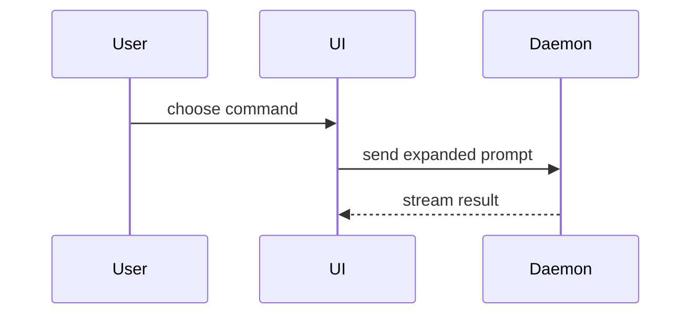

---
source_urls:
  - https://github.com/mattpocock/skills
  - https://github.com/mattpocock/skills/releases/tag/v1.3.1
  - https://raw.githubusercontent.com/mattpocock/skills/v1.3.1/README.md
  - https://raw.githubusercontent.com/mattpocock/skills/v1.3.1/CHANGELOG.md
collected: 2026-10-11
published: 2026-10-04 (v1.3.1; v1.3.0 same day; v1.2.0 2026-08-05)
author: Matt Pocock
---

# Skills for Real Engineers — v1.3.1 update (mattpocock/skills)

> Update ingest 2026-10-11, pinned to tag `v1.3.1` (latest release, 2026-10-04). Supersedes the
> 2026-07-09 (v1.1.0) raw for the current skill set. Preserves the README verbatim, a generated
> catalogue of every SKILL.md's frontmatter at the tag (bucket, name, invocation mode, description),
> the CHANGELOG entries for 1.2.0 → 1.3.1 verbatim, and the full SKILL.md text of the `ask-matt`
> router and of each skill newly promoted since v1.1.0.

---

## README.md

<p>
  <a href="https://www.aihero.dev/s/skills-newsletter">
    <picture>
      <source media="(prefers-color-scheme: dark)" srcset="https://res.cloudinary.com/total-typescript/image/upload/v1777382277/skills-repo-dark_2x.png">
      <source media="(prefers-color-scheme: light)" srcset="https://res.cloudinary.com/total-typescript/image/upload/v1777382277/skill-repo-light_2x.png">
      
    </picture>
  </a>
</p>

# Skills For Real Engineers

[](https://skills.sh/mattpocock/skills)

My agent skills that I use every day to do real engineering - not vibe coding.

Developing real applications is hard. Approaches like GSD, BMAD, and Spec-Kit try to help by owning the process. But while doing so, they take away your control and make bugs in the process hard to resolve.

These skills are designed to be small, easy to adapt, and composable. They work with any model. They're based on decades of engineering experience. Hack around with them. Make them your own. Enjoy.

If you want to keep up with changes to these skills, and any new ones I create, you can join ~60,000 other devs on my newsletter:

[Sign Up To The Newsletter](https://www.aihero.dev/s/skills-newsletter)

## Installation (30-second setup)

Two ways in, two philosophies. **The [Claude Code plugin](https://code.claude.com/docs/en/plugins)** installs the whole set as a managed, read-only bundle that updates when I ship, so you subscribe rather than fork. **[skills.sh](https://skills.sh/mattpocock/skills)** copies editable skill files into your project, so you can hack on them and make them your own. Pick one: installing both leaves you with every skill twice.

### 1. Get the skills

<details>
<summary><strong>Claude Code</strong></summary>

```bash
claude plugins install mattpocock-skills
```

Or, from inside a session:

```
/plugin install mattpocock-skills
```

It's in Claude Code's official marketplace, so there's nothing to add first, and updates arrive automatically.

</details>

<details>
<summary><strong>Codex, and other agents</strong></summary>

```bash
npx skills@latest add mattpocock/skills
```

Pick the skills you want, and which coding agents to install them on. **The installer lets you choose which skills to take, so make sure `setup-matt-pocock-skills` is one of them.**

A native Codex plugin is on the roadmap (see [`.agents/adr/0002-ship-as-a-claude-code-plugin.md`](./.agents/adr/0002-ship-as-a-claude-code-plugin.md)).

</details>

<details>
<summary><strong>For tinkerers</strong></summary>

Use the same installer, on any agent, including Claude Code:

```bash
npx skills@latest add mattpocock/skills
```

It writes the skills into your repo as ordinary files you own and can edit. Nothing updates behind your back; pull my latest changes when you want them with `npx skills update`.

</details>

### 2. Run `/setup-matt-pocock-skills`

In your agent, run it once per repo. It will:

- Ask you which issue tracker you want to use (GitHub, Linear, or local files)
- Ask you what labels you apply to tickets when you triage them (`/triage` uses labels)
- Ask you where you want to save any docs we create

### 3. Bam - you're ready to go.

## Why These Skills Exist

I built these skills as a way to fix common failure modes I see with Claude Code, Codex, and other coding agents.

### #1: The Agent Didn't Do What I Want

> "No-one knows exactly what they want"
>
> David Thomas & Andrew Hunt, [The Pragmatic Programmer](https://www.amazon.co.uk/Pragmatic-Programmer-Anniversary-Journey-Mastery/dp/B0833F1T3V)

**The Problem**. The most common failure mode in software development is misalignment. You think the dev knows what you want. Then you see what they've built - and you realize it didn't understand you at all.

This is just the same in the AI age. There is a communication gap between you and the agent. The fix for this is a **grilling session** - getting the agent to ask you detailed questions about what you're building.

**The Fix** is to use:

- [`/grill-me`](./skills/productivity/grill-me/SKILL.md) - for non-code uses
- [`/grill-with-docs`](./skills/engineering/grill-with-docs/SKILL.md) - same as [`/grill-me`](./skills/productivity/grill-me/SKILL.md), but adds more goodies (see below)

These are my most popular skills. They help you align with the agent before you get started, and think deeply about the change you're making. Use them _every_ time you want to make a change.

### #2: The Agent Is Way Too Verbose

> With a ubiquitous language, conversations among developers and expressions of the code are all derived from the same domain model.
>
> Eric Evans, [Domain-Driven-Design](https://www.amazon.co.uk/Domain-Driven-Design-Tackling-Complexity-Software/dp/0321125215)

**The Problem**: At the start of a project, devs and the people they're building the software for (the domain experts) are usually speaking different languages.

I felt the same tension with my agents. Agents are usually dropped into a project and asked to figure out the jargon as they go. So they use 20 words where 1 will do.

**The Fix** for this is a shared language. It's a document that helps agents decode the jargon used in the project.

<details>
<summary>
Example
</summary>

Here's an example [glossary](https://github.com/mattpocock/course-video-manager/blob/076a5a7a182db0fe1e62971dd7a68bcadf010f1c/CONTEXT.md) (still named `CONTEXT.md` at that pinned commit, from before the skills renamed the convention), from my `course-video-manager` repo. Which one is easier to read?

- **BEFORE**: "There's a problem when a lesson inside a section of a course is made 'real' (i.e. given a spot in the file system)"
- **AFTER**: "There's a problem with the materialization cascade"

This concision pays off session after session.

</details>

This is built into [`/grill-with-docs`](./skills/engineering/grill-with-docs/SKILL.md). It's a grilling session, but that helps you build a shared language with the AI, and document hard-to-explain decisions in ADR's.

It's hard to explain how powerful this is. It might be the single coolest technique in this repo. Try it, and see.

> [!TIP]
> A shared language has many other benefits than reducing verbosity:
>
> - **Variables, functions and files are named consistently**, using the shared language
> - As a result, the **codebase is easier to navigate** for the agent
> - The agent also **spends fewer tokens on thinking**, because it has access to a more concise language

### #3: The Code Doesn't Work

> "Always take small, deliberate steps. The rate of feedback is your speed limit. Never take on a task that’s too big."
>
> David Thomas & Andrew Hunt, [The Pragmatic Programmer](https://www.amazon.co.uk/Pragmatic-Programmer-Anniversary-Journey-Mastery/dp/B0833F1T3V)

**The Problem**: Let's say that you and the agent are aligned on what to build. What happens when the agent _still_ produces crap?

It's time to look at your feedback loops. Without feedback on how the code it produces actually runs, the agent will be flying blind.

**The Fix**: You need the usual tranche of feedback loops: static types, browser access, and automated tests.

For automated tests, a red-green-refactor loop is critical. This is where the agent writes a failing test first, then fixes the test. This helps give the agent a consistent level of feedback that results in far better code.

I've built a **[`/tdd`](./skills/engineering/tdd/SKILL.md) skill** you can slot into any project. It encourages red-green-refactor and gives the agent plenty of guidance on what makes good and bad tests.

For debugging, I've also built a **[`/diagnosing-bugs`](./skills/engineering/diagnosing-bugs/SKILL.md)** skill that wraps best debugging practices into a disciplined loop, gated phase by phase.

### #4: We Built A Ball Of Mud

> "Invest in the design of the system _every day_."
>
> Kent Beck, [Extreme Programming Explained](https://www.amazon.co.uk/Extreme-Programming-Explained-Embrace-Change/dp/0321278658)

> "The best modules are deep. They allow a lot of functionality to be accessed through a simple interface."
>
> John Ousterhout, [A Philosophy Of Software Design](https://www.amazon.co.uk/Philosophy-Software-Design-2nd/dp/173210221X)

**The Problem**: Most apps built with agents are complex and hard to change. Because agents can radically speed up coding, they also accelerate software entropy. Codebases get more complex at an unprecedented rate.

**The Fix** for this is a radical new approach to AI-powered development: caring about the design of the code.

This is built in to every layer of these skills:

- [`/to-spec`](./skills/engineering/to-spec/SKILL.md) quizzes you about which modules you're touching before creating a spec

And crucially, [`/improve-codebase-architecture`](./skills/engineering/improve-codebase-architecture/SKILL.md) surveys a codebase for deepening opportunities and hands you the candidates. I recommend running it on your codebase once every few days. It is a survey, not a rescue: on a genuinely old codebase it will find real candidates, but it won't untangle the mud for you.

### Summary

Software engineering fundamentals matter more than ever. These skills are my best effort at condensing these fundamentals into repeatable practices, to help you ship the best apps of your career. Enjoy.

## Reference

These split on one axis: who can invoke them. **User-invoked** skills are reachable only when you type them (e.g. `/grill-me`); their job is to orchestrate. **Model-invoked** skills can be invoked by you _or_ reached for automatically by the agent when the task fits; they hold the reusable discipline. A user-invoked skill may invoke model-invoked skills, but never another user-invoked one.

### Engineering

Skills I use daily for code work.

**User-invoked**

- **[ask-matt](./skills/engineering/ask-matt/SKILL.md)**: Ask which skill or flow fits your situation. A router over the user-invoked skills in this repo.
- **[grill-with-docs](./skills/engineering/grill-with-docs/SKILL.md)**: Grilling session that also builds your project's domain model, sharpening terminology and updating `GLOSSARY.md` and ADRs inline.
- **[triage](./skills/engineering/triage/SKILL.md)**: Move issues through a state machine of triage roles.
- **[improve-codebase-architecture](./skills/engineering/improve-codebase-architecture/SKILL.md)**: Scan a codebase for deepening opportunities, present them as a visual HTML report, then grill through whichever one you pick.
- **[setup-matt-pocock-skills](./skills/engineering/setup-matt-pocock-skills/SKILL.md)**: Configure this repo for the engineering skills (issue tracker, triage labels, domain doc layout). Run once per repo before using the other engineering skills.
- **[to-spec](./skills/engineering/to-spec/SKILL.md)**: Turn the current conversation into a spec and publish it to the issue tracker. No interview, just synthesizes what you've already discussed.
- **[to-tickets](./skills/engineering/to-tickets/SKILL.md)**: Break any plan, spec, or conversation into a set of tracer-bullet tickets, each declaring its blocking edges, written as text in a local file, or as native blocking links on a real tracker.
- **[implement](./skills/engineering/implement/SKILL.md)**: Build the work described by a spec or set of tickets, driving `/tdd` at pre-agreed seams and closing out with `/code-review` before committing.
- **[implement-spec](./skills/engineering/implement-spec/SKILL.md)**: Implement a whole spec on one integration branch. Works the tickets as a task graph, running implementer subagents across the ready frontier for maximum concurrency, then closes out with `/code-review`.
- **[wayfinder](./skills/engineering/wayfinder/SKILL.md)**: Plan a huge chunk of work, more than one agent session can hold, as a shared map of decision tickets on the issue tracker, and resolve them one at a time until the way to the destination is clear.
- **[retro](./skills/engineering/retro/SKILL.md)**: Suggest improvements to the coding agent's environment (navigation, automated checks, coding standards, steering files, tooling) after a session, most severe first.

**Model-invoked**

- **[prototype](./skills/engineering/prototype/SKILL.md)**: Build a throwaway prototype to answer a design question, either a single shareable HTML file for state/logic questions, or several radically different UI variations toggleable from one route.
- **[diagnosing-bugs](./skills/engineering/diagnosing-bugs/SKILL.md)**: Disciplined diagnosis loop for hard bugs and performance regressions: build a feedback loop that goes red on this bug → minimise → hypothesise → instrument → fix → regression-test.
- **[research](./skills/engineering/research/SKILL.md)**: Investigate a question against high-trust primary sources and capture the findings as a cited Markdown file in the repo, run as a background agent.
- **[tdd](./skills/engineering/tdd/SKILL.md)**: Test-driven development with a red-green-refactor loop. Builds features or fixes bugs one vertical slice at a time.
- **[domain-modeling](./skills/engineering/domain-modeling/SKILL.md)**: Actively build and sharpen a project's domain model: challenge terms against the glossary, stress-test with edge-case scenarios, and update `GLOSSARY.md` and ADRs inline.
- **[codebase-design](./skills/engineering/codebase-design/SKILL.md)**: Shared discipline and vocabulary for designing deep modules: a lot of behaviour behind a small interface, placed at a clean seam, testable through that interface.
- **[code-review](./skills/engineering/code-review/SKILL.md)**: Two-axis review of the diff since a fixed point: **Standards** (does it follow the repo's coding standards, plus a Fowler smell baseline?) and **Spec** (does it faithfully implement the originating issue/spec?), run as parallel sub-agents so neither pollutes the other.
- **[pr](./skills/engineering/pr/SKILL.md)**: The shape a pull request body should take: a summary as the smallest visual that makes the change clear, before/after evidence that it works, and a merge-danger call (one-way or two-way door, plus blast radius).
- **[wizard](./skills/engineering/wizard/SKILL.md)**: Generate an interactive bash wizard that walks a human through steps only they can perform: provisioning infrastructure, setting up credentials or CI secrets, walking an unfamiliar third-party dashboard, or running a one-off migration or cutover.

### Productivity

General workflow tools, not code-specific.

**User-invoked**

- **[grill-me](./skills/productivity/grill-me/SKILL.md)**: Get relentlessly interviewed about a plan or design until every branch of the design tree is resolved.
- **[handoff](./skills/productivity/handoff/SKILL.md)**: Compact the current conversation into a handoff document so another agent can continue the work.
- **[teach](./skills/productivity/teach/SKILL.md)**: Teach the user a new skill or concept over multiple sessions, using the current directory as a stateful teaching workspace.
- **[to-questionnaire](./skills/productivity/to-questionnaire/SKILL.md)**: Turn a decision you can't answer alone into a Markdown questionnaire for the one person who can, filled in async, or together over a meeting. It grills you about the send (who it's for, what you need back), not the subject.
- **[wait-what](./skills/productivity/wait-what/SKILL.md)**: Fire this the moment a message doesn't land. The agent re-pitches it with the context you're missing, in plain English, using your `GLOSSARY.md` vocabulary.

**Model-invoked**

- **[grilling](./skills/productivity/grilling/SKILL.md)**: Interview the user relentlessly about a plan, decision, or idea until every branch of the design tree is resolved. The reusable interview primitive behind `grill-me`, `grill-with-docs`, `triage`, `wayfinder` and `improve-codebase-architecture`.
- **[writing-for-agents](./skills/productivity/writing-for-agents/SKILL.md)**: Writing documents for agents: skills, AGENTS.md/CLAUDE.md, and any doc an agent reaches by a pointer.

---

## Skill catalogue at v1.3.1 (SKILL.md frontmatter, grouped by folder)

Invocation mode derived from `disable-model-invocation: true` (user-invoked) vs absent (model-invoked). `skills/deprecated/` is empty at this tag; `skills/personal/` no longer exists.

```
[engineering] ask-matt (user-invoked) — Ask which skill or flow fits your situation. A router over the skills in this repo.
[engineering] code-review (model-invoked) — Review the changes since a fixed point (commit, branch, tag, or merge-base) along two axes: Standards (does the code follow this repo's documented coding standards?) and Spec (does the code match what the originating issue/spec asked for?). Runs both reviews in parallel sub-agents and reports them side by side. Use when the user wants to review a branch, a PR, work-in-progress changes, or asks to "review since X".
[engineering] codebase-design (model-invoked) — Shared vocabulary for designing deep modules. Use when the user wants to design or improve a module's interface, find deepening opportunities, decide where a seam goes, make code more testable or AI-navigable, or when another skill needs the deep-module vocabulary.
[engineering] diagnosing-bugs (model-invoked) — Diagnosis loop for hard bugs and performance regressions. Use when the user says "diagnose"/"debug this", or reports something broken/throwing/failing/slow.
[engineering] domain-modeling (model-invoked) — Build and sharpen a project's domain model. Use when discussing codebase terminology, writing or editing a GLOSSARY.md, or recording or editing an ADR.
[engineering] grill-with-docs (user-invoked) — A relentless interview to sharpen a plan or design, which also creates docs (ADR's and glossary) as we go.
[engineering] implement-spec (user-invoked) — Implement the result of /to-spec and /to-tickets in code.
[engineering] implement (user-invoked) — Implement a piece of work based on a spec or set of tickets.
[engineering] improve-codebase-architecture (user-invoked) — Scan a codebase for deepening opportunities, present them as a visual HTML report, then grill through whichever one you pick.
[engineering] pr (model-invoked) — Use when writing a PR body.
[engineering] prototype (model-invoked) — Build a throwaway prototype to answer a design question. Use when the user wants to sanity-check whether a state model or logic feels right, or explore what a UI should look like.
[engineering] research (model-invoked) — Investigate a question against high-trust primary sources and capture the findings as a Markdown file in the repo. Use when the user wants a topic researched, docs or API facts gathered, or reading legwork delegated to a background agent.
[engineering] retro (user-invoked) — Conduct a retrospective on a coding session.
[engineering] setup-matt-pocock-skills (user-invoked) — Configure this repo for the engineering skills: set up its issue tracker, triage label vocabulary, and domain doc layout. Run once before first use of the other engineering skills.
[engineering] tdd (model-invoked) — Test-driven development. Use when the user wants to build features or fix bugs test-first, mentions "red-green-refactor", or wants integration tests.
[engineering] to-spec (user-invoked) — Turn the current conversation into a spec and publish it to the project issue tracker: no interview, just synthesis of what you've already discussed.
[engineering] to-tickets (user-invoked) — Break a plan, spec, or the current conversation into a set of tracer-bullet tickets, each declaring its blocking edges, published to the configured tracker (edges as text in one file per ticket locally, or native blocking links on a real tracker).
[engineering] triage (user-invoked) — Move issues and external PRs through a state machine of triage roles, categorise, verify, grill if needed, and write agent-ready briefs.
[engineering] wayfinder (user-invoked) — Plan a huge chunk of work (more than one agent session can hold) as a shared map of decision tickets on your issue tracker, and resolve them one at a time until the way to the destination is clear.
[engineering] wizard (model-invoked) — Generate an interactive bash wizard that walks a human through steps only they can perform. Use when provisioning infrastructure, setting up credentials or CI secrets, walking an unfamiliar third-party dashboard, or running a one-off migration or cutover. Don't invoke this for steps the agent can perform itself.
[in-progress] claude-handoff (user-invoked) — Hand the current conversation off to a fresh background agent that picks up the work immediately.
[in-progress] loop-me (user-invoked) — Grill me about specs for the workflows I want to build, within this workspace.
[in-progress] setup-ts-deep-modules (user-invoked) — Wire dependency-cruiser into a TypeScript repo so each package is a deep module, with implementation hidden in subfolders and reachable only through its entry-point files. User-invoked.
[in-progress] writing-beats (user-invoked) — Writing, exploit; assemble raw material into a journey of beats, grounding each term before a beat leans on it.
[in-progress] writing-fragments (user-invoked) — Writing, explore: mine raw fragments, no structure yet.
[in-progress] writing-shape (user-invoked) — Writing, exploit: shape raw material into an article, paragraph by paragraph.
[misc] git-guardrails-claude-code (model-invoked) — Set up Claude Code hooks to block dangerous git commands (push, reset --hard, clean, branch -D, etc.) before they execute. Use when user wants to prevent destructive git operations, add git safety hooks, or block git push/reset in Claude Code.
[misc] migrate-to-shoehorn (model-invoked) — Migrate test files from `as` type assertions to @total-typescript/shoehorn. Use when user mentions shoehorn, wants to replace `as` in tests, or needs partial test data.
[misc] scaffold-exercises (model-invoked) — Create exercise directory structures with sections, problems, solutions, and explainers that pass linting. Use when user wants to scaffold exercises, create exercise stubs, or set up a new course section.
[misc] setup-pre-commit (model-invoked) — Set up Husky pre-commit hooks with lint-staged (Prettier), type checking, and tests in the current repo. Use when user wants to add pre-commit hooks, set up Husky, configure lint-staged, or add commit-time formatting/typechecking/testing.
[productivity] grill-me (user-invoked) — A relentless interview to sharpen a plan or design.
[productivity] grilling (model-invoked) — Grill the user relentlessly about a plan, decision, or idea. Use when the user wants to stress-test their thinking, or uses any 'grill' trigger phrases.
[productivity] handoff (user-invoked) — Compact the current conversation into a handoff document for another agent to pick up.
[productivity] teach (user-invoked) — Teach the user a new skill or concept, within this workspace.
[productivity] to-questionnaire (user-invoked) — Turn a decision you can't fully answer into a questionnaire for someone else to fill in.
[productivity] wait-what (user-invoked) — Stop. That last message did not land: re-pitch it.
[productivity] writing-for-agents (model-invoked) — Writing documents for agents. Use when creating or editing skills, or modifying AGENTS.md or CLAUDE.md.
```

---

## CHANGELOG — 1.2.0 through 1.3.1

## 1.3.1

### Patch Changes

- [#1121](https://github.com/mattpocock/skills/pull/1121) [`c5b9869`](https://github.com/mattpocock/skills/commit/c5b98691982c4f0d3a5e40ab09566b3b84721e00) Thanks [@mattpocock](https://github.com/mattpocock)! - `ask-matt` no longer says `diagnosing-bugs` hands off to `improve-codebase-architecture` from a post-mortem; that step was removed. It now points you at `/retro` once the fix is in, to ask what would have prevented the bug, and at `/improve-codebase-architecture` where the finding is a missing seam. The `diagnosing-bugs` docs page drops the same stale hand-off. Thanks @Ygilany for spotting it ([#1117](https://github.com/mattpocock/skills/issues/1117)).

## 1.3.0

### Minor Changes

- [#1120](https://github.com/mattpocock/skills/pull/1120) [`2aecca1`](https://github.com/mattpocock/skills/commit/2aecca12ea9ff047f76c8178cb64dfeafd192abe) Thanks [@mattpocock](https://github.com/mattpocock)! - Graduate **`implement-spec`** into the **Engineering** bucket, so it ships in the Claude Code plugin, gets a docs page, and is routed by `ask-matt` as the parallel alternative to per-ticket `implement`.

  `implement-spec` (user-invoked) implements a whole spec in one run. It reads the tickets as a **task graph**, runs implementer subagents in their own worktrees across the ready **frontier**, and lands everything on one **integration branch**, closing out with `code-review`. Ahead of graduating:

  - The goal is now the integration branch, not a PR. A draft PR opens only when the issue tracker closes work through PRs or you ask for one, and only after the first merge (a branch with no commits ahead of main can't open one). Without a PR, the tickets are resolved the way the tracker closes work.
  - It points at the issue tracker like its siblings, telling you to run `/setup-matt-pocock-skills` when none has been provided, rather than silently defaulting to `gh`.
  - Each implementer confirms its worktree is based on the integration branch, builds its ticket with `tdd`, and merges the integration tip into its own branch before reporting done, so each merge is a fast-forward.

- [#1120](https://github.com/mattpocock/skills/pull/1120) [`2aecca1`](https://github.com/mattpocock/skills/commit/2aecca12ea9ff047f76c8178cb64dfeafd192abe) Thanks [@mattpocock](https://github.com/mattpocock)! - Graduate **`pr`** into the **Engineering** bucket, so it ships in the Claude Code plugin, gets a docs page, and is routed by `ask-matt` as the PR-body close-out.

  `pr` (model-invoked) is the shape a pull request body should take: a summary as the smallest visual that makes the change clear (pseudocode, a call tree, a file tree, Mermaid, a diff), before/after evidence that it works, and a merge-danger call (one-way or two-way door, plus blast radius). The Summary visuals are adapted from Dex Horthy's `show-me`, credited in the skill's `CREDITS.md`.

- [#1120](https://github.com/mattpocock/skills/pull/1120) [`2aecca1`](https://github.com/mattpocock/skills/commit/2aecca12ea9ff047f76c8178cb64dfeafd192abe) Thanks [@mattpocock](https://github.com/mattpocock)! - Graduate **`retro`** into the **Engineering** bucket, so it ships in the Claude Code plugin, gets a docs page, and is routed by `ask-matt` as the last step of the main flow, after `code-review`.

  `retro` (user-invoked) looks back at a coding session and suggests changes to the agent's environment rather than the code: navigation pointers, automated checks, coding standards, steering files, tool economy, information access. It classifies each coding-standards finding first: a mechanical violation gets a deterministic check (a linter rule, a pre-commit hook, or a CI job), and `CODING_STANDARDS.md` is kept for genuine judgement calls. A repo with no guardrail at all is a finding in its own right.

- [#1120](https://github.com/mattpocock/skills/pull/1120) [`daa01d8`](https://github.com/mattpocock/skills/commit/daa01d8aa68ad5c61b68970ec2018d0ce9567be6) Thanks [@mattpocock](https://github.com/mattpocock)! - Remove the **`resolving-merge-conflicts`** skill. It's no longer needed, and nothing replaces it: the agent works through an in-progress merge or rebase conflict without a dedicated skill. It leaves the Claude Code plugin, the README and the `ask-matt` router. Its docs page at `https://aihero.dev/skills-resolving-merge-conflicts` stays up, marked archived.

- [#1120](https://github.com/mattpocock/skills/pull/1120) [`006a52b`](https://github.com/mattpocock/skills/commit/006a52be23e0178375e083e30535fa8224471f3e) Thanks [@mattpocock](https://github.com/mattpocock)! - Rename the `CONTEXT.md`/`CONTEXT-MAP.md` domain-doc convention to `GLOSSARY.md`/`GLOSSARY-MAP.md` everywhere the skills read and write it (`domain-modeling`, `grill-with-docs`, `improve-codebase-architecture`, `setup-matt-pocock-skills`, `triage`, `tdd`, `diagnosing-bugs`, `ask-matt`, `codebase-design`, `wait-what`, `pr`), plus the docs pages and this repo's own root glossary.

  If you have an existing `CONTEXT.md` (or `CONTEXT-MAP.md`) from before this change, `git mv` it to the new name: the skills only look for `GLOSSARY.md`/`GLOSSARY-MAP.md` going forward.

### Patch Changes

- [#848](https://github.com/mattpocock/skills/pull/848) [`f02e2ed`](https://github.com/mattpocock/skills/commit/f02e2ed3624d031272f8547742d23bf6bca8b072) Thanks [@mattpocock](https://github.com/mattpocock)! - domain-modeling: trigger on discussing codebase terminology and on writing or editing a GLOSSARY.md or an ADR directly, replacing the narrower "pin down domain terminology or a ubiquitous language" / "record an architectural decision" phrasing. Also drops the "another skill needs to maintain the domain model" caveat, since that's the invoking skill's job to state explicitly, not this description's.

- [#911](https://github.com/mattpocock/skills/pull/911) [`4f28947`](https://github.com/mattpocock/skills/commit/4f289474bad013fe2be8f8769d733f59d9103d6b) Thanks [@mattpocock](https://github.com/mattpocock)! - Quote the `description` front matter in `to-spec`, `code-review`, `setup-matt-pocock-skills`, `writing-fragments`, `writing-shape`, and `wait-what`. An unquoted colon-space left over from the em-dash sweep in [#905](https://github.com/mattpocock/skills/issues/905) made each block invalid YAML, so `skills.sh` skipped all six during discovery and they couldn't be listed or installed via `npx skills`.

- [#917](https://github.com/mattpocock/skills/pull/917) [`85f83d3`](https://github.com/mattpocock/skills/commit/85f83d3fde1d3a90d5c9a657f6998c79a6c37308) Thanks [@mattpocock](https://github.com/mattpocock)! - grilling: update the round template so consecutive questions are separated by a horizontal rule (`---`) instead of running together.

- [#879](https://github.com/mattpocock/skills/pull/879) [`d419977`](https://github.com/mattpocock/skills/commit/d419977fe07d9e1607d3523f3579310bbb076b93) Thanks [@mattpocock](https://github.com/mattpocock)! - grilling: remove em-dashes from `SKILL.md`, replacing them with colons and semicolons so the instructions read as plain text.

- [#905](https://github.com/mattpocock/skills/pull/905) [`e6e9577`](https://github.com/mattpocock/skills/commit/e6e957797d8cceb5b351c0dc840369523f9fb8fb) Thanks [@mattpocock](https://github.com/mattpocock)! - Remove every em-dash from the repo's prose (docs, `SKILL.md` files, ADRs, `README.md`, scripts, JSON/YAML metadata), hand-rewriting each sentence with a comma, colon, period, parentheses, or conjunction rather than mechanically substituting the character. `CLAUDE.md`/`AGENTS.md` now says not to reintroduce them.

- [#878](https://github.com/mattpocock/skills/pull/878) [`e3e547b`](https://github.com/mattpocock/skills/commit/e3e547b57d549110a0aa6ff40fd7b871c01c76c9) Thanks [@mattpocock](https://github.com/mattpocock)! - Standardize cross-skill invocation on an explicit "call the Skill tool" instruction instead of bare `/skill`-style prose, across `code-review`, `diagnosing-bugs`, `grill-with-docs`, `grill-me`, `improve-codebase-architecture`, `tdd`, `to-spec`, `to-tickets`, `triage`, and `wayfinder`.

  - A skill that names another skill in prose ("run the `/grilling` skill") does not reliably cause it to load. This is the documented rough edge behind `grill-with-docs`'s most-reported problem. Naming the tool directly (`Call the Skill tool with "grilling"`) is intended to raise the hit rate. Dropping the leading `/` also makes the instruction harness-neutral rather than less: it no longer assumes Claude Code's trigger syntax.
  - A step needing more than one skill now says so as multiple calls ("Call the Skill tool twice, for `grilling` and `domain-modeling`"), not one call carrying two names.
  - Documents the convention in `.agents/invocation.md` for future skills to follow.

- [#880](https://github.com/mattpocock/skills/pull/880) [`1dab982`](https://github.com/mattpocock/skills/commit/1dab98299c3b81f560026c01b7ebf55ed5d91373) Thanks [@mattpocock](https://github.com/mattpocock)! - Stop skills from trying to reach user-invoked skills through the Skill tool: fix cross-skill references that violated the "no other skill can call it" invariant in `.agents/invocation.md`, in `to-spec`, `wayfinder`, `to-tickets`, `triage`, `code-review`, and `diagnosing-bugs`.

  - `to-spec`, `wayfinder`, `to-tickets`, `triage`, and `code-review` each carried a precondition ("...run `/setup-matt-pocock-skills` if not") that PR [#878](https://github.com/mattpocock/skills/issues/878) rewrote into a literal `Call the Skill tool with "setup-matt-pocock-skills"` instruction. `setup-matt-pocock-skills` is user-invoked, so none of these skills (user-invoked or model-invoked) can call it. Reworded all five as instructions for the agent to tell the human to run it instead.
  - `diagnosing-bugs`'s Phase 6 post-mortem hand off to `improve-codebase-architecture` (also user-invoked) the same way, from an autonomous, often-unattended bug-fixing flow with no human in the loop to catch the failed call. Removed the hand-off outright rather than softening it, since it rarely fired in practice. Phase 6 is now "Cleanup" only; the mechanical checklist is untouched.
  - Added a carve-out paragraph to `.agents/invocation.md`'s "Dependencies between them" section: the `Call the Skill tool with "name"` convention only applies when the named skill is model-invoked. This is the section PR [#878](https://github.com/mattpocock/skills/issues/878) introduced without reconciling it against the user-invoked/model-invoked invariant stated eight lines above it; the gap is most of why this bug reached six call sites instead of one.

  Fixes [#453](https://github.com/mattpocock/skills/issues/453).

- [#904](https://github.com/mattpocock/skills/pull/904) [`594f0f8`](https://github.com/mattpocock/skills/commit/594f0f83188921a60d45d63d6cdac509de20df2c) Thanks [@mattpocock](https://github.com/mattpocock)! - wait-what: follow `GLOSSARY-MAP.md` to the right `GLOSSARY.md` when a repo indexes multiple contexts that way instead of keeping a single root `GLOSSARY.md`.

## 1.2.3

### Patch Changes

- [#779](https://github.com/mattpocock/skills/pull/779) [`efce423`](https://github.com/mattpocock/skills/commit/efce423018fc6468a3239621f1c1bcaacc723801) Thanks [@mattpocock](https://github.com/mattpocock)! - Make `diagnosing-bugs` redact secrets.

  - Add a **Redact** section to `SKILL.md`. The skill has the agent show commands, outputs and captured artifacts; the section makes redaction the first move on each — write `<REDACTED>`, build loops against env vars so the credential stays in the environment, and quote only the signal-carrying lines of a captured artifact.
  - The Phase 1 completion criterion said "paste the invocation and its output". It now says show it redacted, and Phase 1 asks the user for a **redacted** captured artifact.
  - Note in `scripts/hitl-loop.template.sh` that `capture` prints its value back to the terminal, so it takes observations while signing in stays a `step`.

- [#781](https://github.com/mattpocock/skills/pull/781) [`14bfbbd`](https://github.com/mattpocock/skills/commit/14bfbbd8654a8d2910299e1a004c19c1979687d8) Thanks [@mattpocock](https://github.com/mattpocock)! - Drop Claude Code's tool and agent-type names from the subagent-dispatch instructions in `code-review`, `codebase-design`, and `improve-codebase-architecture`, so the step is followable on Codex and other harnesses.

- [#783](https://github.com/mattpocock/skills/pull/783) [`c0fd1e9`](https://github.com/mattpocock/skills/commit/c0fd1e973e040347d424e09934099f1bd6c2dee0) Thanks [@mattpocock](https://github.com/mattpocock)! - wizard: remove the time estimate. The template drops `TOTAL_MINUTES` and the time-remaining display, `stage` takes a name only, and progress is counted in stages.

## 1.2.2

### Patch Changes

- [#766](https://github.com/mattpocock/skills/pull/766) [`4aaccb5`](https://github.com/mattpocock/skills/commit/4aaccb58d40559d7e3c59a029b2290ae5ba538de) Thanks [@mattpocock](https://github.com/mattpocock)! - Make `writing-for-agents` model-invokable in Codex again.

  - Drop `policy.allow_implicit_invocation: false` from `agents/openai.yaml`. Codex filtered the skill out of the model-visible skills list, so its description could not trigger it — only an explicit `$writing-for-agents` mention worked.
  - Update the stale `interface.display_name` and `interface.short_description`, which still named the old `writing-great-skills` skill.
  - Move the skill from the **User-invoked** list to the **Model-invoked** list in `README.md` and `skills/productivity/README.md`.

## 1.2.0

### Minor Changes

- [#551](https://github.com/mattpocock/skills/pull/551) [`697d4ce`](https://github.com/mattpocock/skills/commit/697d4ce9742da558fd1ba6697c8e9775e2e302dd) Thanks [@mattpocock](https://github.com/mattpocock)! - Add Codex metadata alongside each skill's Claude Code frontmatter so the set works in both harnesses without generated copies.

  - Add an `agents/openai.yaml` beside every `SKILL.md` with Codex UI metadata (`interface.display_name`, `interface.short_description`).
  - Mark every user-invoked skill with `policy.allow_implicit_invocation: false`, the Codex analog of `disable-model-invocation: true`, so Codex excludes it from implicit invocation while explicit `$skill` invocation still works.
  - Document the dual-harness invocation model in `.agents/invocation.md`, `CLAUDE.md`, and the promoted-bucket READMEs.
  - Add `AGENTS.md` as a symlink to `CLAUDE.md` so Codex reads the same repo instructions.

- [#593](https://github.com/mattpocock/skills/pull/593) [`0f2bdbd`](https://github.com/mattpocock/skills/commit/0f2bdbdb06220d2df3718b8f0483157c6c8a8600) Thanks [@mattpocock](https://github.com/mattpocock)! - Graduate **`to-questionnaire`** out of `in-progress/` into the **Productivity** bucket, so it ships in the plugin. It turns a decision you can't answer alone into a Markdown questionnaire for the one person who can — filled in async, or worked through together in a meeting.

  Its defining move is that it grills you about the **send**, not the subject: a normal grilling session interrogates the topic, which is exactly what you can't answer here, so the interview asks only who the questionnaire is going to and what you need back, then aims every question at the gap between the two.

  Now wired as a promoted skill — plugin entry, top-level + Productivity READMEs under **User-invoked**, a docs page at `docs/productivity/to-questionnaire.md`, and a Standalone route in `ask-matt` framing it as the inverse of `/grill-me` (mine someone else, not yourself).

- [#680](https://github.com/mattpocock/skills/pull/680) [`b3376f8`](https://github.com/mattpocock/skills/commit/b3376f8d39848dd08572ec2667da4739a67c8c04) Thanks [@mattpocock](https://github.com/mattpocock)! - Graduate **`wizard`** out of `in-progress/` into the **Engineering** bucket, so it ships in the plugin — and make it model-invoked. It generates an interactive bash script that walks a human through a manual procedure — third-party setup, a one-off migration, an A→B state transition — opening each URL, saying what to click, capturing the values, and writing them into `.env` files and GitHub Actions secrets.

  The delightful UX is pre-solved by the bundled `template.sh` (progress with time-remaining, confirmation gates, cross-platform URL opening including WSL, hidden secret entry, idempotent `.env` upserts, `gh secret`/`gh variable` writes with graceful degradation, closing skip summary). Everything above the `STAGES` marker is a fixed library that's never hand-edited — the skill's job is only to scope the procedure and author its **stages**.

  Engineering rather than Productivity: it reads `.env*`, `docker-compose*`, framework config and every `secrets.*`/`vars.*` reference in `.github/workflows/` to scope itself, writes CI secrets, and verifies its output with `bash -n` and `shellcheck`.

  Because it is model-invoked, the agent can reach for it the moment it hits a step only a human can perform, instead of dumping numbered instructions into the chat and hoping you follow them. Typing `/wizard` works exactly as before — model-invocation only ever _adds_ the agent's reach. The description is written as the pointer that decides when it fires: what it produces, four trigger branches (provisioning infrastructure, setting up credentials or CI secrets, walking an unfamiliar third-party dashboard, a one-off migration or cutover), and an explicit non-trigger — don't invoke it for steps the agent can perform itself. Work an agent can do, an agent should do; the wizard is for the clicks, approvals and dashboard trips you would not hand to one. The stage-list confirmation before a line is written now doubles as the proposal when the agent fires it mid-build.

  Now wired as a promoted skill — plugin entry, top-level + Engineering READMEs under **Model-invoked**, a docs page at `docs/engineering/wizard.md`, and a Standalone route in `ask-matt` for the steps only a human can take. Model-invocation also puts it out of the reach of [#693](https://github.com/mattpocock/skills/issues/693), which drops user-invoked skills from the listing on Claude's desktop and web surfaces.

- [#763](https://github.com/mattpocock/skills/pull/763) [`77d207e`](https://github.com/mattpocock/skills/commit/77d207ef03219cc603e2832e1159cbdd1c91818e) Thanks [@mattpocock](https://github.com/mattpocock)! - Reshape the **`prototype`** skill around two ideas: the demo is **a single shareable HTML file**, and the prototype is **a primary source**.

  The logic branch now produces one self-contained file (plain HTML/CSS/JS, no build, no server) instead of a terminal app — a non-developer can open it by double-click and drive it in their own domain language: a labelled state panel, always-available free-play buttons, and a set of tabbed **guided walkthroughs**, each a scenario with the ordered buttons to press underneath it. The portable pure-logic module still lifts into the real code; the HTML shell is the throwaway.

  Throwaway no longer means deleted. Rather than being removed once it has answered its question, the prototype is captured as runnable evidence on a throwaway branch (`prototype/<name>`) out of main, with a context pointer to it left on the implementation issue — so the main branch keeps only the validated decision while the exploration stays findable. The answer (verdict + question) is still captured durably in an issue/ADR/commit.

- [#536](https://github.com/mattpocock/skills/pull/536) [`42a5b70`](https://github.com/mattpocock/skills/commit/42a5b70fcacc7baff1977b13f3919fb2f63af14e) Thanks [@mattpocock](https://github.com/mattpocock)! - Ship the skill set as a native **Claude Code plugin**, listed in Claude Code's official marketplace. You can now subscribe to the promoted skills as a managed, read-only bundle instead of copying editable files:

  ```bash
  claude plugins install mattpocock-skills
  ```

  Or, from inside a session:

  ```
  /plugin install mattpocock-skills
  ```

  There is no marketplace to add first — the official marketplace is configured by default.

  `.claude-plugin/plugin.json` carries the full plugin metadata (version, description, author, license, keywords) and the explicit list of promoted skills. `skills.sh` remains the universal installer (and the path for Codex and other harnesses today); a native Codex plugin is deferred — see `.agents/adr/0002-ship-as-a-claude-code-plugin.md` for why.

- [#751](https://github.com/mattpocock/skills/pull/751) [`355fa74`](https://github.com/mattpocock/skills/commit/355fa7420b418af838998f7ec4365ceda1c8dfcc) Thanks [@mattpocock](https://github.com/mattpocock)! - Add **`wait-what`** — a one-word corrective for model verbosity. Type it the moment a message doesn't land, and the agent re-pitches it: a little context, ASD-STE100 Simplified Technical English, and the ubiquitous language from your `CONTEXT.md`. User-invoked, three lines long.

  The mechanism is the name. Concision skills fail by growing — a 400-line skill still leaves the model verbose — so this one is a single precise leading word and nothing else. Names that describe the _output_ (`/tldr`, `/no-fluff`) make the model clip words and lose you further; naming the _listener's_ state asks for both halves at once, fewer words **and** the context you were missing. It also reuses the leading words already in your global `CLAUDE.md`, so the skill, `CLAUDE.md` and every `CONTEXT.md` reach for the same tokens.

  It repairs one message; it doesn't prevent the next one. The cure for jargon is a shared language built upfront with `/grill-with-docs`; this is what you reach for when you don't have one yet.

- [#763](https://github.com/mattpocock/skills/pull/763) [`77d207e`](https://github.com/mattpocock/skills/commit/77d207ef03219cc603e2832e1159cbdd1c91818e) Thanks [@mattpocock](https://github.com/mattpocock)! - Name the `/wayfinder` unit a **decision ticket**, and burn research tickets down with subagents.

  People kept reading a wayfinder ticket as an ordinary _implementation_ ticket — a slice of a build to execute — when wayfinder uses them as **decision tickets**: questions whose resolution is a decision. The skill description and its opening line now introduce the term (and say what makes it one), with the `ask-matt` / engineering README blurbs and the docs page matching — while "ticket" stays the everyday word once the term is established. `CONTEXT.md` records **Decision ticket** as a domain term, so the "avoid: ticket" guidance no longer contradicts wayfinder's deliberate use of the word.

  Research tickets are no longer parked for a separately-launched session. Research stays a real ticket type — it's a genuine shared blocker that downstream decisions hang on, and that dependency is exactly what the frontier's blocking edges exist to render. What changes is how it's resolved: because research is AFK, charting doesn't stop and read it. After creating the tickets, the charting session fires a `/research` subagent for each research ticket to burn it down in parallel, capturing the findings on a throwaway `research/<name>` branch with a context pointer. Research tickets are the one exception to _one ticket per session_.

- [#763](https://github.com/mattpocock/skills/pull/763) [`77d207e`](https://github.com/mattpocock/skills/commit/77d207ef03219cc603e2832e1159cbdd1c91818e) Thanks [@mattpocock](https://github.com/mattpocock)! - **Breaking:** rename **`writing-great-skills`** → **`writing-for-agents`**, restructure it, and add a new leading word.

  The reference now covers any document an agent consumes — skills, `AGENTS.md` / `CLAUDE.md`, docs reached by a pointer — not just skills. `GLOSSARY.md` is merged into `SKILL.md` (one authoritative treatment per term; the `_Avoid_` synonym lists and the standalone Predictability definition are gone); the skill-only mechanics (frontmatter, model- vs user-invoked, router skills, the invocation cut of splitting) are disclosed to a new `SKILL-MECHANICS.md`. The skill is now **model-invoked**: it fires when creating or editing skills or modifying `AGENTS.md`/`CLAUDE.md`. `ask-matt`'s pointer updated. Reinstall under the new name; the old name is gone (no alias).

  The pruning section gains **cache**. Single source of truth now reaches past the document into the environment — `package.json` scripts, config files, directory layout, `--help` output are themselves authoritative, so a doc that restates them is a cache of a lookup, earning its load only when the lookup is expensive. The positive target: cache what the agent cannot find by looking (unwritten conventions, the reason behind a choice, gotchas no config confesses), and leave one-file, one-command lookups to the environment, where they cannot go stale.

- [#533](https://github.com/mattpocock/skills/pull/533) [`45afd80`](https://github.com/mattpocock/skills/commit/45afd8074a8b7de5fe073845d080fa9dd6c429fa) Thanks [@mattpocock](https://github.com/mattpocock)! - Add a YAGNI scoping filter to the **`improve-codebase-architecture`** skill's Explore step. Instead of scanning the whole repo evenly, it now scopes to where change is actually landing: if you name a direction it takes it, otherwise it reads the last ~20 commit messages to bias exploration toward actively-developed paths. A deepening opportunity in code nobody touches is a refactor you'll never cash in — the leverage only pays off where you keep editing — so the report stops tidying dormant corners of the repo.

### Patch Changes

- [#763](https://github.com/mattpocock/skills/pull/763) [`77d207e`](https://github.com/mattpocock/skills/commit/77d207ef03219cc603e2832e1159cbdd1c91818e) Thanks [@mattpocock](https://github.com/mattpocock)! - Sharpen `/ask-matt` — the router now covers phase boundaries, the two wayfinder mistakes, and two skills it never mentioned.

  **Phase boundaries.** A **phase** is a chunk of work inside a session — the grilling, the implementation, the QA — and the boundary between two of them is where you decide what to do with the context you've built. The two-bullet `Crossing sessions` section is replaced by a decision tree carrying all five options in order (**continue**, `/clear`, `/handoff`, **subagent**, `/compact`), with the reasoning disclosed in a new `PHASE-BOUNDARIES.md`. Three fixes come with it:

  - **`/handoff` was oversold.** It read as the general bridge between context windows. It's narrow: you need it only when something has to _travel_ — a new harness, a new directory, a colleague, or a side task forked mid-phase. What it buys is portability.
  - **`/compact` is the default, not the first reach.** It sits at the bottom of the tree, after the four cheaper or more precise questions above it. Starting there produces a session that's confidently wrong about whatever the summary flattened.
  - **Two branches were missing entirely.** **Continue** is the one to rule out first — it's the only move that keeps the conversation as a primary source rather than a summary of one — and a **subagent** handles anything scoped tightly enough to run AFK.

  Context hygiene's escape hatch now says `/compact` rather than `/handoff` (same harness, same directory, at a boundary — the handoff clause doesn't apply), and the smart zone figure is updated from ~120k to ~150k tokens.

  **Wayfinder routing.** The two mistakes people most often make with the heaviest, most cognitively demanding flow:

  - **Over-reaching for it.** It's slower and denser than a single grill, so it's flagged as the heaviest flow and reserved for the idea that genuinely won't fit one session — a well-scoped feature belongs on `/grill-with-docs`, not here.
  - **Losing the way at the handoff.** When the map clears, wayfinder hands off, it doesn't build: merge onto the main flow at `/to-spec` (which collapses the map's linked decisions into a buildable plan) rather than looping the map straight into `/implement`. Straight-to-`/implement` is only for efforts that turned out genuinely small.

  **Missing routes.** `/grilling` and `/resolving-merge-conflicts` were absent from the router altogether and are now in it, and `grill-me` splits from `grill-with-docs` on whether you are in a working directory.

- [#502](https://github.com/mattpocock/skills/pull/502) [`44eed54`](https://github.com/mattpocock/skills/commit/44eed545186ffd0263e8004867750b80cfddd215) Thanks [@mattpocock](https://github.com/mattpocock)! - Make `/setup-matt-pocock-skills` friendlier and align the local-markdown tracker with the current spec.

  - **Triage labels** are now asked about only when the `triage` skill is installed, and then as a single recommended-yes question ("keep the default triage labels?") instead of an override interrogation. When `triage` isn't installed, the section — and `docs/agents/triage-labels.md` — are skipped.
  - **External PRs as a request surface** is no longer a setup question. The GitHub/GitLab templates still carry the flag, defaulted off; a user can flip it in `docs/agents/issue-tracker.md` later.
  - **Domain docs** default to single-context without asking; multi-context is only offered when the repo shows monorepo signals.
  - **Local-markdown tickets** are now one file per ticket under `.scratch/<feature>/issues/<NN>-<slug>.md` — never a single combined `tickets.md`. `/to-tickets` and the local issue-tracker template now agree, and the spec file is `spec.md` (not `PRD.md`) to match `/to-spec`.

  Docs pages for `setup-matt-pocock-skills` and `to-tickets` re-synced.

- [#532](https://github.com/mattpocock/skills/pull/532) [`170ad48`](https://github.com/mattpocock/skills/commit/170ad48655825783d0193e850e31a9aac957bb95) Thanks [@mattpocock](https://github.com/mattpocock)! - Reword **`grilling`** for general use. Its description and body no longer scope the interview to a software plan: "this plan" → "this", "enact the plan" → "act on it", and "exploring the codebase" → "exploring the environment". The technique is unchanged; it now reads as a stress-test of any plan, decision, or idea.

- [#593](https://github.com/mattpocock/skills/pull/593) [`a4b2009`](https://github.com/mattpocock/skills/commit/a4b2009a1a3ac9575506c10b4c84f08f9bba7a38) Thanks [@mattpocock](https://github.com/mattpocock)! - Rework **`grilling`** from one-question-at-a-time to round-by-round. It now maps the decision tree and asks the whole **frontier** — every question whose prerequisites are already settled — in a single numbered round, then recomputes the frontier from the user's answers and asks the next round. Same 13 questions land in ~3 rounds instead of 13. Facts the environment can answer are dispatched to background sub-agents so research never blocks the round: only questions downstream of a running exploration wait for it. The session ends when the frontier is empty.

  Every question in a round is emitted in one fixed shape — `❓ **Q1** - **<title>**`, then the body (prose or multiple choices), then the recommendation on its own `➡️` line. A round reads as a scannable numbered list with each recommendation visually separated from the question, so you can answer by number instead of quoting questions back.

  `grill-me`, `grill-with-docs` and `triage` run the frontier a round at a time as well — `triage`'s grill step and `grilling`'s Codex `short_description` now say so instead of describing the old rhythm. The opt-out for one-question-at-a-time (a line in your global `CLAUDE.md`) is unchanged.

- [#752](https://github.com/mattpocock/skills/pull/752) [`c66bdee`](https://github.com/mattpocock/skills/commit/c66bdeeee002d81e3f8b21403c07f9a0d7bea6da) Thanks [@mattpocock](https://github.com/mattpocock)! - Remove six skills from the repo. None of them was in the Claude Code plugin, but all six were installable through [skills.sh](https://skills.sh/mattpocock/skills), which serves every skill in the repo — so this is what leaves that listing, and where each one went.

  Four retired skills, each already absorbed by a skill that does the job better:

  - **`ubiquitous-language`** → **`/domain-modeling`**, which builds and maintains the whole domain model rather than dumping a glossary from one conversation.
  - **`design-an-interface`** → **`/codebase-design`**. Nothing is lost: the "design it twice" technique — parallel sub-agents generating radically different designs, from Ousterhout — ships inside that skill as `DESIGN-IT-TWICE.md`.
  - **`qa`** → **`/triage`** and **`/to-tickets`**.
  - **`request-refactor-plan`** → **`/to-spec`** and **`/improve-codebase-architecture`**.

  And two that were only ever mine — tied to my own machine and never meant for anyone else. The `personal/` bucket goes with them:

  - **`edit-article`**
  - **`obsidian-vault`**, which hardcoded a path to my own Obsidian vault.

  `skills/deprecated/` stays as a bucket, now empty. `skills/in-progress/` is unchanged and is now described for what it actually is: a beta channel, published on purpose, installable one skill at a time through skills.sh.

- [#734](https://github.com/mattpocock/skills/pull/734) [`a2f9333`](https://github.com/mattpocock/skills/commit/a2f9333669ff53db762c87ecda5a15442060a3be) Thanks [@mattpocock](https://github.com/mattpocock)! - Finish the `to-prd` → `to-spec` rename: "spec" is now the only term in the shipped text.

  - **`to-spec`** no longer opens with "you may know this document as a PRD" — the parenthetical is dropped from the skill and its docs page. The local-markdown tracker template drops the same hedge.
  - **`code-review`** talks about the originating issue/spec rather than issue/PRD, in its frontmatter description, its two-axis summary, and the spec-source search order. Both READMEs re-synced.
  - **The GitHub and GitLab tracker templates** now say "Issues and specs for this repo live as GitHub/GitLab issues" — they had been left on "PRDs" when the local template was updated, so the stale term propagated into every repo they were written into.
  - **`docs/engineering/research.md`** pointed at `https://aihero.dev/skills-to-prd`, a dead slug for the renamed skill; it now links `to-spec` like the other nineteen docs pages do.

  The CHANGELOG and existing changesets still name PRDs where they document the rename itself, which is correct.


---

## SKILL.md — ask-matt (router, v1.3.1)

---
name: ask-matt
description: Ask which skill or flow fits your situation. A router over the skills in this repo.
disable-model-invocation: true
---

# Ask Matt

You don't remember every skill, so ask.

A **flow** is a path through the skills. Most paths run along one **main flow**, and two **on-ramps** merge onto it. Everything else is standalone, or a vocabulary layer that runs underneath.

## The main flow: idea → ship

The route most work travels. You have an idea and want it built.

1. **`/grill-with-docs`** sharpens the idea by interview. Start here whenever you are **working in a working directory**: it's stateful, retaining what it learns in `GLOSSARY.md` and ADRs. (No working directory? Use `/grill-me` instead, covered under Standalone. Both run the same `/grilling` primitive; `grill-with-docs` is the one that leaves a paper trail, which makes it the better of the two whenever a repo is there to leave it in.)
2. **Branch: can you settle every question in conversation?** If a question needs a runnable answer (state, business logic, a UI you have to see), detour through a prototype, bridged by **`/handoff`** in both directions (a prototype lives in its own directory, which is exactly what `/handoff` is for; see Phase boundaries):
   - **`/handoff`** out, then open a fresh session against that file,
   - **`/prototype`** to answer the question with throwaway code,
   - **`/handoff`** back what you learned, and reference it from the original idea thread.
3. **Branch: is this a multi-session build?**
   - **Yes** → **`/to-spec`** (turn the thread into a spec), then **`/to-tickets`** to split it into tracer-bullet tickets, each declaring its **blocking edges**. Then work the tickets one of two ways:
     - **`/implement`** per ticket, **`/clear`ing context between each one**. On a local tracker that's one file per ticket under `.scratch/<feature>/issues/`, worked blockers-first by hand; on a real tracker the edges become native blocking links, so any ticket whose blockers are done can be grabbed. Each ticket is self-contained, so the last one's context is disposable.
     - **`/implement-spec`** for the whole spec in one run. It reads the tickets as a **task graph**, runs implementer subagents across the ready **frontier** in parallel, and lands everything on one **integration branch**. Reach for it when you'd rather orchestrate the build than drive each ticket yourself.
   - **No** → **`/implement`** right here, in the same context window.

   Either way, the code gets built by driving **`/tdd`** (one red-green slice at a time) and closes out with **`/code-review`**, a two-axis review (Standards + Spec) of the diff. `/implement` runs both per ticket; `/implement-spec`'s implementers each drive `/tdd`, and it runs one `/code-review` over the integration branch. Reach for **`/tdd`** on its own when you just want to build a concrete behaviour test-first without a full spec, and **`/code-review`** on its own whenever you want to review a branch or PR against a fixed point.

   When the work goes up as a pull request, **`/pr`** shapes the body: the smallest visual that shows the change, before/after evidence that it works, and a one-way or two-way door call. It's model-invoked, so the agent reaches for it whenever it writes a PR.

4. **`/retro`** closes the loop. After a build, and especially one that went sideways, it looks back over the session and suggests changes to the agent's **environment**, not the code: navigation pointers, automated checks, the coding standards `/code-review` enforces, steering files, tooling. Mechanical mistakes become deterministic checks; judgement calls become coding standards. The next build then starts from a better environment.

### Context hygiene

Keep steps 1–3 in **one unbroken context window** (don't compact or clear until after `/to-tickets`) so the grilling, spec, and tickets all build on the same thinking. Each `/implement` then starts fresh, working from the ticket. Run `/retro` in the session it's looking back on, before you clear; after clearing, point it at that session's log instead.

The limit on this is the **[smart zone](https://www.aihero.dev/ai-coding-dictionary/smart-zone)**: the window (~150k tokens on state-of-the-art models) within which the model still reasons sharply. If a session approaches it before `/to-tickets`, don't push on degraded; `/compact` at the nearest phase boundary and carry on (see Phase boundaries).

## On-ramps

A starting situation that generates work, then merges onto the main flow.

- **Bugs and requests piling up** → **`/triage`**. It moves issues through triage roles and produces agent-ready issues, which **`/implement`** later picks up.

  Triage is only for issues **you didn't create**: bug reports, incoming feature requests, anything that arrives raw. Tickets that `/to-tickets` produced are already agent-ready, so **don't triage them**.

- **Something's broken** → **`/diagnosing-bugs`**. For the hard ones: the bug that resists a first glance, the intermittent flake, the regression that crept in between two known-good states. It refuses to theorise until it has a **tight feedback loop** (one command that already goes red on *this* bug), then fixes with a regression test. Once the fix is in, run **`/retro`** in the same session to ask what would have prevented the bug; where the real finding is that there's no good seam to lock it down, that's a job for **`/improve-codebase-architecture`**.

- **A huge, foggy effort: a greenfield project or a huge feature build, too big for one session** → **`/wayfinder`**, the most cognitively demanding flow here. When the way from here to the destination isn't visible yet, it charts a **shared map** of **decision tickets** on the issue tracker and resolves them one at a time, producing **decisions, not deliverables**, until the fog is pushed back and the way is clear. Where **`/grill-with-docs`** sharpens an idea you can hold in one session, wayfinder is for the idea you can't, and it's slower and denser, so save it for exactly that, never a well-scoped feature.

  When the map clears, **it hands off, it doesn't build**: merge onto the main flow at **`/to-spec`**, which collapses the map's linked decisions into a buildable plan, then `/to-tickets` and `/implement` as usual. Looping the map straight into `/implement` skips that collapse and throws the linked detail away, so go straight to `/implement` only when the effort turned out genuinely small.

## Codebase health

Not feature work, just upkeep.

- **`/improve-codebase-architecture`** runs whenever you have a spare moment to keep the codebase good for agents to operate in. It surfaces **deepening opportunities**; picking one _generates an idea_ you can take into the main flow at `/grill-with-docs`. It's the survey that finds the candidates; **`/codebase-design`** (below) is the bench you design the chosen one on.

## Vocabulary underneath

Two model-invoked references that run *beneath* the other skills, each the single source of truth for its vocabulary. Reach for them directly when the **words**, not the process, are the problem; or let the skills above pull them in.

- **`/domain-modeling`**: sharpen the project's *domain* language: challenge a fuzzy term, resolve an overloaded word ("account" doing three jobs), record a hard-to-reverse decision as an ADR. It's the active discipline `/grill-with-docs` drives to keep `GLOSSARY.md` a clean glossary.
- **`/codebase-design`** is the deep-module vocabulary (module, interface, depth, seam, adapter, leverage, locality) for designing a module's *shape*: a lot of behaviour behind a small interface at a clean seam. `/tdd` and `/improve-codebase-architecture` both speak it.

## Phase boundaries

A **phase** is a chunk of work inside a session: the grilling, the implementation, the QA. At the **boundary** between two of them you have five options, and picking between them is the fuzziest decision in this whole map:

- **Continue**: stay put. Costs nothing, loses nothing.
- **`/clear`**: empty the window, when nothing here matters to what's next.
- **`/handoff`** writes a portable markdown file. Narrow: only for a **new harness**, a **new directory**, a **colleague**, or forking a side task **mid-phase**. What it buys is portability.
- **Subagent**: send a tightly-scoped task to its own window and get a report back.
- **`/compact`** compresses this context and seeds a fresh session with it. The **default**, at the bottom of the tree rather than the first reach.

Read [PHASE-BOUNDARIES.md](PHASE-BOUNDARIES.md) for the ordered tree: the five questions, the reasoning behind each branch, and why the primary-source cost makes **Continue** the one to rule out first. Make the decision **at** a boundary; mid-phase, continue or split the rest into subagents.

## Standalone

Off the main flow entirely.

- **`/grill-me`**: the same relentless interview as `/grill-with-docs`, but **stateless**: it saves nothing locally and builds no `GLOSSARY.md`. Reach for it when you are **not working in a working directory** (sharpening a plan, a design, a piece of writing, anything with no repo under it). If you are in a working directory, use `/grill-with-docs` instead: it runs the same interview and leaves a paper trail, so it is strictly the better one.
- **`/grilling`** is the interview primitive itself: rounds, the frontier, facts are the agent's job and decisions are yours. `/grill-me` and `/grill-with-docs` are the two named ways in, and `/triage`, `/wayfinder` and `/improve-codebase-architecture` all run it internally. Reach for it directly only when you want the interview with no wrapper around it.
- **`/prototype`** is a small, throwaway program that answers one design question: does this state model feel right, or what should this UI look like. Throwaway is a constraint on how the code is written, not a promise to destroy it: the answer folds into the real code, and the prototype itself is kept as a **primary source** on a `prototype/<name>` branch out of main, pointed at from the implementation issue. It's the detour in step 2 of the main flow, but reach for it any time a design question is hard to settle on paper.
- **`/research`**: delegate reading legwork to a **background agent**: it investigates a question against **primary sources**, then leaves a cited Markdown file in the repo. Keep working while it reads. The file it produces is something to take *into* the main flow at `/grill-with-docs`, since research feeds the thinking rather than replacing it.
- **`/to-questionnaire`** comes in when the thing blocking you isn't in your head or the codebase but in **someone else's**, and it writes them a questionnaire to fill in. It's the inverse of `/grill-me`: instead of interviewing you about the subject, it interviews you about the **send** (who it's going to, what you need back) and aims the questions at the gap. What comes back is material for `/grill-with-docs` or `/to-spec`.
- **`/wizard`** is for the steps only a **human** can take: provisioning infrastructure, setting up credentials or CI secrets, clicking through an unfamiliar third-party dashboard, running a one-off migration or cutover. It generates an interactive bash script that opens each URL, captures each value, and writes it into `.env` and GitHub secrets, so the procedure stops being something you re-explain to an agent every time. Model-invoked, so the agent reaches for it the moment it hits a wall only you can pass. If the agent could just do it itself, it should; this is for where a human is genuinely in the loop.
- **`/wait-what`** is the corrective for a message that didn't land. Use it mid-conversation, inside any other skill, and the agent re-pitches what it just said with the context you were missing, in plain English, using the `GLOSSARY.md` vocabulary. It works after the fact; `/grill-with-docs` is the upfront cure, because a shared language agreed early is what stops the jargon arriving at all.
- **`/teach`**: learn a concept over multiple sessions, using the current directory as a stateful workspace.
- **`/writing-for-agents`** is the reference for writing documents agents consume: skills, AGENTS.md, pointed-at docs.

## Precondition

**`/setup-matt-pocock-skills`**: run before your first engineering flow to configure the issue tracker, triage labels, and doc layout the other skills assume. Custom issue trackers also work.

---

## SKILL.md — implement-spec (v1.3.1)

---
name: implement-spec
description: "Implement the result of /to-spec and /to-tickets in code."
disable-model-invocation: true
---

You have been provided a spec. This spec should have tickets associated with it, describing how to implement the spec.

The issue tracker should have been provided to you. If not, tell the user to run `/setup-matt-pocock-skills`.

The goal is the entire spec implemented on a single **integration branch**, with every ticket resolved the way the issue tracker closes work.

The tickets are not a list of steps. They are a **task graph** with blocking relationships between them. This means there is always a **frontier** of tickets which are ready to be grabbed.

Communication to and from subagents should be sparse. Communicate primarily through **context pointers**: to the spec, tickets, research notes, and previous commits. Don't duplicate information already available via pointers.

**Implementer subagents** should be run in the background where possible for maximum concurrency.

## Steps

1. Read the spec and tickets to understand the task graph.

2. (optional) Use an **exploration subagent** to conduct any exploration required by the tickets - relevant codebase files or external documentation. Ensure the exploration subagent can save files - it should save its markdown notes in a directory outside the repo, accessible by all future subagents. This lets **implementer subagents** focus on implementation rather than exploration.

3. Create the integration branch. If the issue tracker closes work through PRs, or the user asks for one, open a draft PR after the first merge in step 5 (a branch with no commits ahead of main can't open one), marked as closing the spec and tickets.

4. Use **implementer subagents** to implement each ticket, each in its own worktree on its own branch. Each implementer subagent:
   - confirms its worktree is based on the integration branch before starting, and resets onto it if not;
   - calls the Skill tool with `tdd` to build the ticket;
   - merges the integration branch tip into its own branch before reporting done

5. Once an **implementer subagent** completes, merge its work to the integration branch with a **merger subagent**.

6. If this changes the **frontier** of available tickets, kick off more **implementer subagents** to work on the new tickets. This allows for maximum concurrency.

7. Once all tickets are complete, call the Skill tool with `code-review` on the integration branch. Fix all issues raised by the code review in a single **implementer subagent**.

8. If a draft PR exists, mark it ready for review. Otherwise, resolve each ticket the way the issue tracker closes work, and report the integration branch.

9. Clean up all **implementer subagent** worktrees.

---

## SKILL.md — pr (v1.3.1)

---
name: pr
description: "Use when writing a PR body."
metadata:
  credits:
    skill: show-me
    author: Dex Horthy
    organisation: Humanlayer
    url: "https://github.com/humanlayer/skills/blob/main/plugins/show-me/skills/show-me/SKILL.md"
---

Use this template for writing the PR body:

```markdown
## Summary

<diagram, diff-sketch, or tree>

## Evidence

- **Before:** <screenshot/output/failing test run>
  **After:** <screenshot/output/passing test run>

## Merge Danger

**Door:** <one-way or two-way>

<optional: description>

**Blast Radius:** <one-word description>

<optional: potential ramifications of merge>
```

## Sections

Skip all preambles and keep prose brief. Use the user's domain language from `GLOSSARY.md`.

### Summary

Pick the smallest view that makes the key point clear.

- Show logic or an algorithm as pseudocode:

```text
on(save)
  if content is unchanged
    return cached result
  write new content
  return fresh result
```

- Show runtime control flow as a call tree:

```text
submitForm
  createSession
    persistPrompt
    launchAgent
  navigateToSession
```

- Show UI structure as a component tree, including state and module boundaries that matter:

```text
<SessionPage> (apps/example/src/routes/session.tsx)
  useSessionEvents()
  <SessionToolbar>
    <RunSkillButton> (packages/ui)
```

- Show file responsibility or a broad refactor as a shallow file tree:

```text
src/
├── commands/       # parses user actions
├── sessions/       # owns session state
└── transport/      # sends API requests
```

- Show component interaction, control flow, or data flow with Mermaid:



- Use `diff` when the point is what changes and the surrounding shape already exists. Match the diff shape to the topic.

For a component change:

```diff
 <SessionPage>
   useSessionEvents()
   <SessionToolbar>
+    <RunSkillButton />
   <SessionTimeline>
+    <SkillResultCard />
```

For a file-layout change:

```diff
 src/
 ├── commands/
+│   └── show-me.ts       # expands the slash command
 ├── sessions/
-└── transport.ts
+└── transport/
+    ├── client.ts
+    └── stream.ts
```

For a call-tree or call-stack change:

```diff
 submitForm
   createSession
     persistPrompt
+    expandSkillMention
     launchAgent
-  navigateToSession
+  navigateToSession
+    subscribeToEvents
```

For a state or control-flow change:

```diff
 on(save)
-  write content
+  if content is unchanged
+    return cached result
+  write new content
+  invalidate cache
```

- Show the whole block when most of it is new, when omitted context would hide ownership or order, or when the user needs a copyable target shape:

```ts
function expandSkill(command: string): string {
  const skillName = command.slice(1);
  return `use the ${skillName} skill`;
}
```

#### Guidance

Place each visual next to the short text it supports. Keep only the calls, files, props, states, and boundaries needed to answer the user's current question or the options to resolve the current discussion point.

You may use one of these, you may use several, it is unlikely you will use all of them. Use your judgement and don't overwhelm the user.

### Evidence

Concrete evidence that the change works. Show a before and after.

Screenshots are S-tier - when the environment is set up for it and the change is visual.

Execution-based evidence is A-tier. Test results, console output. Show the exact test that now fails and passes, using pseudocode.

### Merge Danger

Describe whether it's a one-way or two-way door. You can walk back through two-way doors, but not one-way doors. A PR that is cheap to roll back is lower risk. Changes that involve destructive actions or hard-to-reverse decisions are one-way doors.

The blast radius is the potential impact or scope of the changes introduced by this PR. Consider all possibilities. Examples are layout shift, breakages for consumers, mobile responsiveness, etc.

---

## SKILL.md — retro (v1.3.1)

---
name: retro
description: "Conduct a retrospective on a coding session."
disable-model-invocation: true
---

The user has asked for a **retrospective**. You are suggesting improvements to the coding agent's **environment** to improve future runs.

## Steps

1. Call the Skill tool with `writing-for-agents` for the writing style guide.

2. Read the primary sources for the session the user specifies. This may mean searching through session logs on this machine. If the user doesn't specify a session, default to the current one.

3. Look for candidates for improvement in these categories.

- **Navigation**: how easy was it for the agent to find the right files? Are there hidden dependencies between files? Would a **navigation pointer** make it easier? _Use when_ the session took a long time to find a piece of information.
- **Automated checks**: are there automated checks that could catch errors the agent made? Linting, typing, tests, filesystem linters? Read the repo's own check command first (its `package.json`/build-tool `lint`/`check` scripts, its CI workflow), so a check that already exists but sits unwired or silently broken is the finding, not a reinvention. A repo with no **guardrail** (no pre-commit hook and no CI job running its lint/typecheck/test command) is itself a finding: an un-linted repo is a standing missed opportunity, not a neutral default. _Use when_ the agent made a mistake an automated check could have caught, or the repo has no guardrail at all.
- **Coding standards**: should the **reviewer agent** be given a new rule to enforce? Should an existing rule be removed or clarified? Classify the violation first: a **mechanical** one (a fixed syntactic pattern, a banned API, an import shape, a file-location rule) gets a deterministic check, full stop: a custom rule in the repo's own linter, a new pre-commit hook, or a new CI job, whichever the repo's language and existing guardrail make cheapest. Default to building the check over writing the rule. Reserve `CODING_STANDARDS.md` for genuine **judgement calls** (cross-file consistency, "matches the surrounding style," anything no guardrail could ever substitute for). _Use when_ the reviewer agent failed to catch a mistake.
- **Global AGENTS.md**: are there any steering instructions that should be moved to coding standards (or automated checks) instead? _Use when_ the AGENTS.md file is particularly large - in the repo OR the user's global scope.
- **Tool economy**: did the agent make expensive tool calls that could be streamlined? Is there any custom tooling (CLI's, MCP's) that is particularly token-inefficient? _Use when_ the agent made an expensive tool call.
- **No-ops**: look for instructions in steering files that don't modify the agent's behavior. _Use when_ the steering files are large and unwieldy.
- **Information access**: look for opportunities to increase the agent's access to information. Teeing dev server logs, readonly access to third-party services. _Use when_ a crucial piece of information was not available to the agent.

4. Present these candidates to the user, in order of severity.

## Reference

### Implementation vs Review

Remember that all work goes through two stages: implementation and review. The implementation agent has the most **context pressure**. They are responsible for exploration, writing code, and debugging failures.

The review agent has the least context pressure - it receives a diff, so no exploration needed. It often does not need to write code or debug.

This means that the review agent should be responsible for imposing coding standards, not the implementation agent.

### Files

You have access to several files in the repo:

- `CLAUDE.md`/`AGENTS.md`: these files are pushed to the context window of any agent working in this repo. They should be used incredibly sparingly, usually only for **navigation pointers** to other files.
- `CODING_STANDARDS.md`: this file is read during review, not implementation. Add **navigation pointers** to docs folders if the standards file gets more than 1,000 lines long.
- Docs: use docs as references files, pointed to by other files. Look for existing docs before writing new ones.
- Skills: use skills for docs (since their description goes into the agent's context window), or for user-invoked commands. Follow the advice in the `writing-for-agents` skill.

---

## SKILL.md — wizard (v1.3.1)

---
name: wizard
description: Generate an interactive bash wizard that walks a human through steps only they can perform. Use when provisioning infrastructure, setting up credentials or CI secrets, walking an unfamiliar third-party dashboard, or running a one-off migration or cutover. Don't invoke this for steps the agent can perform itself.
---

# Wizard

A **wizard** is a bash script that walks a human, step by step, through a manual procedure that's tedious to do by hand and tedious to re-explain to an AI every time. It opens each URL, says exactly what to click and copy, captures the values, writes them where they belong (`.env`, GitHub secrets), confirms at every stage, and shows how many stages are left. It might configure third-party services, run a one-off migration, or move the project from one state to another.

The delightful UX is already solved by [template.sh](template.sh): stage-by-stage progress, confirmation gates, cross-platform URL opening (including WSL), hidden secret entry, idempotent `.env` upserts, `gh secret`/`gh variable` writes, and a closing summary. **Your job is only to scope the procedure and author its stages.** The library above the `STAGES` marker is identical in every wizard; that consistency is the point: never hand-edit it.

A wizard is ephemeral by default: built for one run, saved to a scratch or `scripts/` path, deleted when the job's done. Commit it only when the user wants a repeatable setup path that should live in the repo.

## Process

### 1. Scope the procedure

Work out every manual step the human must take and every value that gets captured along the way. Read the repo first, don't ask cold:

- For setup: `.env`, `.env.example`, `.env.*`, `README`, `docker-compose*`, framework config, and `.github/workflows/*` (every `secrets.*` / `vars.*` reference is a value the wizard must produce).
- For a migration or transition: the current state, the target state, and the irreversible actions between them.

Then show the user the ordered list of stages and the values each produces, and confirm: they may add, drop, or reorder.

**Done when:** every stage is named in order, and for each captured value you know (a) where the human gets it, (b) where it's written (`.env`, a GitHub secret, both, or nowhere; some stages are pure actions), and (c) whether it's secret (hidden entry) or public.

### 2. Map each stage's journey

For each stage, write the precise path a human follows: which URL to open, what to do there, where a value is shown, which variable it fills: e.g. "Dashboard → Developers → API keys → Reveal test key → copy". Where you don't actually know the current UI or the exact command, say so and ask the user or check the docs: never invent steps that may not exist.

**Done when:** every stage traces to concrete instructions a stranger could follow.

### 3. Author the wizard

Copy `template.sh` to the target path. Replace the example stage with one `stage` per step, in dependency order. Use the library helpers: `stage`, `say`/`step`, `open_url`, `ask`/`ask_secret`, `write_env`, `set_secret`/`set_var`, `pause`/`confirm`. Set `TOTAL_STAGES` to the number of stages you wrote.

Hold the bar the template sets: open the URL before asking for its value, use `ask_secret` for anything secret, `write_env` every persisted value, `set_secret` only the values CI actually needs, and `confirm` before any irreversible action. Each `stage` clears the screen so only the current step is visible: keep a stage to one focused task so nothing the human needs scrolls away. Don't touch the library above the marker.

### 4. Verify and hand off

- `bash -n <script>`; run `shellcheck` if available.
- `chmod +x <script>`.
- Don't run it end-to-end yourself: it opens browsers and blocks on human input. Trace it statically instead: every value from step 1 is captured and lands where step 1 said, and every `set_secret` name exactly matches a `secrets.*` reference in CI.
- Tell the user how to run it. If it's a repeatable setup path, commit it and link it from the README so the next person runs the script instead of asking an AI.

---

## SKILL.md — to-questionnaire (v1.3.1)

---
name: to-questionnaire
description: Turn a decision you can't fully answer into a questionnaire for someone else to fill in.
disable-model-invocation: true
---

Turn something the user can't answer alone into a **questionnaire**: a Markdown document they hand to one person to fill in async, or fill out together over a meeting. The recipient holds knowledge the user lacks; the questionnaire pulls it out of them.

**Grill the send, not the subject.** Interview the user only about the _send_, which they can always answer: who it goes to, and what they need back. The questions in the document then target the **gap** between what the recipient knows and what the user needs.


1. **Who is it going to?** Ask, in one exchange, the recipient's role, expertise, and relationship to the user. This fixes the questionnaire's tone and how much context it must carry. Done when you know who the recipient is and what they know that the user doesn't.

2. **What do you need back?** Ask, in one exchange, the specific decisions or facts the user can't resolve alone and needs from this person. Done when you have a concrete list of what the user must walk away able to do or decide.

3. **Write the questionnaire.** Draft questions aimed at the gap from steps 1–2, following the Document structure below. Write it to `to-questionnaire-<slug>.md` in the current directory (slug from the topic) and report the path. Done when the file exists and every item the user named in step 2 is covered by a question.

## Document structure

Frame the document as a **discovery questionnaire**: the user lacks context, the recipient holds it. Order questions most-important-first, since async means you may only get one pass, and group them under `##` headings by theme once there are more than a handful. Write it using the template below.

<questionnaire-template>

# <Questionnaire title>

**Purpose:** why this questionnaire exists and the decision riding on it.

**From:** <the user>, **To:** <the recipient>, **How your answers will be used:** <where they go>

## Context

One paragraph orienting a recipient who wasn't in the user's head. Enough to answer well, not a page.

## How to answer

Deadline and rough effort. Partial answers and "I don't know" are useful: flag anything you're unsure of rather than skipping it.

## <Theme heading>

One `##` section per theme. Under each, its questions, most-important-first. Every question is one idea, never compound, with an answer stub directly beneath, and a one-line _why this matters_ only where the question could be misread or invite a throwaway answer.

<question-example>
### What load is the system expected to handle at launch?

_Why this matters: it decides whether we provision for burst traffic now or defer it._

>
</question-example>

## Anything else?

A closing catch-all: anything we didn't ask that we should know?

</questionnaire-template>

---

## SKILL.md — wait-what (v1.3.1)

---
name: wait-what
description: "Stop. That last message did not land: re-pitch it."
disable-model-invocation: true
---

Wait, I don't understand where you've got to here. Re-pitch that: give me a little bit of context, talk in ASD-STE100 Simplified Technical English, and use the ubiquitous language from `GLOSSARY.md` (follow `GLOSSARY-MAP.md` to the right one if the repo has more than one).

---

## SKILL.md — writing-for-agents (v1.3.1)

---
name: writing-for-agents
description: Writing documents for agents. Use when creating or editing skills, or modifying AGENTS.md or CLAUDE.md.
---

Reference for writing any document an agent consumes: a skill, an `AGENTS.md` / `CLAUDE.md`, a doc reached by a pointer. The packaging differs; the writing does not: the same levers make each one predictable, since the agent takes the same _process_ every run rather than producing the same output.

When the document you're writing is a skill, read [`SKILL-MECHANICS.md`](SKILL-MECHANICS.md) for frontmatter, invocation choice, and router skills.

## Context pointers

A **context pointer** is a reference held in the agent's context that names some out-of-context material and encodes the condition for reaching it. A skill's description is one; a line in `AGENTS.md` naming a doc is the same object. The pointer's _wording_, not its target, decides when the agent reaches the material, and how reliably. A must-have target behind a weakly worded pointer is a variance bug: sharpen the wording first, and inline the material only if sharpening fails.

A pointer does two jobs: state what the material is, and list the **branches** that should trigger reaching it (a branch is a distinct case the document handles, so different runs take different paths through it). Every word of an always-loaded pointer costs on every turn, so it earns even harder pruning than the body:

- **Front-load the leading word**: the pointer is where it does its triggering work.
- **One trigger per branch.** Synonyms that rename a single branch are one branch written twice; collapse them and keep only genuinely distinct branches.
- **Cut identity the body already carries.**

## The two loads

Every document and pointer you add spends one of two budgets:

- **Context load** is the cost of always-loaded material on the agent's window: an `AGENTS.md` line, a skill description, anything sitting in context every turn, spending tokens and attention whether or not it fires.
- **Cognitive load** is the cost on the human: which documents exist and when to reach for each. The human is the index. Not a cost to minimise: it is the price of human agency; spend it where human judgement matters, remove it where it does not.

Material reached only through a pointer escapes context load at the price of the pointer's own line; material with no pointer at all rides entirely on cognitive load.

## Information hierarchy

A document is built from two content types: **steps** (the ordered actions the agent performs) and **reference** (definitions, rules, facts consulted on demand). The two mix freely: all steps (a recipe), all reference (a review's rules, this skill), or both. The core decision is where each piece sits on the **information hierarchy**, a ladder ranked by how immediately the agent needs the material:

1. **In-file step** is the primary tier: what the agent does, in order.
2. **In-file reference** is consulted on demand. Often a legitimately flat peer-set (every rule of a review on one rung), which is a fine arrangement, not a smell.
3. **Disclosed reference** is pushed out into a separate file, reached by a context pointer, loaded only when the pointer fires. Spans a sibling file in the same folder through fully external reference that lives anywhere and any document can point at.

Push too little down and the top bloats; push too much and you hide material the agent actually needs. That tension is the whole decision.

**Progressive disclosure** is the move down the ladder (out of the main file and behind a pointer) so the top stays legible. Not primarily a token optimisation: it is how the hierarchy is protected. Branching is the cleanest disclosure test: inline what every branch needs, and push behind a pointer what only some branches reach. When a document has steps, in-file reference that should be disclosed buries them and turns attending to them into a coin-flip: a variance lever, not just a legibility one.

**Co-location** is the within-file companion: where the ladder decides _how far down_ a piece sits, co-location decides _what sits beside it_ once there. Keep a concept's definition, rules, and caveats under one heading rather than scattered, so reading one part brings its neighbours with it. The test: the document should read like documentation written for the agent. Grouped material reads that way; scattered material does not. (Distinct from duplication: that repeats one meaning in two places; scattering fragments one meaning across many.)

**Sprawl** is the failure mode here: a document simply too long, even when every line is live and unique. Attention thins across the excess, and every extra line is one more to keep relevant. The cure is the ladder: disclose reference behind pointers, and split by branch or sequence so each path carries only what it needs.

## Steps and completion criteria

Every step ends on a **completion criterion**, the condition that tells the agent the work is done. Two properties make it a lever:

- **Clarity**: can the agent tell done from not-done? A vague bound ("understanding reached") invites **premature completion**: ending the step before it is genuinely done, attention slipping to _being done_. The visible steps still ahead (the **post-completion steps**) supply the pull; the criterion's clarity is the resistance. Defend in order: **sharpen the bound first** (local and cheap); only if it is irreducibly fuzzy _and_ you observe the rush, hide the later steps by splitting the sequence. Hiding only works across a real context boundary (a hand-off or a subagent dispatch; an inline call leaves the later steps in context and clears nothing).
- **Demand**: how much it requires. "Every modified model accounted for" forces thorough work where "produce a change list" does not. Demand drives **legwork** (the digging the agent does within the work, latent in the wording rather than written as its own step), and it is not step-bound: "every rule applied" binds a body of flat reference just as "every step done" binds a sequence, which is how an all-reference document still carries an exhaustiveness bar.

The strongest criteria are both checkable and exhaustive.

## When to split

Splitting one document into two spends one of the two loads, so split only when the cut earns it:

- **By sequence**: split a run of steps where the post-completion steps tempt the agent to rush the one in front of it. Keeping them out of view drives more legwork on the current task. Beware the reverse: merging sequences exposes each step's later steps to what follows, inviting premature completion.
- **By invocation**, skill-specific: see [`SKILL-MECHANICS.md`](SKILL-MECHANICS.md).

## Leading words

A **leading word** is a compact concept already living in the model's pretraining that the agent thinks with while running the document (_lesson_, _fog of war_, _tracer bullets_). Repeated as a token, never as a sentence, it accumulates a distributed definition and anchors a whole region of behaviour in the fewest tokens, by recruiting priors the model already holds. Coining your own works if you define it clearly, but a made-up word recruits no priors: you pay in definition tokens what a pretrained word gives free; reach for an existing word first.

It anchors twice. In the body, _execution_: the agent reaches for the same behaviour every time the word appears, and inside flat reference it focuses attention on a class of thing to look for. In a pointer, _invocation_: when the same word lives in your prompts, your docs, and your codebase, the agent links that shared language to the material and reaches it more reliably.

Hunt for opportunities to refactor with leading words. A triad spelled out at three sites, a pointer spending a sentence to gesture at one idea. Each is a passage begging to collapse into a single token:

- "fast, deterministic, low-overhead" → _tight_ (a _tight_ loop).
- "a loop you believe in" → _red_, turning a fuzzy gate into a binary observable state (the loop goes _red_ on the bug, or it doesn't).

You win twice: fewer tokens, and a sharper hook for the agent to hang its thinking on. Assume every document is carrying restatements that leading words retire. Go find them.

**Negation** is the failure mode beside this lever: steering by prohibition drags the forbidden behaviour into context and makes it _more_ available, not less. _Don't think of an elephant_, and the elephant is all there is; the negation is a weak modifier the strongly-activated concept overruns, so the ban half-reads as an instruction to do the thing. Prompt the **positive**: state the target behaviour ("write one-line comments") so the banned one is never spoken. A prohibition earns its place only as a hard guardrail you cannot phrase positively; even then, pair it with the positive target so attention lands on what to do.

## Pruning

- Keep each meaning in a **single source of truth**: one authoritative place, so changing the behaviour is a one-place edit. **Duplication** (the same meaning in more than one place) costs maintenance and tokens, and inflates a meaning's prominence on the ladder past its real rank. (The accidental inverse of a leading word, which repeats a token on purpose, never the meaning.)
- The **environment** is a source of truth too (`package.json` scripts, config files, the directory layout, `--help` output), and a document that restates it is a **cache**: a copy of a lookup, earning its load only when the lookup is expensive. Cache what the agent cannot find by looking: the unwritten convention, the reason behind a choice, the gotcha no config confesses. Leave the one-file, one-command lookups to the environment, where they cannot go stale.
- Check every line for **relevance**: does it still bear on what the document does? A line loses relevance by never bearing on the task (mere exposition, or a branch that should be disclosed) or by going stale as the behaviour or world it describes changes. Shorter documents are easier to keep relevant. Without a pruning discipline the default fate is **sediment**: stale layers that settle because adding feels safe and removing feels risky, until you must core down through them to find what is still live.
- Hunt **no-ops** sentence by sentence: an instruction the model already obeys by default pays load to say nothing. The test (does it change behaviour versus the default?) is model-relative, not reader-relative: two people disagreeing about a no-op disagree about the default, and settle it by running the document, not by debate. When a sentence fails, delete the whole sentence rather than trim words from it. The test also grades leading words: a word too weak to beat the default (_be thorough_ when the agent is already thorough-ish) is a no-op, and the fix is a stronger word (_relentless_), not a different technique.
