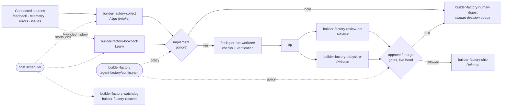

# builder-skills

**Workflow**: the Factory's delivery loop, which is the main thing in this repo. The other fifteen skills are independent utilities (see [below](#the-other-skills)). Every arrow is a *possible* handoff. Each one crossing into an external write passes its own policy gate, and no gate grants another.

**builder-skills** is Builder.io's MIT-licensed repository of *"small, composable skills for your favorite agent"*: 24 skills and one command, shipped as a Claude Code plugin marketplace (`builder-skills`), as a Claude Cowork marketplace, and through Builder's own `npx @agent-native/skills` installer. The repository holds two different kinds of thing, and the page is organized around that split.

- **Factory** (experimental): nine `factory-*` skills that together make a **policy-gated software factory built entirely out of instructions**. *"Factory is an experimental set of agent skills for turning feedback, product telemetry, errors, and delivery signals into policy-gated software changes."* This is the part this ingest is mainly about.
- **Everything else**: fifteen independent utilities. They cover cross-agent review, autonomy, cost-tiered orchestration, docs discipline, status signalling, and a set of front-ends onto Builder's **Agent-Native** hosted apps (Plans, Design, Slides, Dispatch, Clips).

- **Root router for the Factory:** [[builder-factory]]. It configures sources, per-action policies, schedules, and worktrees, and it creates host automations and verifies them by reading them back. The modules can also run alone.
- **Install:** `/plugin marketplace add BuilderIO/skills` then `/plugin install builder-skills@builder-skills`. Alternatively, `npx @agent-native/skills@latest add` offers a picker with a **Factory** group preselected and can also write managed `AGENTS.md` / `CLAUDE.md` blocks and a PR Visual Recap GitHub Action. `npx skills@latest add BuilderIO/skills --skill <name>` (Vercel's `skills` CLI) does a plain folder copy.

## Layer call: why the Factory is a `framework` and not a `runtime`

It calls itself a *software factory*, and [topic-software-factory](../topic/topic-software-factory.md) defines one as a system that turns intent into merged changes *"by spawning coding-agent loops it does not itself contain"*. The [CONVENTIONS §0](../CONVENTIONS.md#ingest-workflow-reminders) test still puts it in the process layer, because **it spawns nothing**. The guide says so in its first line:

> "Factory skills install agent instructions. They do not add integrations, credentials, scheduled jobs, or permission grants. Host support and the configuration conventions can change."

The pieces a runtime would own are all borrowed from the **host harness**: the scheduler (*"Every recurring job must be created and verified in the host scheduler"*), the connectors (*"there is no fixed Factory connector catalog"*), the worktree (`fresh-per-run` is a request that the host may not honour), and the credentials. Its configuration is *"an agent-readable convention, not a validated schema"*. The Factory is a methodology for running a factory that you assemble from whatever your harness already exposes. Stage coverage agrees: twelve of the 24 capabilities perform a lifecycle stage, and the Factory's own modules cover align, review, release, and learn.

That makes it the wiki's first instance of the **prompt-owned control plane**. It is the opposite bet to [[sssf]], whose pitch is *"moving the control plane out of the prompt and into Python"*. In the software-factory grid, the control-plane column *"in the prompt — the agent sequences itself"* had no documented anchor until this ingest. See the [dated section on the topic page](../topic/topic-software-factory.md#a-factory-with-no-runtime-the-skill-pack-pole).

## Distinctive contributions to the ontology

- **Authority decomposed into ten independent actions.** *"Fix, reply, close, review, approve, publish, merge, deploy, recover, and notify are independent decisions."* Each has its own policy (`never` · `manual` · `criteria` with `allow`/`stop` lists · `after-fix` / `after-merge` proof points), and the rule against inference is stated in every skill: *"The skills never infer permission for one action from another."* Other frameworks gate *whether* the agent may act ([[pattern-edit-guardrails]]) or *whether* the work is good ([[pattern-deterministic-gates]]). This one gates **each kind of external write separately**, which is why [[pattern-action-gating]] is minted here. [[pstack]]'s benny pack and [[gh-aw]]'s safe outputs were the two earlier instances.
- **Evidence bound to the live head, with a soak.** Approval and merge evidence counts only for the exact head it was read against. *"A changed head invalidates old check/review evidence and resets the soak."* The soak is a configured unchanged interval (e.g. `10 minutes`) that the agent must actually observe: *"Missing history does not satisfy it."* This is the most precise statement in the wiki of *when* a gate result expires.
- **Unavailable, truncated, and empty are three different answers.** Every Factory skill carries some form of *"A missing connector, partial page, or failed query is not an empty source"* and *"Never report 'no recurring issues' when coverage is partial."* It is [[pattern-evidence-before-claims]] applied to the agent's **inputs**, where the pattern usually targets its outputs, and it is what stops an unattended sweep over a broken connector from reporting all clear.
- **The factory's front door is the user.** Intake here is product feedback, telemetry, and runtime errors, not a ticket queue. [[builder-factory-collect]] triages them, may ask the reporter **one targeted question** if the reply policy allows, and re-triages the original report when an answer comes back. [[pstack-benny-triage]] was the only earlier framework capability triggered by an external report. This is the first to make it a standing, scheduled workflow.
- **Learning from production, not from the session.** [[builder-factory-lookback]] clusters a bounded history of reports, errors, and prior fixes. It asks why the same class of problem keeps coming back and prefers *"one verified correction at that boundary over a pile of caller-specific patches."* This is a **third flavor of [[stage-learn]]**. The existing two fold lessons into an agent corpus or a team retrospective; this one folds the product's own recurrence signal into a systemic fix. See the note on the stage page.
- **The human is a queue, not an interrupt.** [[builder-factory-human-digest]] is a read-only, deduplicated list of everything the automated paths held for a person, including PRs awaiting judgment, reports held for context, and answers not yet re-triaged. It is the *escalation* socket in the [factory anatomy](../topic/topic-software-factory.md#anatomy-of-a-factory) implemented as a capability. The nearest earlier thing is [[beads]]' `bd human` in the store layer.
- **Configuration you must read back.** *"A YAML schedule is only a request; `/factory` must read the saved job settings back and report anything the host could not configure."* The Factory treats its own setup the way it treats a PR: a claim is not proof until live state confirms it.
- **Prompt overlays that cannot grant permission.** `skill_prompts.<skill>` layers project-specific text onto each module and is copied into saved automation prompts. It *"cannot override the user's current request, grant permission, or weaken repository and host safeguards"*, and on conflict *"follow the more restrictive requirement and surface the conflict."*
- **A new artifact: [[artifact-autonomy-policy]].** `.agent-factory/config.yaml` is the durable, per-project document that says which actions the agent may take unattended and under what conditions. The nearest earlier artifacts are [[artifact-constitution]] (principles that gate plans) and [[artifact-standards]] (conventions). This one governs **authority** rather than design or style.

## The other skills

The non-Factory skills share no workflow. Three themes group them, and a fourth group consists of product front-ends.

- **Cross-agent review and autonomy.** [[builder-agent-watchdog]] audits another agent's run as a *second investigator* rather than a grader. [[builder-plan-arbiter]] turns competing plans from different agents into one decision memo. [[builder-plow-ahead]] is an explicit autonomy contract with named stop conditions and a closing decision recap. All three assume a user who runs **Codex and Claude Code side by side** and moves work between them. That multi-harness, multi-vendor workflow is taken as given here and is still unusual in this wiki.
- **Cost-tiered orchestration.** [[builder-efficient-fable]] and [[builder-efficient-frontier]] keep the expensive model for judgment and send bounded, token-heavy work to cheaper subagents. [[builder-stay-within-limits]] checks 5-hour and weekly usage between waves and pauses at 95%. Together with [[pstack-setup-pstack]] and [[gsd]]'s Opus-tier planner, the first two are enough evidence to mint [[pattern-model-tiering]].
- **Discipline conventions.** [[builder-read-the-damn-docs]] requires reading the docs before writing code against external APIs. [[builder-quick-recap]] ends every response with a 🟢/🟡/🔴 status line.
- **Agent-Native front-ends.** [[builder-visual-plan]], [[builder-visual-recap]], [[builder-visual-edit]], [[builder-an]], [[builder-webmcp]], [[builder-rewind]], and [[builder-turn-into-app]] each connect the agent to a Builder-hosted surface (Plans, Design, Dispatch-hosted apps, Clips Desktop screen memory) through MCP or in-page WebMCP tools. Their procedures are mostly about host integration. The ideas that carry over are **one read, one smallest mutation, one readback** (WebMCP), recaps that describe a diff *"at a higher altitude than line-by-line review"*, and plans published as commentable review surfaces instead of chat paragraphs.

## Capabilities by stage

### Align: understand before acting ([[stage-align]])
- [[builder-factory-collect]] — collect and triage configured feedback, telemetry, errors, and issues, with coverage accounting, and apply separate fix, reply, and close gates (intake flavor).

### Plan: settle the shape ([[stage-plan]])
- [[builder-plan-arbiter]] — cross-review competing agent plans, then adopt one, build a hybrid, or send them back for revision, returning a decision memo with an executor recommendation.
- [[builder-visual-plan]] — publish the plan as an interactive, commentable MDX review surface with diagrams, file maps, and an optional wireframe or prototype.

### Implement: write it ([[stage-implement]])
- [[builder-read-the-damn-docs]] — a docs-first trigger list and workflow that requires web-searching official docs before coding against external contracts.
- [[builder-visual-edit]] — open a running local app in hosted Design as route-backed screens and edit the source from the canvas.

### Review: judge it ([[stage-review]])
- [[builder-factory-review-prs]] — sweep a filtered PR queue; findings kept separate from reply, approval, and merge gates.
- [[builder-agent-watchdog]] — audit another agent's work by running an independent investigation and diffing it against theirs.
- [[builder-visual-recap]] — turn a diff into an interactive visual recap for reviewers; also available as a GitHub Action on every PR.

### Release: deliver it ([[stage-release]])
- [[builder-factory-ship]] — verify, publish, merge under a head-match guard, and **verify the deployment separately**, because *"a merge is not live proof."*
- [[builder-factory-babysit-pr]] — follow one explicitly authorized PR through checks and review, fixing in-scope findings under six separate action gates including a soak.

### Learn: fold it back ([[stage-learn]])
- [[builder-factory-lookback]] — a bounded retrospective over production signal that looks for recurrence after a claimed fix and aims for one systemic change at the shared boundary.
- [[builder-turn-into-app]] — package a proven thread, skill, or workflow into a runnable Agent-Native app.

### Cross-cutting: setup, supervision, autonomy, and tooling (no single lifecycle stage)

**Factory control**
- [[builder-factory]] — configure sources, ten independent action policies, overlays, schedules, and worktrees, and read back host automations.
- [[builder-factory-human-digest]] — read-only queue of work held for human judgment, grouped by underlying pattern.
- [[builder-factory-watchdog]] — find stalled, authorized delivery work and notify only when a concrete next step is due (`DONT_NOTIFY` otherwise).
- [[builder-factory-recover]] — resume interrupted runs only while their original authorization and worktree are still valid, without repeating completed writes.

**Autonomy and cost**
- [[builder-plow-ahead]] — convert routine questions into stated assumptions, stop only for listed blockers, and end with an auditable decision recap.
- [[builder-efficient-fable]] — Claude Fable as orchestrator and final judge, with cheaper subagents doing research, coding, and testing.
- [[builder-efficient-frontier]] — the same orchestration for any high-cost frontier model.
- [[builder-stay-within-limits]] — check the usage window between waves, pause at 95%, and resume from a self-contained wake prompt.
- [[builder-quick-recap]] — the 🟢/🟡/🔴 end-of-response status line, installed as a managed `AGENTS.md` / `CLAUDE.md` block.

**Agent-Native surfaces**
- [[builder-an]] — open and operate a granted Agent-Native app through Dispatch MCP (also the `/an` command).
- [[builder-webmcp]] — open a URL in the host's built-in browser and use the page's WebMCP tools before any UI automation.
- [[builder-rewind]] — retrieve recent local screen context from Clips Rewind, local-first, with permission-gated setup.

## Harness support

The installer targets *"the shared `.agents` path for Codex, Pi, Cursor, OpenCode, GitHub Copilot / VS Code, and similar agents, plus Claude Code's native skills path"*. The repo also ships `.claude-plugin/` and `.codex-plugin/` manifests and a Cowork marketplace. Per the [support-scope rule](../CONVENTIONS.md#the-harness-layer), `runs_on:` is wired to the three that have pages: **claude-code**, **pi**, **opencode**. **Codex, Cursor, GitHub Copilot / VS Code, and Claude Cowork** are also officially supported and are recorded here as prose until they have pages. This adds one more source naming Cursor, which is already the wiki's [most-referenced unpaged harness](../harness/index.md).

## Artifacts produced
- [[artifact-autonomy-policy]] — **new**. The per-action authority document (`.agent-factory/config.yaml`) written by [[builder-factory]] and read by every Factory module.
- [[artifact-pull-request]] — the gated PR ([[builder-factory-collect]], [[builder-factory-ship]], [[builder-factory-babysit-pr]]).
- [[artifact-review-report]] — PR findings and gap reports ([[builder-factory-review-prs]], [[builder-agent-watchdog]]).
- [[artifact-retrospective]] — the lookback report covering coverage, recurrence, confirmed cause, and systemic fix ([[builder-factory-lookback]]).
- [[artifact-plan-md]] — the arbitrated execution plan and the visual plan ([[builder-plan-arbiter]], [[builder-visual-plan]]).
- [[artifact-explainer]] — the visual recap of a diff ([[builder-visual-recap]]).
- [[artifact-decision-log]] — the autonomous-decision recap, written for a human who was not watching ([[builder-plow-ahead]]).
- [[artifact-handoff-doc]] — self-contained wake prompts and blocked-state handoffs ([[builder-stay-within-limits]], [[builder-plow-ahead]]).

## Patterns applied
- [[pattern-action-gating]] — **new, signature**. Ten independently authorized actions, no inference between them, live-state recheck before each write ([[builder-factory]] and every Factory module).
- [[pattern-evidence-before-claims]] — **co-signature**. Unavailable ≠ truncated ≠ empty, *"a merge is not live proof"*, and schedules that count only after read-back ([[builder-factory-collect]], [[builder-factory-lookback]], [[builder-factory-ship]], [[builder-factory]]).
- [[pattern-deterministic-gates]] — head-bound check and review evidence with a soak interval that restarts on any change ([[builder-factory-babysit-pr]], [[builder-factory-review-prs]], [[builder-factory-ship]]).
- [[pattern-autonomous-loop]] — host-scheduled collect, lookback, digest, and watchdog jobs; [[builder-plow-ahead]]'s autonomy contract.
- [[pattern-worktree-isolation]] — `fresh-per-run` automation-owned worktrees, and *"keep the workflow manual rather than borrowing a shared checkout"* when the host cannot provide one.
- [[pattern-model-tiering]] — **new**. Expensive model for judgment, cheap models for bounded heavy lifting ([[builder-efficient-fable]], [[builder-efficient-frontier]]).
- [[pattern-cross-model-review]] — one vendor's agent auditing or arbitrating another's ([[builder-agent-watchdog]], [[builder-plan-arbiter]]).
- [[pattern-candidate-grafting]] — the plan-arbiter *Hybrid* outcome and its *Borrowed From Other Plans* section ([[builder-plan-arbiter]]).
- [[pattern-source-grounding]] — **signature** of [[builder-read-the-damn-docs]]; official docs over model memory.
- [[pattern-idempotent-operations]] — recovery that never repeats a completed write, reply, approval, merge, or deploy ([[builder-factory-recover]]).
- [[pattern-session-handoff]] — self-contained wake prompts and blocked-state handoffs ([[builder-stay-within-limits]], [[builder-factory-recover]], [[builder-plow-ahead]]).
- [[pattern-systematic-debugging]] — recurrence traced to a shared boundary, confirmed causes separated from hypotheses, and a stated test that would disprove each ([[builder-factory-lookback]]).
- [[pattern-knowledge-compounding]] — a proven workflow packaged into a reusable app ([[builder-turn-into-app]]); production recurrence folded into systemic fixes ([[builder-factory-lookback]]).
- [[pattern-fresh-context-subagents]] — handoff packets written *"as if the subagent has no useful chat context"* ([[builder-efficient-fable]], [[builder-efficient-frontier]]).
- [[pattern-wave-parallelism]] — bounded waves of at most three parallel subagents, with a usage check between waves ([[builder-stay-within-limits]]).

## See Also
- [[topic-software-factory]] — where the Factory fills the empty prompt-owned control-plane cell of the design grid. [[sssf]] is the direct opposite bet (control plane in code). [[gh-aw]] is the nearest runtime relative, with standing repository automation behind gated write channels, but it compiles the gates into CI where the Factory writes them as prose policy.
- [[pstack]] — the other framework with a report-triggered, low-authority automation pack. [[pstack-benny-triage]] ↔ [[builder-factory-collect]]; [[pstack-principle-never-block-on-the-human]] ↔ [[builder-plow-ahead]]; [[pstack-show-me-your-work]] ↔ the plow-ahead decision recap. pstack's Cursor built-in `/babysit` is the same idea as [[builder-factory-babysit-pr]].
- [[compound-engineering]] — [[ce-resolve-pr-feedback]] ↔ [[builder-factory-babysit-pr]]; [[ce-sweep]] ↔ [[builder-factory-collect]]; [[ce-product-pulse]] is the nearest earlier production-signal report.
- [[addy-agent-skills]] — [[addy-source-driven-development]] ↔ [[builder-read-the-damn-docs]].
- [[beads]] — `bd human` is the store-layer counterpart of [[builder-factory-human-digest]].
- [[stage-align]] · [[stage-plan]] · [[stage-implement]] · [[stage-review]] · [[stage-release]] · [[stage-learn]] — the six stages these capabilities feed. There is **no [[stage-specify]]** and **no [[stage-validate]]** capability. Validation is folded into ship and collect as *"run the configured checks"*.
