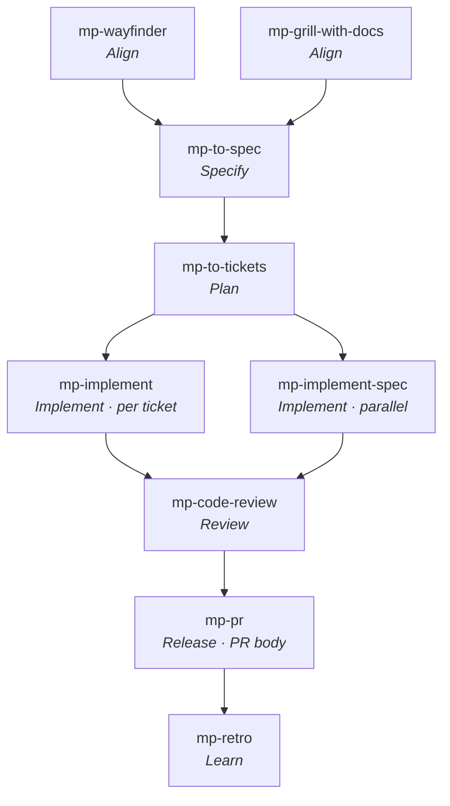

# Matt Pocock — Skills for Real Engineers

**Workflow** — the primary skill per [SDLC stage](../sdlc-stage/index.md) this framework runs, top to bottom (folded and off-stage steps omitted).

A curated set of small, composable agent skills by **Matt Pocock** "for real engineering work — not 'vibe coding'", sourced from his personal `.claude` directory and designed to be adapted ("Hack around with them. Make them your own."). Works with any model and any coding agent. Explicitly positioned *against* owning-the-process frameworks: "Approaches like GSD, BMAD, and Spec-Kit try to help by owning the process. But while doing so, they take away your control and make bugs in the process hard to resolve." These skills stay small and composable instead.

- **Install (v1.2.0+):** two paths, "two philosophies". The **Claude Code plugin** (`claude plugins install mattpocock-skills`, in the official marketplace) is a managed, read-only bundle that self-updates: "you subscribe rather than fork". **`npx skills@latest add mattpocock/skills`** (skills.sh) copies editable files for Codex and other agents. "Pick one: installing both leaves you with every skill twice."
- **Configure:** `/setup-matt-pocock-skills` (issue tracker — GitHub/Linear/local files, triage labels, doc paths).

**Dual-harness since v1.2.0.** Every skill ships an `agents/openai.yaml` beside its `SKILL.md` with Codex UI metadata, and user-invoked skills set `policy.allow_implicit_invocation: false` (the Codex analog of `disable-model-invocation: true`). `AGENTS.md` is a symlink to `CLAUDE.md`. A native Codex plugin is deferred (ADR 0002). `runs_on:` stays `[[claude-code]]` only, since the wiki has no Codex harness page (support-scope rule).

Unlike [[gsd]] — a single end-to-end workflow engine — this is a **loose toolkit of independent skills**, each **user-invoked** (typed as a slash command; orchestrates) or **model-invoked** (typed *or* auto-reached-for by the agent; holds reusable discipline). A user-invoked skill may invoke model-invoked ones, never another user-invoked one.

> **Updated to v1.3.1 (2026-10-04; ingested 2026-10-11).** Headline changes since v1.1: the main flow gained a **tail**, [[mp-pr]] (PR body, release) and [[mp-retro]] (environment retrospective, the toolkit's first [[stage-learn]] capability). [[mp-implement-spec]] is a parallel, whole-spec alternative to per-ticket [[mp-implement]]. Five more skills were promoted out of `in-progress/`: [[mp-to-questionnaire]], [[mp-wizard]], [[mp-wait-what]], and `writing-great-skills` renamed to [[mp-writing-for-agents]]. [[mp-resolving-merge-conflicts]] was **removed** ("nothing replaces it"). The `CONTEXT.md` domain doc became **`GLOSSARY.md`**. [[mp-grilling]] runs **round-by-round** over a question frontier. [[mp-prototype]] is now a single HTML file kept on a `prototype/<name>` branch. [[mp-wayfinder]] maps **decision tickets** and burns research down with subagents. [[mp-ask-matt]] gained a five-option **phase-boundary** tree. The four v1.1 deprecations and the `personal/` bucket were deleted outright. Cross-skill calls now say "call the Skill tool with …", and the em-dash was removed from all prose.
>
> **Previously, v1.1 (2026-07-09).** The repo grew to ~38 skills across `engineering/`, `productivity/`, `misc/`, and new `deprecated/`, `in-progress/`, and `personal/` folders. Headline changes since the 2026-06-28 ingest: a first-class [[mp-implement]] execute skill; [[mp-code-review]] (two-axis Standards∥Spec, graduated from in-progress); [[mp-research]] (background primary-source research); [[mp-wayfinder]] (plan work too big for one session); [[mp-resolving-merge-conflicts]]; `to-prd`→[[mp-to-spec]] and `to-plan`+`to-issues`→[[mp-to-tickets]]; [[mp-tdd]] reshaped to red→green (refactoring moved to [[mp-code-review]]); [[mp-prototype]] now model-invoked; and four deprecations (see below).

## The main flow (via [[mp-ask-matt]])

The router [[mp-ask-matt]] frames the skills as **flows**. The main flow, *idea → ship* (v1.3.1):

> [[mp-grill-with-docs]] → *(prototype detour bridged by [[mp-handoff]] when a question needs a runnable answer: [[mp-prototype]])* → [[mp-to-spec]] → [[mp-to-tickets]] → [[mp-implement]] *(per ticket, clearing context between each)* **or** [[mp-implement-spec]] *(whole spec, parallel)* → [[mp-code-review]] → [[mp-pr]] *(when it goes up as a PR)* → [[mp-retro]] *(closes the loop)*

Three **on-ramps** merge onto it: [[mp-triage]] (raw incoming issues), [[mp-diagnosing-bugs]] (the "something's broken" entry, followed by `/retro` once fixed), and [[mp-wayfinder]] (an effort too big for one session, merging back at `/to-spec`). A **codebase-health** lane ([[mp-improve-codebase-architecture]]) generates ideas for the front of the flow. A **vocabulary layer** runs underneath ([[mp-domain-modeling]], [[mp-codebase-design]]). At every **phase boundary**, the router's tree orders the options *continue → `/clear` → `/handoff` → subagent → `/compact`*.

**The loop now closes.** Up to v1.1 the flow ended at review, a line. v1.3.0's [[mp-retro]] feeds findings back into the *environment* (checks, coding standards, navigation pointers, tooling) that the next build starts from. That makes Matt Pocock the newest framework with a [[stage-learn]] capability, in the **environment-compounding** flavor (see [[topic-compounding-loop]]).

## Four failure modes addressed

- **Didn't do what I want** — close the user↔agent gap with a grilling session. → [[mp-grill-me]], [[mp-grill-with-docs]].
- **Too verbose** — establish shared domain language (`GLOSSARY.md`, was `CONTEXT.md`). → [[mp-grill-with-docs]], [[mp-domain-modeling]]; after-the-fact corrective [[mp-wait-what]].
- **Code doesn't work** — add real feedback loops (types, tests, debugging). → [[mp-tdd]], [[mp-diagnosing-bugs]].
- **Ball of mud** — daily design investment. → [[mp-to-spec]] (quizzes which modules you touch before speccing), [[mp-codebase-design]], [[mp-improve-codebase-architecture]].

## Capabilities

### Skills — align / elicitation & intake
- [[mp-grill-me]] — comprehensive interview on plans/designs until decisions resolve.
- [[mp-grilling]] — the reusable interview loop underneath the grill skills (v1.1: confirmation gate + facts-vs-decisions; v1.2.0: round-by-round over the question **frontier**).
- [[mp-grill-with-docs]] — grilling that also builds a domain model + ADRs.
- [[mp-triage]] — move issues/PRs through a triage state machine → agent-ready briefs (intake).
- [[mp-wayfinder]] — map an oversized effort as a shared map of **decision tickets** on the tracker (v1.2.0 rename), resolving *decisions* until the destination is clear; research tickets burned down by parallel subagents (situational on-ramp; upstream of the spec).
- [[mp-to-questionnaire]] — turn a decision you can't answer into a questionnaire for the one person who can; grills the *send*, not the subject (v1.2.0, new).

### Skills — specify
- [[mp-to-spec]] — synthesize the conversation into a **spec** (formerly `to-prd`) on the issue tracker; sketches testing seams; no interview.

### Skills — plan (decompose, design, research)
- [[mp-to-tickets]] — break a plan/spec into **tracer-bullet tickets** with blocking edges (formerly `to-issues`+`to-plan`); handles wide refactors via expand–contract.
- [[mp-research]] — background agent investigating **primary sources** → cited Markdown ([[artifact-research-md]]).
- [[mp-domain-modeling]] — build/sharpen the project domain model + ubiquitous language (v1.1: absorbed the deprecated `ubiquitous-language`).
- [[mp-codebase-design]] — shared vocabulary for designing **deep modules** at clean seams.

### Skills — implement (build, fix, integrate)
- [[mp-implement]] — **build the work from a spec/tickets** (v1.1, new); drives [[mp-tdd]] at seams, closes with [[mp-code-review]], commits.
- [[mp-implement-spec]] — **implement a whole spec in one run**: tickets as a task graph, implementer subagents in worktrees across the ready frontier, one integration branch, one closing code-review (v1.3.0, new).
- [[mp-tdd]] — test-first **red → green** loop (v1.1: refactor moved to [[mp-code-review]]; "seam" leading word).
- [[mp-prototype]] — throwaway prototypes for a design question (v1.1: now model-invoked; v1.2.0: single shareable HTML file, kept on a `prototype/<name>` branch as a primary source).
- [[mp-diagnosing-bugs]] — reproduce → minimize → hypothesize → instrument → fix → regression-test.
- ~~[[mp-resolving-merge-conflicts]]~~ — resolve an in-progress merge/rebase from each side's primary-source intent (v1.1; **removed in v1.3.0**, nothing replaces it).

### Skills — review (quality gate)
- [[mp-code-review]] — **two-axis** diff review, Standards (+ Fowler smell baseline) ∥ Spec, parallel sub-agents (v1.1, graduated from `in-progress`).
- [[mp-improve-codebase-architecture]] — scan for deepening opportunities; visual HTML report, then grill the one you pick (v1.2.0: YAGNI-scoped to recently changed paths).

### Skills — release (PR write-up)
- [[mp-pr]] — model-invoked shape for a PR body: smallest-visual Summary, before/after Evidence, Merge Danger (one-/two-way door + blast radius) (v1.3.0, new). Writes the body only; it does not push or merge.

### Skills — learn (loop close)
- [[mp-retro]] — retrospective on a coding session that suggests changes to the agent's **environment**: navigation pointers, automated checks, coding standards, steering files, tool economy, information access; mechanical findings become deterministic checks (v1.3.0, new).

### Skills — cross-cutting
- [[mp-handoff]] — compact a conversation into a handoff document; v1.2.0 narrowed it to when context must *travel* (new harness/directory/colleague/mid-phase fork).
- [[mp-ask-matt]] — router over the skills; describes the flows above and the phase-boundary tree.
- [[mp-wizard]] — model-invoked generator of an interactive bash wizard for steps **only a human can perform** (provisioning, credentials/CI secrets, dashboards, cutovers) (v1.2.0, new).
- [[mp-wait-what]] — three-line corrective: re-pitch the last message in Simplified Technical English using the `GLOSSARY.md` vocabulary (v1.2.0, new).
- [[mp-writing-for-agents]] — model-invoked reference for writing any agent-facing document (skills, `AGENTS.md`/`CLAUDE.md`): context pointers, the two loads, information hierarchy, leading words, pruning (v1.2.0; renamed from `writing-great-skills`).

### Catalogued (non-lifecycle infra / tooling — not paged)
- **setup-matt-pocock-skills** — configure issue tracker, triage labels, doc paths (run once per repo). v1.2.0 made it friendlier: triage labels are asked about only if `triage` is installed, domain docs default to single-context, and local tickets are one file per ticket under `.scratch/<feature>/issues/`.
- **git-guardrails-claude-code** — block dangerous git commands via pre-execution hooks (an [[pattern-edit-guardrails]] relative).
- **setup-pre-commit** — Husky hooks: lint-staged, Prettier, type-check, tests.
- **migrate-to-shoehorn** — migrate `as` test assertions to @total-typescript/shoehorn.
- **scaffold-exercises** — generate exercise directory structures.
- **teach** — multi-session teaching workspace (productivity).

### Removed (deleted from the repo in v1.2.0 / v1.3.0)
Deprecated in v1.1 and **deleted in v1.2.0**, each "already absorbed by a skill that does the job better". `skills/deprecated/` is now empty:
- **ubiquitous-language** → [[mp-domain-modeling]].
- **design-an-interface** → [[mp-codebase-design]] ("design it twice" ships inside it as `DESIGN-IT-TWICE.md`).
- **qa** → [[mp-triage]] + [[mp-to-tickets]].
- **request-refactor-plan** → [[mp-to-spec]] + [[mp-improve-codebase-architecture]].
- **edit-article**, **obsidian-vault** (the `personal/` bucket) — "only ever mine", deleted in v1.2.0.
- **resolving-merge-conflicts** → nothing; deleted in v1.3.0 ([[mp-resolving-merge-conflicts]] kept as a historical page).

### In-progress (the beta channel, not paged)
`skills/in-progress/` is "a beta channel, published on purpose, installable one skill at a time through skills.sh": **claude-handoff**, **loop-me**, **setup-ts-deep-modules** (new: wire dependency-cruiser so each TS package is a deep module reachable only via its entry points), **writing-beats**, **writing-fragments**, **writing-shape**.

## Artifacts produced
- [[artifact-spec-md]] — the spec from [[mp-to-spec]] (v1.1: "spec" is now the through-line term; was a PRD → [[artifact-prd]]; v1.2.0 finished the rename everywhere).
- [[artifact-issue]] — tracer-bullet tickets from [[mp-to-tickets]]; investigation tickets from [[mp-wayfinder]]; agent-ready briefs from [[mp-triage]].
- [[artifact-research-md]] — cited primary-source research file from [[mp-research]].
- [[artifact-review-report]] — two-axis findings from [[mp-code-review]].
- [[artifact-domain-model]] — the `GLOSSARY.md` (was `CONTEXT.md`) shared-language glossary ([[mp-domain-modeling]] / [[mp-grill-with-docs]]).
- [[artifact-adr]] — Architecture Decision Records, updated inline during grilling/modeling.
- [[artifact-atomic-commit]] — commits from [[mp-implement]] / [[mp-implement-spec]] (and, until v1.3.0, [[mp-resolving-merge-conflicts]]).
- [[artifact-pull-request]] — the PR body shaped by [[mp-pr]]; draft PR opened by [[mp-implement-spec]] when the tracker closes work through PRs.
- [[artifact-standards]] — `CODING_STANDARDS.md` judgement-call rules that [[mp-retro]] proposes (mechanical ones become checks instead).
- [[artifact-skill-doc]] — skills and steering docs written to [[mp-writing-for-agents]]'s standard.
- [[artifact-handoff-doc]] — from [[mp-handoff]].

## Patterns applied
- [[pattern-grilling]] — elicitation interview loop (its signature; [[mp-grilling]]).
- [[pattern-spec-driven-development]] — spec-then-tickets flow ([[mp-to-spec]]).
- [[pattern-vertical-slice]] — tracer-bullet, independently-shippable work units ([[mp-to-tickets]]).
- [[pattern-test-driven-development]] — red → green ([[mp-tdd]], driven by [[mp-implement]]).
- [[pattern-systematic-debugging]] — reproduce → minimize → hypothesize → instrument → fix ([[mp-diagnosing-bugs]]).
- [[pattern-deep-modules]] — Ousterhout: rich functionality behind a simple interface ([[mp-codebase-design]], [[mp-improve-codebase-architecture]]).
- [[pattern-parallel-persona-review]] + [[pattern-adversarial-review]] — two-axis parallel sub-agent review with a Fowler smell baseline ([[mp-code-review]]).
- [[pattern-source-grounding]] — cite primary sources ([[mp-research]]).
- [[pattern-fresh-context-subagents]] — background research / per-ticket fresh context / grilling's background fact-finding ([[mp-research]], [[mp-implement]], [[mp-implement-spec]], [[mp-wayfinder]], [[mp-grilling]]).
- [[pattern-wave-parallelism]] + [[pattern-worktree-isolation]] — implementer subagents in their own worktrees across a ready frontier ([[mp-implement-spec]]).
- [[pattern-knowledge-compounding]] — environment edits fed back from a session retrospective ([[mp-retro]]).
- [[pattern-deterministic-gates]] — mechanical standards → lint/hook/CI checks ([[mp-retro]]; continuous checks in [[mp-implement]]).
- [[pattern-evidence-before-claims]] — before/after evidence in every PR body ([[mp-pr]]).
- [[pattern-idempotent-operations]] — idempotent `.env` upserts in generated wizards ([[mp-wizard]]).
- [[pattern-scale-adaptive-planning]] — size ceremony to work bigger than one session ([[mp-wayfinder]]).
- [[pattern-throwaway-prototype]] — build to learn, then archive off-trunk on a `prototype/<name>` branch (v1.2.0; was "discard") ([[mp-prototype]]).
- [[pattern-session-handoff]] — compact context across agent transitions ([[mp-handoff]]).
- [[pattern-context-engineering]] — the shared-language glossary as curated context ([[mp-domain-modeling]]); context pointers and the two loads ([[mp-writing-for-agents]]).
- [[pattern-trunk-based-development]] — keep a shared trunk mergeable ([[mp-resolving-merge-conflicts]], until v1.3.0).

## See Also
- [[pstack]] — the other framework that deliberately refuses to own the whole process, and the second to import Ousterhout's design vocabulary. [[mp-codebase-design]] ↔ [[pstack-architect]] (deep modules, information leakage, pass-through methods); [[mp-tdd]] ↔ [[pstack-tdd]] (both conditional rather than mandatory); [[mp-wayfinder]] ↔ [[pstack-figure-it-out]]; [[mp-prototype]] ↔ [[pstack-arena]]; [[mp-triage]] ↔ [[pstack-benny-triage]]. The divergence is the spec: MP's through-line runs grill → to-spec → to-tickets, while pstack ships no specify capability at all.

- [[gsd]] — sibling framework; shares [[pattern-vertical-slice]], [[pattern-test-driven-development]], [[pattern-grilling]], [[pattern-systematic-debugging]], and [[pattern-session-handoff]]; [[mp-research]] ↔ [[gsd-phase-researcher]], [[mp-implement]] / [[mp-implement-spec]] ↔ [[gsd-execute-phase]], [[mp-pr]] ↔ [[gsd-ship]].
- [[superpowers]] — [[mp-implement-spec]] ↔ [[sp-subagent-driven-development]] (an implementer subagent per unit, a review at the end); [[mp-writing-for-agents]] ↔ [[sp-writing-skills]].
- [[addy-agent-skills]] — lifecycle-complete framework by Addy Osmani, whose docs explicitly compare against this toolkit. Shared clusters: [[addy-interview-me]] ↔ [[mp-grill-me]], [[addy-spec-driven-development]] ↔ [[mp-to-spec]] (the pair that promoted [[stage-specify]]), [[addy-tdd]] ↔ [[mp-tdd]], [[addy-debugging]] ↔ [[mp-diagnosing-bugs]], [[addy-api-design]] ↔ [[mp-codebase-design]], [[addy-code-review]] ↔ [[mp-code-review]], [[addy-using-agent-skills]] ↔ [[mp-ask-matt]].
- [[openspec]] — spec-first framework; [[mp-to-spec]] ↔ [[openspec-propose]] in the [[stage-specify]] cluster; [[mp-implement]] ↔ [[openspec-apply]].
- [[compound-engineering]] — Every's compounding loop; [[mp-diagnosing-bugs]] ↔ [[ce-debug]], [[mp-code-review]] ↔ [[ce-code-review]], [[mp-triage]] ↔ [[ce-sweep]] (intake), [[mp-pr]] ↔ [[ce-commit-push-pr]], [[mp-retro]] ↔ [[ce-compound]]. CE promoted the [[stage-learn]] stage; v1.3.0's [[mp-retro]] gives this toolkit its first capability there (compounding into the *environment* rather than a solutions corpus).
- [[bmad]] — full-lifecycle persona framework; [[mp-to-spec]] ↔ [[bmad-prd]] (specify), [[mp-to-tickets]] ↔ [[bmad-create-epics-and-stories]] (decompose), [[mp-implement]] ↔ [[bmad-dev-story]] (execute), [[mp-code-review]] ↔ [[bmad-code-review]]. Matt's skills are loose and composable; BMAD binds the same activities to named role personas.
- [[gstack]] — [[mp-code-review]] ↔ [[gstack-review]], [[mp-ask-matt]] ↔ [[gstack-router]], [[mp-implement]]'s execute role parallels gstack's build phase.
- [[pstack]] (cont.) — [[mp-retro]] ↔ [[pstack-reflect]] (both demote a mechanical lesson to a lint rule); [[mp-implement-spec]] ↔ [[pstack-swarm]].
- [[sandcastle]] — Matt Pocock's own runtime library; [[mp-implement-spec]] is the prompt-level version of the same branch-per-agent, merge-back shape.
- [[stage-align]] · [[stage-specify]] · [[stage-plan]] · [[stage-implement]] · [[stage-review]] · [[stage-release]] (partial: [[mp-pr]]) · [[stage-learn]] (partial: [[mp-retro]]) — the canonical stages this toolkit's capabilities feed (still no functional [[stage-validate]] capability).
