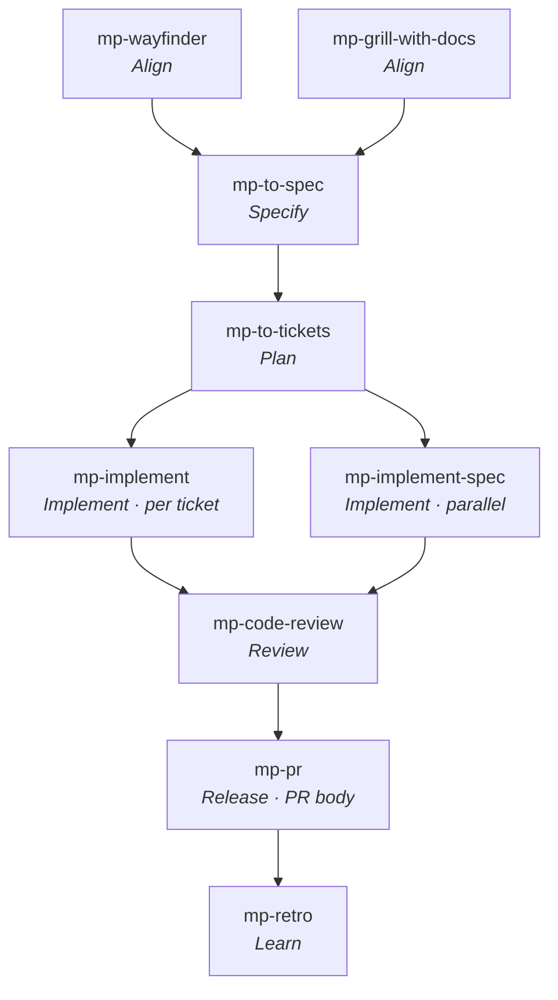

# Matt Pocock — Skills for Real Engineers

**Workflow** — the primary skill per [SDLC stage](../sdlc-stage/index.md) this framework runs, top to bottom (folded and off-stage steps omitted).

A curated set of small, composable agent skills by **Matt Pocock** "for real engineering work — not 'vibe coding'", sourced from his personal `.claude` directory and designed to be adapted ("Hack around with them. Make them your own."). Works with any model and any coding agent. Explicitly positioned *against* owning-the-process frameworks: "Approaches like GSD, BMAD, and Spec-Kit try to help by owning the process. But while doing so, they take away your control and make bugs in the process hard to resolve." These skills stay small and composable instead.

The current release is **v1.3.1** (2026-10-04): 37 skills in `engineering/`, `productivity/`, `misc/`, and a beta-channel `in-progress/` folder.

- **Install:** two paths, "two philosophies". The **Claude Code plugin** (`claude plugins install mattpocock-skills`, in the official marketplace) is a managed, read-only bundle that self-updates: "you subscribe rather than fork". **`npx skills@latest add mattpocock/skills`** (skills.sh) copies editable files for Codex and other agents. "Pick one: installing both leaves you with every skill twice."
- **Configure:** `/setup-matt-pocock-skills` (issue tracker — GitHub/Linear/local files, triage labels, doc paths).

**Dual-harness.** Every skill ships an `agents/openai.yaml` beside its `SKILL.md` with Codex UI metadata, and user-invoked skills set `policy.allow_implicit_invocation: false` (the Codex analog of `disable-model-invocation: true`). `AGENTS.md` is a symlink to `CLAUDE.md`. A native Codex plugin is deferred (ADR 0002). `runs_on:` lists only `[[claude-code]]`, since the wiki has no Codex harness page (support-scope rule).

Unlike [[gsd]] — a single end-to-end workflow engine — this is a **loose toolkit of independent skills**, each **user-invoked** (typed as a slash command; orchestrates) or **model-invoked** (typed *or* auto-reached-for by the agent; holds reusable discipline). A user-invoked skill may invoke model-invoked ones, never another user-invoked one. Cross-skill calls are written as an explicit "call the Skill tool with …" instruction, which only works for model-invoked targets.

## The main flow (via [[mp-ask-matt]])

The router [[mp-ask-matt]] frames the skills as **flows**. The main flow, *idea → ship*:

> [[mp-grill-with-docs]] → *(prototype detour bridged by [[mp-handoff]] when a question needs a runnable answer: [[mp-prototype]])* → [[mp-to-spec]] → [[mp-to-tickets]] → [[mp-implement]] *(per ticket, clearing context between each)* **or** [[mp-implement-spec]] *(whole spec, parallel)* → [[mp-code-review]] → [[mp-pr]] *(when it goes up as a PR)* → [[mp-retro]] *(closes the loop)*

Three **on-ramps** merge onto it: [[mp-triage]] (raw incoming issues), [[mp-diagnosing-bugs]] (the "something's broken" entry, followed by `/retro` once fixed), and [[mp-wayfinder]] (an effort too big for one session, merging back at `/to-spec`). A **codebase-health** lane ([[mp-improve-codebase-architecture]]) generates ideas for the front of the flow. A **vocabulary layer** runs underneath ([[mp-domain-modeling]], [[mp-codebase-design]]). At every **phase boundary**, the router's tree orders the options *continue → `/clear` → `/handoff` → subagent → `/compact`*.

**The flow is a loop, not a line.** [[mp-retro]] feeds findings back into the *environment* (checks, coding standards, navigation pointers, tooling) that the next build starts from. That puts the toolkit in [[stage-learn]], in the **environment-compounding** flavor (see [[topic-compounding-loop]]).

## Four failure modes addressed

- **Didn't do what I want** — close the user↔agent gap with a grilling session. → [[mp-grill-me]], [[mp-grill-with-docs]].
- **Too verbose** — establish shared domain language (`GLOSSARY.md`). → [[mp-grill-with-docs]], [[mp-domain-modeling]]; after-the-fact corrective [[mp-wait-what]].
- **Code doesn't work** — add real feedback loops (types, tests, debugging). → [[mp-tdd]], [[mp-diagnosing-bugs]].
- **Ball of mud** — daily design investment. → [[mp-to-spec]] (quizzes which modules you touch before speccing), [[mp-codebase-design]], [[mp-improve-codebase-architecture]].

## Capabilities

### Skills — align / elicitation & intake
- [[mp-grill-me]] — comprehensive interview on plans/designs until decisions resolve.
- [[mp-grilling]] — the reusable interview loop underneath the grill skills: asks the whole question **frontier** round by round, sends facts to background sub-agents, puts decisions to the human, and waits for confirmation before acting.
- [[mp-grill-with-docs]] — grilling that also builds a domain model + ADRs.
- [[mp-triage]] — move issues/PRs through a triage state machine → agent-ready briefs (intake).
- [[mp-wayfinder]] — map an oversized effort as a shared map of **decision tickets** on the tracker, resolving *decisions* until the destination is clear; research tickets burned down by parallel subagents (situational on-ramp; upstream of the spec).
- [[mp-to-questionnaire]] — turn a decision you can't answer into a questionnaire for the one person who can; grills the *send*, not the subject.

### Skills — specify
- [[mp-to-spec]] — synthesize the conversation into a **spec** on the issue tracker; sketches testing seams; no interview.

### Skills — plan (decompose, design, research)
- [[mp-to-tickets]] — break a plan/spec into **tracer-bullet tickets** with blocking edges; handles wide refactors via expand–contract.
- [[mp-research]] — background agent investigating **primary sources** → cited Markdown ([[artifact-research-md]]).
- [[mp-domain-modeling]] — build/sharpen the project domain model + ubiquitous language.
- [[mp-codebase-design]] — shared vocabulary for designing **deep modules** at clean seams.

### Skills — implement (build, fix)
- [[mp-implement]] — **build the work from a spec/tickets**, one ticket per context; drives [[mp-tdd]] at seams, closes with [[mp-code-review]], commits.
- [[mp-implement-spec]] — **implement a whole spec in one run**: tickets as a task graph, implementer subagents in worktrees across the ready frontier, one integration branch, one closing code-review.
- [[mp-tdd]] — test-first **red → green** loop at pre-agreed seams.
- [[mp-prototype]] — a throwaway prototype for one design question: a single shareable HTML file (logic) or toggleable UI variations, kept on a `prototype/<name>` branch as a primary source.
- [[mp-diagnosing-bugs]] — reproduce → minimize → hypothesize → instrument → fix → regression-test, with secrets redacted throughout.

### Skills — review (quality gate)
- [[mp-code-review]] — **two-axis** diff review, Standards (+ Fowler smell baseline) ∥ Spec, parallel sub-agents.
- [[mp-improve-codebase-architecture]] — scan recently changed paths for deepening opportunities; visual HTML report, then grill the one you pick.

### Skills — release (PR write-up)
- [[mp-pr]] — model-invoked shape for a PR body: smallest-visual Summary, before/after Evidence, Merge Danger (one-/two-way door + blast radius). Writes the body only; it does not push or merge.

### Skills — learn (loop close)
- [[mp-retro]] — retrospective on a coding session that suggests changes to the agent's **environment**: navigation pointers, automated checks, coding standards, steering files, tool economy, information access; mechanical findings become deterministic checks.

### Skills — cross-cutting
- [[mp-handoff]] — compact a conversation into a handoff document when context must *travel* (new harness, new directory, a colleague, a mid-phase fork).
- [[mp-ask-matt]] — router over the skills; describes the flows above and the phase-boundary tree.
- [[mp-wizard]] — model-invoked generator of an interactive bash wizard for steps **only a human can perform** (provisioning, credentials/CI secrets, dashboards, cutovers).
- [[mp-wait-what]] — three-line corrective: re-pitch the last message in Simplified Technical English using the `GLOSSARY.md` vocabulary.
- [[mp-writing-for-agents]] — model-invoked reference for writing any agent-facing document (skills, `AGENTS.md`/`CLAUDE.md`): context pointers, the two loads, information hierarchy, leading words, pruning.

### Catalogued (non-lifecycle infra / tooling — not paged)
- **setup-matt-pocock-skills** — configure issue tracker, triage labels (asked only if `triage` is installed), and doc layout (single-context by default) once per repo; local tickets live one file per ticket under `.scratch/<feature>/issues/`.
- **git-guardrails-claude-code** — block dangerous git commands via pre-execution hooks (an [[pattern-edit-guardrails]] relative).
- **setup-pre-commit** — Husky hooks: lint-staged, Prettier, type-check, tests.
- **migrate-to-shoehorn** — migrate `as` test assertions to @total-typescript/shoehorn.
- **scaffold-exercises** — generate exercise directory structures.
- **teach** — multi-session teaching workspace (productivity).

### In-progress (the beta channel, not paged)
`skills/in-progress/` is "a beta channel, published on purpose, installable one skill at a time through skills.sh": **claude-handoff**, **loop-me**, **setup-ts-deep-modules** (wire dependency-cruiser so each TS package is a deep module reachable only via its entry points), **writing-beats**, **writing-fragments**, **writing-shape**.

## Artifacts produced
- [[artifact-spec-md]] — the spec from [[mp-to-spec]].
- [[artifact-issue]] — tracer-bullet tickets from [[mp-to-tickets]]; decision tickets from [[mp-wayfinder]]; agent-ready briefs from [[mp-triage]].
- [[artifact-research-md]] — cited primary-source research file from [[mp-research]].
- [[artifact-review-report]] — two-axis findings from [[mp-code-review]].
- [[artifact-domain-model]] — the `GLOSSARY.md` shared-language glossary ([[mp-domain-modeling]] / [[mp-grill-with-docs]]).
- [[artifact-adr]] — Architecture Decision Records, updated inline during grilling/modeling.
- [[artifact-atomic-commit]] — commits from [[mp-implement]] / [[mp-implement-spec]].
- [[artifact-pull-request]] — the PR body shaped by [[mp-pr]]; draft PR opened by [[mp-implement-spec]] when the tracker closes work through PRs.
- [[artifact-standards]] — `CODING_STANDARDS.md` judgement-call rules that [[mp-retro]] proposes (mechanical ones become checks instead).
- [[artifact-skill-doc]] — skills and steering docs written to [[mp-writing-for-agents]]'s standard.
- [[artifact-handoff-doc]] — from [[mp-handoff]].

## Patterns applied
- [[pattern-grilling]] — elicitation interview loop (its signature; [[mp-grilling]]).
- [[pattern-spec-driven-development]] — spec-then-tickets flow ([[mp-to-spec]]).
- [[pattern-vertical-slice]] — tracer-bullet, independently-shippable work units ([[mp-to-tickets]]).
- [[pattern-test-driven-development]] — red → green ([[mp-tdd]], driven by [[mp-implement]] and [[mp-implement-spec]]).
- [[pattern-systematic-debugging]] — reproduce → minimize → hypothesize → instrument → fix ([[mp-diagnosing-bugs]]).
- [[pattern-deep-modules]] — Ousterhout: rich functionality behind a simple interface ([[mp-codebase-design]], [[mp-improve-codebase-architecture]]).
- [[pattern-parallel-persona-review]] + [[pattern-adversarial-review]] — two-axis parallel sub-agent review with a Fowler smell baseline ([[mp-code-review]]).
- [[pattern-source-grounding]] — cite primary sources ([[mp-research]]).
- [[pattern-fresh-context-subagents]] — background research / per-ticket fresh context / grilling's background fact-finding ([[mp-research]], [[mp-implement]], [[mp-implement-spec]], [[mp-wayfinder]], [[mp-grilling]]).
- [[pattern-wave-parallelism]] + [[pattern-worktree-isolation]] — implementer subagents in their own worktrees across a ready frontier ([[mp-implement-spec]]).
- [[pattern-knowledge-compounding]] — environment edits fed back from a session retrospective ([[mp-retro]]).
- [[pattern-deterministic-gates]] — mechanical standards → lint/hook/CI checks ([[mp-retro]]; continuous checks in [[mp-implement]]).
- [[pattern-evidence-before-claims]] — before/after evidence in every PR body ([[mp-pr]]).
- [[pattern-idempotent-operations]] — idempotent `.env` upserts in generated wizards ([[mp-wizard]]).
- [[pattern-scale-adaptive-planning]] — size ceremony to work bigger than one session ([[mp-wayfinder]]).
- [[pattern-throwaway-prototype]] — build to learn, then archive off-trunk on a `prototype/<name>` branch ([[mp-prototype]]).
- [[pattern-session-handoff]] — compact context across agent transitions ([[mp-handoff]]).
- [[pattern-context-engineering]] — the shared-language glossary as curated context ([[mp-domain-modeling]]); context pointers and the two loads ([[mp-writing-for-agents]]).

## See Also
- [[pstack]] — the other framework that deliberately refuses to own the whole process, and the second to import Ousterhout's design vocabulary. [[mp-codebase-design]] ↔ [[pstack-architect]] (deep modules, information leakage, pass-through methods); [[mp-tdd]] ↔ [[pstack-tdd]] (both conditional rather than mandatory); [[mp-wayfinder]] ↔ [[pstack-figure-it-out]]; [[mp-prototype]] ↔ [[pstack-arena]]; [[mp-triage]] ↔ [[pstack-benny-triage]]; [[mp-retro]] ↔ [[pstack-reflect]] (both demote a mechanical lesson to a lint rule); [[mp-implement-spec]] ↔ [[pstack-swarm]]. The divergence is the spec: MP's through-line runs grill → to-spec → to-tickets, while pstack ships no specify capability at all.
- [[gsd]] — sibling framework; shares [[pattern-vertical-slice]], [[pattern-test-driven-development]], [[pattern-grilling]], [[pattern-systematic-debugging]], and [[pattern-session-handoff]]; [[mp-research]] ↔ [[gsd-phase-researcher]], [[mp-implement]] / [[mp-implement-spec]] ↔ [[gsd-execute-phase]], [[mp-pr]] ↔ [[gsd-ship]].
- [[superpowers]] — [[mp-implement-spec]] ↔ [[sp-subagent-driven-development]] (an implementer subagent per unit, a review at the end); [[mp-writing-for-agents]] ↔ [[sp-writing-skills]].
- [[addy-agent-skills]] — lifecycle-complete framework by Addy Osmani, whose docs explicitly compare against this toolkit. Shared clusters: [[addy-interview-me]] ↔ [[mp-grill-me]], [[addy-spec-driven-development]] ↔ [[mp-to-spec]] (the pair that promoted [[stage-specify]]), [[addy-tdd]] ↔ [[mp-tdd]], [[addy-debugging]] ↔ [[mp-diagnosing-bugs]], [[addy-api-design]] ↔ [[mp-codebase-design]], [[addy-code-review]] ↔ [[mp-code-review]], [[addy-using-agent-skills]] ↔ [[mp-ask-matt]].
- [[openspec]] — spec-first framework; [[mp-to-spec]] ↔ [[openspec-propose]] in the [[stage-specify]] cluster; [[mp-implement]] ↔ [[openspec-apply]].
- [[compound-engineering]] — Every's compounding loop; [[mp-diagnosing-bugs]] ↔ [[ce-debug]], [[mp-code-review]] ↔ [[ce-code-review]], [[mp-triage]] ↔ [[ce-sweep]] (intake), [[mp-pr]] ↔ [[ce-commit-push-pr]], [[mp-retro]] ↔ [[ce-compound]]. CE promoted the [[stage-learn]] stage; [[mp-retro]] compounds into the *environment* rather than a solutions corpus.
- [[bmad]] — full-lifecycle persona framework; [[mp-to-spec]] ↔ [[bmad-prd]] (specify), [[mp-to-tickets]] ↔ [[bmad-create-epics-and-stories]] (decompose), [[mp-implement]] ↔ [[bmad-dev-story]] (execute), [[mp-code-review]] ↔ [[bmad-code-review]]. Matt's skills are loose and composable; BMAD binds the same activities to named role personas.
- [[gstack]] — [[mp-code-review]] ↔ [[gstack-review]], [[mp-ask-matt]] ↔ [[gstack-router]], [[mp-implement]]'s execute role parallels gstack's build phase.
- [[sandcastle]] — Matt Pocock's own runtime library; [[mp-implement-spec]] is the prompt-level version of the same branch-per-agent, merge-back shape.
- [[stage-align]] · [[stage-specify]] · [[stage-plan]] · [[stage-implement]] · [[stage-review]] · [[stage-release]] (partial: [[mp-pr]]) · [[stage-learn]] (partial: [[mp-retro]]) — the canonical stages this toolkit's capabilities feed (no functional [[stage-validate]] capability).

## Version history

Newest first. Each entry records what changed in that release relative to the one before; the sections above describe only the current release.

### v1.3.1 (2026-10-04; ingested 2026-10-11)
- [[mp-ask-matt]] no longer routes [[mp-diagnosing-bugs]] to [[mp-improve-codebase-architecture]] from a post-mortem; it points at [[mp-retro]] once the fix is in, and at improve-codebase-architecture only where the finding is a missing seam.

### v1.3.0 (2026-10-04)
- **Main flow gained a tail:** [[mp-pr]] (PR body) and [[mp-retro]] (environment retrospective) graduated from `in-progress/`. Before this the flow ended at [[mp-code-review]], and the toolkit had no [[stage-release]] or [[stage-learn]] capability.
- [[mp-implement-spec]] graduated as the parallel, whole-spec alternative to per-ticket [[mp-implement]].
- **Removed:** `resolving-merge-conflicts` ([[mp-resolving-merge-conflicts]], kept as a historical page), "no longer needed, and nothing replaces it". It had been an implement-stage skill applying [[pattern-trunk-based-development]] and producing atomic commits.
- **Renamed:** the domain doc `CONTEXT.md` / `CONTEXT-MAP.md` → `GLOSSARY.md` / `GLOSSARY-MAP.md` across all skills (existing files must be `git mv`'d). This ended the filename clash with GSD's [[artifact-phase-context]].
- Cross-skill invocation standardized on "call the Skill tool with …", and preconditions that tried to call the user-invoked `setup-matt-pocock-skills` now tell the human to run it. diagnosing-bugs' Phase 6 hand-off was removed for the same reason.
- Em-dashes removed from all prose.

### v1.2.0 – v1.2.3 (2026-08-05 – 2026-08-06)
- **Distribution:** shipped as a native Claude Code plugin in the official marketplace; added Codex metadata (`agents/openai.yaml`) beside every skill, with `AGENTS.md` symlinked to `CLAUDE.md`.
- **Promoted:** [[mp-to-questionnaire]], [[mp-wizard]] (made model-invoked; v1.2.3 dropped its time estimate), and [[mp-wait-what]] (new).
- **Renamed:** `writing-great-skills` → [[mp-writing-for-agents]] (breaking, no alias), widened from skills to all agent-facing documents; made model-invoked again for Codex in v1.2.2.
- [[mp-grilling]] moved from one-question-at-a-time to **round-by-round over a question frontier**, and was reworded for any plan, decision, or idea.
- [[mp-prototype]] reshaped: the logic branch became a single shareable HTML file instead of a terminal app, and prototypes are kept on a `prototype/<name>` branch rather than deleted.
- [[mp-wayfinder]]'s unit was renamed from "investigation ticket" to **decision ticket**, and research tickets are burned down by parallel subagents.
- [[mp-ask-matt]] gained the five-option phase-boundary tree, narrowed [[mp-handoff]] to when context must travel, and raised the smart-zone figure from ~120k to ~150k tokens.
- [[mp-improve-codebase-architecture]] gained a YAGNI scoping filter (recent commit paths).
- [[mp-diagnosing-bugs]] gained secret redaction (v1.2.3); sub-agent dispatch in [[mp-code-review]], [[mp-codebase-design]], and improve-codebase-architecture became harness-neutral.
- `setup-matt-pocock-skills` got friendlier defaults, and local tickets became one file per ticket.
- The `to-prd` → `to-spec` rename was finished in all shipped text.
- **Deleted:** the four v1.1 deprecations (ubiquitous-language → [[mp-domain-modeling]]; design-an-interface → [[mp-codebase-design]], which ships "design it twice" as `DESIGN-IT-TWICE.md`; qa → [[mp-triage]] + [[mp-to-tickets]]; request-refactor-plan → [[mp-to-spec]] + [[mp-improve-codebase-architecture]]) and the `personal/` bucket (edit-article, obsidian-vault).

### v1.1.0 (2026-07-08; ingested 2026-07-09)
- The repo reorganized into `engineering/`, `productivity/`, `misc/`, `deprecated/`, `in-progress/`, and `personal/` (~38 skills).
- **Added:** [[mp-implement]] (the first first-class execute skill), [[mp-code-review]] (graduated), [[mp-research]], [[mp-wayfinder]] (graduated from `decision-mapping`), and [[mp-resolving-merge-conflicts]].
- **Renamed / merged:** `to-prd` → [[mp-to-spec]]; `to-issues` + `to-plan` → [[mp-to-tickets]].
- [[mp-tdd]] narrowed to red → green (refactoring moved to [[mp-code-review]]); [[mp-prototype]] became model-invoked; [[mp-grilling]] gained a confirmation gate and the facts-vs-decisions split; [[mp-domain-modeling]] absorbed `ubiquitous-language`.
- **Deprecated:** ubiquitous-language, design-an-interface, qa, request-refactor-plan.

### Initial ingest (2026-06-28)
- First documented: 12 core SDLC skills paged (including `to-prd` and `to-issues`), 9 meta/niche skills catalogued. Building was covered only by the test-first [[mp-tdd]] (then red-green-refactor) and the throwaway [[mp-prototype]]; there was no execute skill that walked a plan, and no diff review beyond the architecture scan in [[mp-improve-codebase-architecture]].
