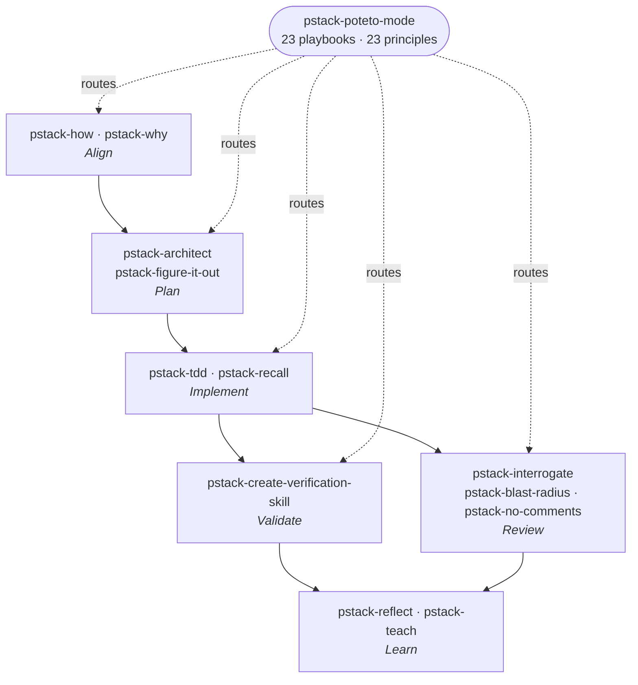

# pstack

**Workflow** — the primary skill per [SDLC stage](../sdlc-stage/index.md) this framework runs. Note how much of it is off-spine: pstack ships no specify stage at all, and its planning capability is an escape hatch rather than a step.

**pstack** is Lauren Tan's (poteto — React core team, previously Meta and Netflix, currently Cursor) MIT-licensed **Cursor plugin**: 25 skills, 23 principle skills, 2 subagents, 23 playbooks, and a dormant automation pack. Its thesis is stated against the grain of the whole category:

> "there's a growing sense that ai writes too much slop code. i agree. i don't want to ship like a team of twenty slop artists. **throughput without quality is not a goal i aspire to. if you want to go fast, go deep first.** […] the goal is not to maximize loc, in fact it's the opposite. pstack helps you write less, but higher quality code."

The argument connecting depth to speed is the framework's actual claim: **"pstack gives you fearless parallelism. when you can go deep on one agent and trust it to write good, verifiable code, you can truly parallelize with confidence."** Rigor is not a tax on throughput here, it is the precondition for it — you can only run many agents at once if you trust each one's output without reading it.

Two steps constitute the entire getting-started instruction: run [[pstack-setup-pstack]] to pick models per role, then use [[pstack-poteto-mode]] whenever the work needs rigor. Everything else is situational and the mode routes to it.

- **Root router:** [[pstack-poteto-mode]] — a **sticky mode** that matches the task to one of 23 playbooks, copies its steps into a todo list verbatim, and routes to the other skills as the steps fire.
- **Its subagent twin:** [[pstack-poteto-agent]] — the same wrapper as a delegate, because a generic subagent starts without the mode loaded and drifts.
- **Install:** `/add-plugin pstack`. It is one of the plugins in Cursor's own `cursor/plugins` marketplace repository.

## Distinctive contributions to the ontology

- **The first framework here that is not Cursor-portable but Cursor-*native*.** Every other framework in this wiki is documented as running across many harnesses — [[superpowers]] on six, [[gstack]] on ten, [[speckit]] on thirty. pstack is a **Cursor plugin** and is built on Cursor-specific machinery throughout: plugin-manifest skill and agent roots, `mode: true` sticky skills with a re-injected `reminder` field, `paths:`-attached skills, `~/.cursor/rules/*.mdc` always-applied rules, `Task` subagents with per-call `model` / `readonly` / `environment: cloud` / `cloud_base_branch`, webhook routines, and `~/.cursor/projects/*/agent-transcripts/` as a mineable corpus. **The `runs_on:` edge is deliberately empty** because Cursor has no `harness` page yet — see [Harness gap](#harness-gap-cursor) below.
- **Principles as a first-class, citable layer.** 23 one-rule skills, indexed inline by the mode skill and grouped Core / Architecture / Verification / Delegation / Meta. The index is read at task start; a leaf is read in full only when its principle is applied. The non-negotiable that makes the layer real: **name each principle that shaped a decision and the specific choice it changed, and cite only principles whose leaf you read this session.** No other framework here carries an explicitly-cited rule set of this size — the nearest relative is [[speckit]]'s [[pattern-project-constitution]], which is one document rather than a navigable, individually-loadable corpus.
- **Model diversity in place of persona diversity.** [[pstack-interrogate]] says it outright: *"the adversarial signal comes from model diversity, not assigned personas."* Every reviewer gets the identical prompt and rubric and differs only in which model runs it. That is a direct rejection of the [[pattern-parallel-persona-review]] approach [[gstack]], [[bmad]], and [[addy-agent-skills]] take, and it makes pstack the wiki's purest [[pattern-cross-model-review]] instance. **The framework is multi-model by construction**, not as an option: [[pstack-setup-pstack]] exists solely to map roles to models, and [[pstack-how]], [[pstack-arena]], [[pstack-architect]], [[pstack-reflect]], and [[pstack-swarm]] each split work across model strengths.
- **It refuses to plan, and says why.** *"why are there no planning skills? cursor already has a great plan mode which works great with pstack. but personally, i don't believe in planning. **the best spec is code.**"* There is no specify stage here at all and no spec artifact — the sharpest possible contrast with the spec-driven pole ([[speckit]], [[openspec]], [[nano-spec]], [[agent-os]]). What planning exists is [[pstack-figure-it-out]], reached only when **no** playbook fits, and [[pstack-architect]], which plans in *code shapes* (types, signatures, `not implemented` bodies) rather than in prose. This is the wiki's clearest instance of a framework putting its rigor entirely downstream of specification.
- **A new pattern: [[pattern-candidate-grafting]].** [[pstack-arena]] fans out N attempts at the same artifact, picks a base, and then **harvests the losers** for the one or two ideas worth porting in. Everyone else's competing-candidates step discards the non-winners ([[gstack-design-shotgun]], [[mp-prototype]]); treating them as a parts bin is new here.
- **A new pattern: [[pattern-tooling-leverage]].** *"Build the tool that does it or proves it… **the tool is the artifact a reviewer can rerun**."* The second clause is the contribution: the lever exists so a reviewer can re-derive the result, which is what makes it evidence rather than efficiency.
- **A new pattern: [[pattern-idempotent-operations]].** Long-horizon agent work is interrupted constantly, so re-enterable steps are the precondition for [[pattern-autonomous-loop]] and [[pattern-session-handoff]] rather than an implementation nicety.
- **A new artifact: [[artifact-decision-log]].** Every other durable artifact here is read by the *next agent* or by *future work*. [[pstack-show-me-your-work]]'s append-only TSV is read by **a human who was not watching**, so they can find the point where trust should stop.
- **Suspension paged as its own procedure.** The mode skill carries a *Pause safely* playbook as the explicit complement of *Session pickup* — suspending in-flight work cleanly on an explicit pause, going offline, a restart, or imminent context compaction. Other frameworks page resumption ([[gstack-context-restore]], [[pstack-recall]]); pstack is the first to page the shutdown half.

## Signature mechanisms

- **The sticky mode.** [[pstack-poteto-mode]] is `mode: true` with a `reminder` the harness re-injects every turn, so once entered it persists across turns and applies itself when a playbook matches or the task needs rigor. Every *other* skill in the plugin carries `disable-model-invocation: true`. The result is an inversion of [[superpowers]]' design, which makes every leaf auto-trigger — pstack makes the **router** persistent and every leaf explicitly manual, so there is exactly one thing deciding what fires.
- **Playbooks copied in verbatim.** 23 playbook files, and the matched one's steps are copied into a todo list *verbatim* before any task-specific todos, with a skipped step staying in the list carrying a one-line `skip: <reason>`. Step text stays out of the router's context until needed, and skipping leaves a trace.
- **The evidence ladder.** [[pstack-blast-radius]] grades every safety claim from *"you said so"* (worthless) through *pointed at the line*, *showed the bad case cannot happen*, *ran it*, up to *reproduced it in the running app* — and requires the writeup to **say where it stopped**, marking anything below rung 4 as **unproven**. The most operational form of [[pattern-evidence-before-claims]] in the wiki.
- **The organizational-evidence sweep.** [[pstack-why]] discovers available MCP servers at run time and fans out one investigator per evidence category across source control, the issue tracker, long-form docs, team chat, infrastructure observability, error tracking, and the analytics warehouse, with shipped per-source playbooks and a rule that **a null result is a finding**. [[pstack-recall]] reuses the same machinery re-pointed at *current state*. No other framework here treats the organizational record as a first-class research corpus.
- **Self-limiting rigor.** Several capabilities exist partly to say when *not* to apply themselves. [[pstack-tdd]] opens by listing when to skip the test and defines what a bad test is (*"prefer no new test over a bad test"*). [[pstack-how]] says *"when in doubt, take the simple path."* [[pstack-figure-it-out]] scales the evidence burden to blast radius. [[pstack-reflect]] skips trivial conversations because *"one-offs are not learnings."* This is [[pattern-scale-adaptive-planning]] applied to rigor rather than to ceremony.
- **The comment-as-bug-report loop.** [[pstack-comment-sicko]] flags a comment on our own code as `MUST KILL` on the guilty *symbol*, and [[pstack-no-comments]] then implements the rename, extract, type, or reshape that makes the behavior obvious without prose — or, for a genuine constraint, **offers the cheapest type, runtime, test, or CI encoding and deletes the comment once it lands**. [[pstack-principle-encode-lessons-in-structure|Encoding lessons in structure]] run at the granularity of one line.
- **Structural enforcement as a growth gate.** [[pstack-reflect]] re-reads its own synthesizer's Accepted list and **demotes to Backlog any learning better served by a lint rule, script, metadata flag, or runtime check**. The framework has a built-in brake on accreting prose, which is the failure mode most skill libraries drift into.
- **A dormant automation pack.** **benny** ships inert inside the plugin — not registered as slash skills — and is installed per repository ([[pstack-benny-setup]]). It triages Slack issue reports ([[pstack-benny-triage]]) and reproduces confirmed bugs through the real UI before opening a **bounded draft PR** ([[pstack-benny-reproduce-and-fix]]). Both fail closed on incomplete configuration. It is the wiki's first example of capabilities triggered by an **external report rather than a developer's prompt**, and it is deliberately high-autonomy and low-authority.

## Capabilities by stage

### Align — understand before acting ([[stage-align]])
- [[pstack-how]] — how does X work; scale-adaptive parallel explorers then one synthesizing explainer.
- [[pstack-why]] — why it is shaped this way; run-time MCP discovery, seven evidence categories in parallel, an explicit epistemics contract.
- [[pstack-benny-triage]] — unattended Slack issue-report triage with cause-aware routing and fail-closed ticketing (intake flavor).

### Plan — settle the shape ([[stage-plan]])
- [[pstack-architect]] — types, signatures, and module boundaries before code; arena-driven sketch, design red-flag screen, and an explicit scrap phase.
- [[pstack-figure-it-out]] — design a bespoke auditable playbook when none fits; falsifiable done predicate, rigor biased high, harness before work.

### Implement — write it ([[stage-implement]])
- [[pstack-tdd]] — failing test first where the path is cheap, with an explicit doctrine for when to skip.
- [[pstack-recall]] — rebuild working context from your own chats *and* the shared organizational record before resuming.
- [[pstack-typescript-best-practices]] — the only `paths:`-attached skill; grounds type-system discipline in syntax.
- [[pstack-benny-reproduce-and-fix]] — unattended repro through the real UI, then a bounded draft PR after before-and-after proof.

### Review — judge it ([[stage-review]])
- [[pstack-interrogate]] — one reviewer per model, same prompt and rubric; diversity from models, not personas.
- [[pstack-blast-radius]] — what this breaks elsewhere; find the one fact it is safe because of and prove it by running code.
- [[pstack-no-comments]] — act on Comment Sicko's findings; root-cause fixes in scope, encodings for claimed constraints.
- [[pstack-comment-sicko]] — the read-only comment reviewer (sub-agent).

### Validate — prove it works ([[stage-validate]])
- [[pstack-create-verification-skill]] — generate a project-local harness that drives the real app, any language or platform.
- [[pstack-maintain-verification-skill]] — the upkeep loop; source wave plus one live pass, at most one PR of proven corrections.

### Learn — fold it back ([[stage-learn]])
- [[pstack-reflect]] — three parallel review lenses over the transcript, routed to concrete skill edits, gated by a structural-enforcement check.
- [[pstack-automate-me]] — mine your transcripts into your own `-mode` skill; the framework's offer to be replaced as the entry point.
- [[pstack-teach]] — explain a subsystem so a person understands it; diagram by diagram, no pedagogy theater.

### Cross-cutting — parallelism, prose, and setup (no single lifecycle stage)
- [[pstack-poteto-mode]] — the sticky router; 23 playbooks and the inline principles index.
- [[pstack-poteto-agent]] — the style-preserving subagent for any delegate inside a playbook step.
- [[pstack-arena]] — N attempts at one artifact, pick a base, graft the losers.
- [[pstack-swarm]] — N parallel cloud workers across slices or races, one aggregated report.
- [[pstack-show-me-your-work]] — the append-only decision trail for unattended work.
- [[pstack-unslop]] — cut AI tells; must always apply, with stable rule ids sibling skills cite.
- [[pstack-technical-writing]] — Diátaxis + Google developer style + STE + Global English, layered.
- [[pstack-bro]] — restate the last message in plain human language.
- [[pstack-setup-pstack]] — map each role to a model; writes an always-applied rule, idempotently.
- [[pstack-make-bot-ui]] — a page whose buttons wake a bot over a webhook, with the sender key kept server-side.
- [[pstack-benny-setup]] — install and configure the dormant benny automation pack into a repository.

### The 23 principles
Each is a loadable one-rule skill. [[pstack-poteto-mode]] indexes them inline and reads the index at task start; a leaf is read in full only when applied.

**Core**
- [[pstack-principle-laziness-protocol]] — bias to deletion and the smallest change that solves the problem.
- [[pstack-principle-foundational-thinking]] — get the data structures right so downstream code becomes obvious.
- [[pstack-principle-redesign-from-first-principles]] — redesign as if the requirement had been foundational, not bolted on.
- [[pstack-principle-attack-the-premise]] — when two fixes sharing a premise fail the same gate, question the premise.
- [[pstack-principle-subtract-before-you-add]] — remove dead weight first, then build on the simpler base.
- [[pstack-principle-minimize-reader-load]] — count layers and hidden state; collapse one-caller wrappers.
- [[pstack-principle-outcome-oriented-execution]] — converge on the target architecture, no throwaway compatibility states.
- [[pstack-principle-experience-first]] — user delight over implementation convenience; fewer polished features.
- [[pstack-principle-exhaust-the-design-space]] — 2-3 competing prototypes compared side by side before committing.
- [[pstack-principle-build-the-lever]] — build the tool that does or proves it; the tool is what a reviewer reruns.

**Architecture**
- [[pstack-principle-model-the-domain]] — encode the domain in a structure, not scattered conditionals.
- [[pstack-principle-boundary-discipline]] — guards at system boundaries, pure business logic inside.
- [[pstack-principle-type-system-discipline]] — make illegal states unrepresentable; parse at boundaries.
- [[pstack-principle-make-operations-idempotent]] — converge to the same end state regardless of partial prior runs.
- [[pstack-principle-migrate-callers-then-delete-legacy-apis]] — migrate and delete in one wave.
- [[pstack-principle-separate-before-serializing-shared-state]] — eliminate the sharing before serializing it.

**Verification**
- [[pstack-principle-prove-it-works]] — verify against the real artifact, not a proxy or "it compiles".
- [[pstack-principle-fix-root-causes]] — trace each symptom to its root cause and fix it there.
- [[pstack-principle-sequence-verifiable-units]] — units that each end in a check, ordered so the sequence proves itself.
- [[pstack-principle-test-behavior-not-implementation]] — if it passes when every import returns `undefined`, rewrite or delete it.

**Delegation**
- [[pstack-principle-guard-the-context-window]] — route bulk to subagents, keep summaries in the main thread.
- [[pstack-principle-never-block-on-the-human]] — proceed on reversible work; pause only for irreversible writes.

**Meta**
- [[pstack-principle-encode-lessons-in-structure]] — encode the rule as a lint, flag, check, or script instead of more text.

## Harness gap: Cursor

pstack runs on **Cursor**, and only on Cursor. There is no `wiki/harness/cursor.md` yet, so per the [support-scope rule](../CONVENTIONS.md#the-harness-layer) the `runs_on:` edge is left empty rather than pointed at a non-existent target, and the support is recorded here in prose. This is the first framework in the wiki with an empty `runs_on:`, and the gap is tracked in [log.md](../log.md).

The source is unusually rich harness evidence should Cursor be ingested later: plugin manifests with `skills:` and `agents:` roots, `SKILL.md` frontmatter (`disable-model-invocation`, `mode: true` with `reminder`/`icon`/`color`, `paths:` auto-attach), `.mdc` rules with `alwaysApply`, the `Task` subagent surface (`subagent_type`, per-call `model`, `readonly`, `run_in_background`, `environment: cloud | local`, `cloud_base_branch`), MCP discovery, webhook routines, plan mode, `/loop`, the `cursor/plugins` marketplace, and transcripts on disk at `~/.cursor/projects/<slug>/agent-transcripts/`. Two further Cursor-shipped plugins are referenced but not bundled: `cursor-team-kit` (which ships `/deslop`, `control-cli`, and `control-ui`) and Cursor's built-ins `/create-skill` and `/babysit`.

## Artifacts produced
- [[artifact-decision-log]] — **new** — the append-only TSV decision trail ([[pstack-show-me-your-work]], [[pstack-figure-it-out]]).
- [[artifact-review-report]] — review findings ([[pstack-interrogate]], [[pstack-blast-radius]], [[pstack-no-comments]], [[pstack-comment-sicko]]).
- [[artifact-skill-doc]] — generated and edited skills ([[pstack-create-verification-skill]], [[pstack-automate-me]], [[pstack-reflect]]).
- [[artifact-explainer]] — the understanding output ([[pstack-how]], [[pstack-why]], [[pstack-teach]]).
- [[artifact-architecture]] · [[artifact-adr]] — the synthesized design package and its rationale ([[pstack-architect]]).
- [[artifact-pull-request]] — the bounded draft PR ([[pstack-benny-reproduce-and-fix]]) and the maintenance PR ([[pstack-maintain-verification-skill]]).
- [[artifact-issue]] — the deduplicated tracker item ([[pstack-benny-triage]]).
- [[artifact-diataxis-docs]] · [[artifact-standards]] — the layered writing standard and the model-role rule ([[pstack-technical-writing]], [[pstack-typescript-best-practices]], [[pstack-setup-pstack]]).
- [[artifact-handoff-doc]] — the current-state brief ([[pstack-recall]]).
- [[artifact-plan-md]] — the designed phase list ([[pstack-figure-it-out]]). Notably **no spec artifact at all**.

## Patterns applied
- [[pattern-cross-model-review]] — **signature** — model diversity as the review mechanism, and multi-model routing throughout ([[pstack-interrogate]], [[pstack-arena]], [[pstack-architect]], [[pstack-reflect]], [[pstack-setup-pstack]]).
- [[pattern-candidate-grafting]] — **new, signature** — bakeoff then harvest the losers ([[pstack-arena]], [[pstack-architect]]).
- [[pattern-tooling-leverage]] — **new, signature** — build the lever a reviewer can rerun ([[pstack-principle-build-the-lever]], [[pstack-create-verification-skill]], [[pstack-blast-radius]]).
- [[pattern-idempotent-operations]] — **new** — converge regardless of partial prior runs ([[pstack-principle-make-operations-idempotent]], [[pstack-setup-pstack]], [[pstack-benny-setup]]).
- [[pattern-evidence-before-claims]] — **co-signature** — the five-rung evidence ladder and the VERIFIED / NOT VERIFIED / **INCONCLUSIVE** verdict where *inconclusive is not a pass* ([[pstack-blast-radius]], [[pstack-figure-it-out]], [[pstack-principle-prove-it-works]]).
- [[pattern-context-engineering]] — bulk stays in subagents, only findings reach the parent; *do not paste raw worker dumps* ([[pstack-how]], [[pstack-recall]], [[pstack-swarm]]).
- [[pattern-fresh-context-subagents]] — with a twist: the style-preserving [[pstack-poteto-agent]] exists precisely because a *generic* fresh subagent drifts.
- [[pattern-wave-parallelism]] — fan-outs everywhere ([[pstack-swarm]], [[pstack-arena]], [[pstack-how]], [[pstack-reflect]], [[pstack-maintain-verification-skill]]).
- [[pattern-worktree-isolation]] — every fan-out gives each worker its own worktree or output path ([[pstack-principle-separate-before-serializing-shared-state]]).
- [[pattern-scale-adaptive-planning]] — rigor, not ceremony, sized to blast radius ([[pstack-figure-it-out]], [[pstack-how]], [[pstack-poteto-mode]]).
- [[pattern-deep-modules]] — the Ousterhout red-flag screen: shallow modules, information leakage, temporal decomposition, pass-through methods ([[pstack-architect]]).
- [[pattern-contract-first]] — the data shape named before any code; parse at the boundary ([[pstack-principle-model-the-domain]], [[pstack-typescript-best-practices]]).
- [[pattern-source-grounding]] — pointed at the **organizational** record rather than the public one ([[pstack-why]], [[pstack-recall]]).
- [[pattern-knowledge-compounding]] — transcripts mined into skill edits and personal mode skills ([[pstack-reflect]], [[pstack-automate-me]]).
- [[pattern-adversarial-review]] — *"tear this apart"* ([[pstack-interrogate]], [[pstack-comment-sicko]]).
- [[pattern-autonomous-loop]] — the Autonomous run, Orchestrate, and both Autopilot playbooks; benny's unattended fix loop.
- [[pattern-session-handoff]] — Session pickup **and** Pause safely, plus [[pstack-recall]]'s two-record reconstruction.
- [[pattern-systematic-debugging]] — root cause before fix, escalating to [[pstack-principle-attack-the-premise]] when fixes sharing a premise keep failing.
- [[pattern-test-driven-development]] — present but deliberately conditional ([[pstack-tdd]]).
- [[pattern-deterministic-gates]] — the structural-enforcement check, the `PASS`/`ISSUES`/`BLOCKED` worker contract, the clean/changed/blocked outcome declaration.
- [[pattern-persona-agents]] — used in exactly one place, and the framework argues against it everywhere else ([[pstack-comment-sicko]]).
- [[pattern-throwaway-prototype]] — the Prototype playbook, and prototyping as the answer to a question the human should not be asked.

## See Also
- [[superpowers]] — the closest structural cousin and the sharpest contrast. Both are small-library, high-discipline, anti-slop frameworks built on gated rigor rather than on personas. Superpowers makes **every leaf auto-trigger** and the router a bootstrap; pstack makes the **router sticky** and every leaf manual. Superpowers is unusually cross-harness, pstack is single-harness. [[sp-systematic-debugging]] ↔ [[pstack-principle-fix-root-causes]]; [[sp-verification-before-completion]] ↔ [[pstack-principle-prove-it-works]]; [[sp-writing-skills]] ↔ [[pstack-reflect]].
- [[gstack]] — the persona-driven maximalist pole. Both ship a router, cross-model review, and knowledge compounding, but pstack **rejects the persona mechanism by name** and has no deploy arc at all. [[gstack-codex]] ↔ [[pstack-interrogate]]; [[gstack-skillify]] ↔ [[pstack-reflect]]; [[gstack-context-restore]] ↔ [[pstack-recall]]; [[gstack-browse]] ↔ [[pstack-create-verification-skill]] (shipped eyes vs generated harness).
- [[matt-pocock-skills]] — the other framework that deliberately refuses to own the process. Shared design vocabulary: [[mp-codebase-design]] ↔ [[pstack-architect]] (both Ousterhout deep modules), [[mp-tdd]] ↔ [[pstack-tdd]], [[mp-wayfinder]] ↔ [[pstack-figure-it-out]], [[mp-prototype]] ↔ [[pstack-arena]].
- [[compound-engineering]] — the loop-closing counterpart; [[ce-compound]] ↔ [[pstack-reflect]], [[ce-explain]] ↔ [[pstack-teach]], [[ce-code-review]] ↔ [[pstack-interrogate]] (persona panel vs model panel), [[ce-dogfood]] ↔ [[pstack-benny-reproduce-and-fix]].
- [[speckit]] · [[openspec]] · [[nano-spec]] · [[agent-os]] — the spec-driven pole pstack defines itself against. *"the best spec is code."* Where they front-load a written contract, pstack front-loads a **code sketch** ([[pstack-architect]]) and puts all its rigor into verification and review.
- [[stage-align]] · [[stage-plan]] · [[stage-implement]] · [[stage-review]] · [[stage-validate]] · [[stage-learn]] — the six canonical stages this framework's capabilities feed. It touches **no [[stage-specify]]** (by stated principle) and **no [[stage-release]]** beyond opening a PR.

- [[builder-skills]] — the other framework with a report-triggered, low-authority automation surface. benny is a dormant two-skill pack; builder-skills' Factory is a nine-skill suite with ten separately gated actions ([[pattern-action-gating]]). [[pstack-benny-triage]] ↔ [[builder-factory-collect]]; [[pstack-principle-never-block-on-the-human]] ↔ [[builder-plow-ahead]]; [[pstack-setup-pstack]] and [[builder-efficient-frontier]] both anchor [[pattern-model-tiering]].
