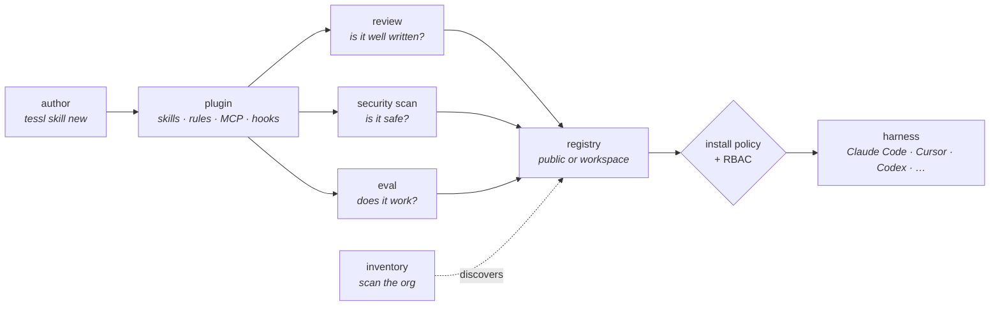

# Tessl

**Tessl** is *"an open platform for managing agentic development across your organization"* — the wiki's anchor instance of the [supply layer](index.md). Its premise is a single sentence, and the whole product follows from it:

> **Context as code.** Skills, rules, and docs are versioned, reviewed, and rolled out with the same rigor as code dependencies.

Founded in London in 2024 by **Guy Podjarny** (previously founder of Snyk), funded to $125M, advertising 3,000+ skills in its public registry. The company's own history is part of why it matters here: in 2025 it **paused its Framework product and removed Framework functionality from the rebuilt CLI to concentrate on the registry and agent integrations**. A company that set out to build a [framework](../catalogue.md#framework) and became a registry instead is direct evidence for this layer existing.

## The six components

| Component | What it is |
|---|---|
| **Registry & package manager** | Discover, install, version, and roll back skills and plugins like any other dependency. One searchable index of public and private context, agent-agnostic. |
| **Governance** | Scan and score every skill against best practices and your own standards, with Snyk security scoring built in. RBAC over who can create, publish, and view; install and publish policies and required skills enforce standards across every workspace; full audit trail. |
| **Evals** | Measure a skill's actual impact by running your agent on real tasks **with and without** the context. *"Every change ships with evidence instead of a guess."* |
| **Observability** | See where skills actually **activate** across agent sessions, not just where they are installed. Mine agent logs for recurring mistakes. |
| **Inventory** | Scan a GitHub org and map every skill across every repo in one living view. Surface duplicates and unmanaged copies — *"govern what you can see."* |
| **Tessl Agent** | A conversational agent that drives the platform and autonomously monitors and improves the setup. Runs alongside your existing agents (open beta). |

## Distinctive contributions to the ontology

- **It reproduces this wiki's [[stage-review]] ∥ [[stage-validate]] split, independently, for the skill corpus.** Tessl ships two quality instruments and is careful to distinguish them: a **review** checks a single skill against best practices (fast, cheap, automatic on publish, scored across validation / description / content) and a **scenario eval** runs an agent on real tasks with and without the context and compares the results. Its own summary is *"a review tells you whether a skill is **well written**; an eval tells you whether it **works**"* — which is the wiki's *is it good?* ∥ *does it work?* partition, arrived at from the supply side by a company that has never read this wiki. The strongest convergence evidence the layer produces.
- **It closes an instrument the wiki had recorded as missing.** [[topic-ai-native-sdlc]] flagged continuous evals of the *agent's own configuration* as *"the one instrument nobody else ships"* — 20–50 real tasks re-run on any change to skills or hooks, with the pass rate enforced at merge. Tessl ships exactly that as [[tessl-eval]] plus [[tessl-scenario]], generating the scenarios, saving them **with the skill** as a regression suite, and gating CI on the score. The claim was not wrong — no *framework* ships it. It turns out to live in a different layer, which is the finding.
- **It makes the `capability` the unit of trade.** A framework here is a bundle of capabilities; Tessl's unit is the **plugin** — a versioned bundle of skills, rules, MCP servers, and hooks, installed, versioned and updated as one, *"much like a package in npm or pip"* → [[artifact-capability-bundle]]. That is the framework bundle coming apart into independently versioned parts, and it is the trend this layer exists to track.
- **A new threat surface: the capability supply chain.** [[pattern-supply-chain-scanning]] — scanning an installed skill for prompt injection buried in instructions, hardcoded secrets, suspicious download URLs, unverifiable external dependencies, and hidden or obfuscated text. Every guardrail pattern in the wiki so far bounds what the agent may **write** ([[pattern-edit-guardrails]]) or reach ([[gh-aw]]'s egress firewall). This one bounds what it may **read**, and it is the first time the wiki has paged instructions-as-attack-surface.
- **A new measurement: [[pattern-capability-evals]].** Prove a capability changes behavior by A/B-ing the agent with and without it, against generated scenarios each pairing a task with a weighted rubric. *"That difference is the skill's value: proof it changes what the agent does, not just that it reads well."*

## Signature mechanisms

- **Two kinds of context, loaded differently.** **Rules** apply *always* (team standards on every task); **skills** load *when relevant* (procedural workflows matched by description). A context-budget model stated as product architecture rather than as advice — [[pattern-context-engineering]] moved into the supply layer.
- **The plugin carries more than context.** Alongside skills and rules a plugin can ship **MCP servers** (live tools) and **hooks** that run deterministic commands on `PreToolUse`, `PostToolUse`, `UserPromptSubmit`, `SessionStart`, and `Stop`. So a registry install can extend the *harness*, not just the prompt — the supply layer reaching down into harness primitives.
- **Three nouns that are easy to confuse, kept apart.** A **plugin** is content and capability; a **workspace** is ownership (the team boundary that decides who may publish and see private plugins, and where the inventory lives); a **project** is location (the stable anchor tying Tessl to one repository so eval results stay attached to the right codebase as branches come and go).
- **Security warns, it does not block.** Findings are severity-graded and critical/high are surfaced at install, *"warning rather than blocking and leaving the decision to you."* A deliberate, recorded choice: policy blocks (that is what install policies are for), scanning informs. Contrast [[gh-aw]], whose threat verdict hard-blocks every safe-output job.
- **A forkable rubric.** The default review rubric scores general best practices; an organization **forks it** to encode its own bar and applies it to every review — *"much like static analysis for code."* Standards as a versioned artifact rather than a document ([[artifact-standards]]).
- **Inventory before governance.** *"Govern what you can see."* [[tessl-inventory]] scans GitHub, GitLab, or Bitbucket and indexes every skill and config it finds across every repo, surfacing duplicates and unmanaged copies. The layer's answer to the problem that a team's real skill estate is unknown before anyone tries to manage it.
- **Harness-agnostic by construction.** `tessl init` detects and auto-configures **Claude Code, Cursor, Codex, Gemini CLI, Antigravity, GitHub Copilot CLI, and GitHub Copilot for VS Code**; anything else that speaks MCP is configured manually, with shipped recipes for **OpenCode** and **OpenClaw**. The integration is an MCP server (`tessl mcp start`) plus written config, so the same skill works everywhere. *"Write context once; Tessl distributes it everywhere."*
- **Open, with an exit.** *"Tessl builds on open standards and writes your skills, rules, and config as plain artifacts in your repo, so you own your agent setup and can walk away with it at any time."* Worth recording because the lock-in question is the obvious objection to a commercial layer sitting upstream of everything else.

## Capabilities by function

### The package manager ([[artifact-capability-bundle]])
- [[tessl-install]] — install, uninstall, list, outdated, update; from the registry, a filesystem path, a GitHub repo, or a specific commit; per-repo or global.
- [[tessl-search]] — search the registry and install from the results.
- [[tessl-init]] — initialize a repo and **auto-configure every detected coding agent**; `tessl project` anchors results to the repository.

### Authoring and publishing
- [[tessl-skill]] — scaffold, import, lint, publish, and unpublish a single skill.
- [[tessl-plugin]] — create, lint, migrate, pack, inspect, publish, unpublish, and archive the versioned bundle.

### Quality, safety, and measurement
- [[tessl-review]] — score a skill's structure, description, and content against a rubric; *is it well written?*
- [[tessl-review-security]] — the Snyk-powered scan for prompt injection, secrets, suspicious URLs, and hidden text ([[pattern-supply-chain-scanning]]).
- [[tessl-review-fix]] — iteratively improve a skill until it clears a score threshold.
- [[tessl-scenario]] — generate the task scenarios an eval grades against, server-side feasibility-checked → [[artifact-eval-suite]].
- [[tessl-eval]] — run the agent with and without the context and score the difference; *does it work?* ([[pattern-capability-evals]]).

### Governance and estate
- [[tessl-workspace]] — workspaces, organizations, roles, members, and API keys: the ownership and RBAC boundary.
- [[tessl-inventory]] — scan a source-control org and index every skill and config across every repo.
- [[tessl-environment]] — named environments carrying secrets and MCP-server wiring into a run.

### Lifecycle capabilities (the sideways growth)
- [[tessl-code-review]] — agentic PR review with configurable **lenses**, as a GitHub App or a CLI ([[stage-review]]).
- [[tessl-change-risk]] — assess a diff's risk and exit non-zero when human review is required ([[stage-review]]).
- [[tessl-change-verify]] — run configured LLM-judge **verifiers** over changed files with caching, sampling, and CI annotations ([[stage-review]]).

### Execution surface (runtime-adjacent — see the boundary note below)
- [[tessl-launch]] — launch a coding agent, or run an installed skill locally or **in the cloud** against a repo.
- [[tessl-schedule]] — schedules that run a plugin against a repo on a cron, declared in the repo's `tessl.json` and synced from the default branch, or created from the CLI or web app.
- [[tessl-agent]] — the conversational platform agent, with its own MCP server management.
- [[tessl-mcp]] — `mcp start` (the integration every harness connects to) and `mcp proxy` (a workspace MCP gateway).

## The factory thesis: context-driven factories

Tessl's account of what a software factory should be is a post by its head of product, Dru Knox, *"Context-Driven Factories"* (2026-09-15). It is a design argument more than a product page, and it takes a side in the question the [execution layer](../runtime/index.md) is organised around: where the control plane lives.

> Our answer is context-driven factories, a method centered on defining your team's workflows and standards in plain files that run on simple, transparent infra.

**Two principles.**

- **Workflow definition lives in context, not code.** *"The agent reads a description of the job and what good looks like, has the tools it needs, and decides what to do next. Code is still present, as scripts, CLIs, and MCP tools the agent can call, but it does not sit in the outer loop deciding how the agent progresses through the task or what it is allowed to see."* In the ticket-to-PR example *"there is no extra logic or magic routing"*: an agent starts with a `triage-issue` skill that names the sibling skills to move to next, and a `pr-shepherd` plugin takes over once a PR exists (*"resolve CI, address review, merge when the criteria are met"*).
- **Every workflow and standard lives in a plugin.** *"Those plugins are checked into your repos and shared between projects with a context registry. Read a plugin and you know how the factory works. Change a plugin and you have changed the factory."* Standards owned by other teams (a design system, brand guidelines, a "company brain") are registry **dependencies** pinned by semver range in `tessl.json`, not copies in the repo.

**The shape on disk** (from the post's diagrams): a `factory/` directory of plugins (`issue-handling/`, `pr-shepherd/`, `code-review/`, `automations/…`), each a `skills/` folder plus `scripts/`, `hooks/`, and `mcp.json`; and a `tessl.json` holding `dependencies`, `schedules`, and `triggers` that bind an event (`linear:issue.delegated`, `github:pull_request.opened`, `github:pull_request.ready_for_review`) or a cron to an entry skill. Below it sits infrastructure the post calls *"invisible, because it carries no logic"*: sandboxes, secrets, webhooks, a scheduler.

**The adoption path** is a slogan: *"from skills, to loops, to factory."* A **skill** is a written-down workflow run by hand until the team trusts it; a **loop** is *"a skill you have deployed to run automatically, one that improves over time as it runs"*; a **factory** *"composes skills and loops into a full agentic SDLC."* *"Automation is the payoff at the end of the effort, not the starting point."*

**Three claimed failure modes of the alternative**, each an argument against a code-owned control plane:

- *"Workflows defined in code are brittle and cannot improve as stronger models ship."* A ticket-to-PR pipeline *"quickly becomes a mess of exceptions and special cases"* (multi-repo features, stacked PRs, a copy fix that deserves lighter review), and *"guardrails that were prudent for one model generation become an invisible straitjacket for the next."*
- *"Knowledge is siloed and improvements in one workflow don't benefit others."* Tools with private memory improve themselves, not the work: *"A review tool that has learned your preferences reviews better, but your PRs do not arrive any cleaner."* Because review, generation, and maintenance read the same plugin files, *"review improved generation without anyone wiring the two together, because they were reading the same file all along."*
- *"Tooling comes before process design, so the team never buys in."* Decisions end up *"trapped in configuration screens, or hidden in glue code only half the team understands."*

**What the docs back, and what they do not yet.** The repo-defined `schedules` and `actions` blocks are documented ([[tessl-schedule]]): declare a schedule in `tessl.json`, validate it with `tessl schedule validate`, push to the default branch, and Tessl applies the block as a whole or not at all. The `triggers` block shown in the post (Linear and GitHub events starting a skill) and the `dependencies` block for registry-owned standards appear in the post's diagrams only; neither had a docs page in the index on 2026-10-24. Treat event triggers as announced, not documented.

**Where it sits against the rest of the wiki.** The thesis is the 🧩 **skill-pack pole** of [[topic-software-factory]], stated by a vendor that also sells the hosting for it: control plane in the prompt, workflow as plugins, infrastructure deliberately empty of policy. It is the direct opposite of [[sssf]]'s *"moving the control plane out of the prompt and into Python"* and [[bernstein]]'s zero-LLM scheduler (see the disagreement note on [[sssf]]). It is closer to [[warp-factories]], which also keeps path choice in a prompt and the factory in reviewed files, but differs on authority: Warp Factories puts access in platform configuration and a foreman agent in front of the role agents, where the post wants *"no extra logic or magic routing"* and would let a `pr-shepherd` skill *"merge when the criteria are met."* Its compounding claim (one standards file read by review, generation, and maintenance) is a sharper statement of [[pattern-knowledge-compounding]] than most framework pages make: the lesson compounds because there is only one place for it to live.

## The layer boundary, honestly

Tessl is not *only* a registry, and the wiki should say so rather than tidy it away. [[tessl-launch]] spawns harnesses including cloud runs, and [[tessl-schedule]] puts them on a cron — which is, by the [execution layer](../runtime/index.md)'s own definition, runtime behavior. Tessl's own tagline points straight at it: *"It takes you from scaling skills to **building your software factory**"* (see [[topic-software-factory]]).

It is filed as a `registry` under the [harness/runtime boundary rule](../CONVENTIONS.md#the-harness-layer) applied one layer over: **page the product's center of gravity, record the second act as prose.** The centre of gravity is unambiguous — the docs, the CLI's bulk, the funding thesis, and the pivot away from Framework all point at governing the supply of capabilities. The launch and schedule surface exists so that a *registry plugin* can be run, which serves the registry rather than replacing it.

**This is a re-ingest trigger, not a settled fact.** If the execution surface grows past prose — a real scheduler, fleet control, steering — Tessl becomes a genuine two-layer product and this page needs splitting. The same watch applies to the whole layer: a supply platform that can also run what it distributes is one product decision away from being a factory.

**Re-checked 2026-10-24, against the context-driven factories post and the Automations docs: still a `registry`.** The execution surface is larger than the original call assumed: schedules are repo-defined and synced from `tessl.json`, and the post shows event triggers and names sandboxes, secrets, webhooks, and a scheduler as the infrastructure. But the test that separates a runtime is *a runtime owns coordination policy*, and the post's whole argument is that the infrastructure should own none (*"the infrastructure that remains… is invisible, because it carries no logic"*). There is still no fan-out, queue, or mid-run steering, and a schedule skips a tick rather than queueing it when the previous run is still active. So the call holds on Tessl's own stated design, not just on missing features. **Next trigger:** if documented event triggers ship with any routing, retry, or concurrency policy of their own, re-check again, and page the execution surface as a `runtime` if they do.

## Artifacts produced
- [[artifact-capability-bundle]] — **new** — the versioned plugin: skills, rules, MCP servers, and hooks installed and updated as one unit.
- [[artifact-eval-suite]] — **new** — the `evals/` directory of scenarios, each a task plus a weighted rubric, saved with the skill as a regression suite.
- [[artifact-review-report]] — the review score across validation, description, and content, plus severity-graded security findings ([[tessl-review]], [[tessl-review-security]], [[tessl-code-review]]).
- [[artifact-standards]] — the forked review rubric encoding an organization's own quality bar.
- [[artifact-skill-doc]] — the `SKILL.md` itself, which this layer treats as the tradeable unit.

## See Also
- [Registry layer overview](index.md) — the layer this anchors, its boundary test, and the queue of unpaged instances.
- [[beads]] · [[seeds]] — the [state layer](../store/index.md), the nearest neighbour. A store holds what a run *produced*; a registry holds what a run is *provisioned from*. Both are durable, agent-facing, and off-stage; they sit on opposite sides of the run.
- [[claude-code]] · [[opencode]] — the paged harnesses it ships an integration for.
- [[topic-ai-native-sdlc]] — the governance frame Tessl implements commercially, including the config-evals instrument that page recorded as unshipped.
- [[topic-software-factory]] — where the product says it is heading; the context-driven thesis is its 🧩 skill-pack pole.
- [[warp-factories]] — the nearest runtime: also prompt-coordinated and defined in reviewed files, but with a foreman agent and authority held in configuration.
- [[sssf]] — the code-owned control plane the context-driven thesis argues against.
- [[bm-skills]] — a marketplace filed as a `framework` for want of anywhere better; see the layer page for why it stays there.
- [[std-agent-skills]] · [[std-mcp]] — the spec its skill review validates against, and the protocol its harness integration is built on.

## Version history

### Docs and blog as of 2026-10-24 (ingested 2026-10-24)
- Added the factory thesis from *"Context-Driven Factories"* (2026-09-15): workflows as plugins, control plane in context, *"skills, to loops, to factory."*
- Schedules are now declared in `tessl.json` (`schedules` and `actions` blocks), validated with `tessl schedule validate`, and synced from the default branch; CLI and web-app creation is the older path. Event `triggers` and registry `dependencies` in `tessl.json` appear in the post's diagrams but are not yet documented.
- New `enables:` edge to [[pattern-factory-as-code]].
- Layer boundary re-checked; still a registry.

### Initial ingest (2026-09-12)
- Documented at CLI v0.108.0: registry and package manager, governance, evals, observability, inventory, Tessl Agent; launch and schedule recorded as a runtime-adjacent surface.
