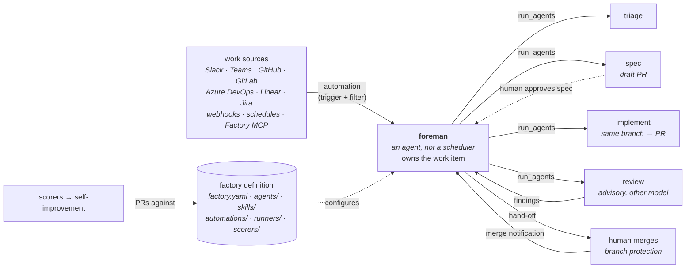

# warp-factories

**Execution layer** — a [runtime](index.md), not a process framework. It decides *where and how* an agent runs, not *what* it does; it therefore [implements](../sdlc-stage/index.md) no SDLC stage and connects to the ontology only through the [[#Patterns enabled|patterns]] it provides as substrate.



**Warp Factories** (Warp, proprietary, Early Access since 2026-08-27) is a hosted platform for running a **team of cloud agents** against a group of repositories: *"Warp Factories turns issues, tickets, and Slack messages into reviewed pull requests. Teams of cloud agents do the work, while people approve specs and merges."* Work arrives from the tools a team already uses, a **foreman** agent turns it into a **work item** and dispatches stage agents (triage, spec, implement, review), and the pull request comes back to the thread or issue where the request started. Everything that defines the factory — its repositories, agents and their prompts, skills, automations, runners, model routers, scorers, benchmarks, and webhooks — is a versioned file tree, the **factory definition**, and the factory's own evaluation loop can open pull requests against it. The launch post positions the product as **infrastructure rather than a product or an AI teammate**: *"We provide the infrastructure and control plane; you own and customize the rest."* Its home in the layer is the **agent-team pole**: the only member here whose coordinator is itself a prompted agent, and the one that goes furthest on measuring and improving its own configuration.

## Layer call, recorded rather than smoothed over

`type: runtime`, `subtype: platform`. It spawns loops — every agent run is a cloud agent run on Warp's Automation Platform, on a sandbox Warp provisions or a worker the team operates — and it owns intake, dispatch, identity, credentials, execution hosting, and the run record, so it passes the *a runtime spawns loops* test cleanly. It is not a framework, although it ships one: the five default agent prompts in [`00-warp-default-agents`](https://github.com/warpdotdev/warp-factory-examples/tree/main/examples/00-warp-default-agents) are a complete triage → spec → implement → review methodology. Those prompts are seeded configuration a team is expected to edit, not the product, so they are recorded here as prose rather than paged as a framework with `capability` pages. **Re-ingest trigger:** if Warp starts versioning and distributing the default agents as a methodology in their own right (separate from factory setup), page them as a `framework` with `runs_on:` → the Warp Agent harness.

Two things it is **not**: it is not the Warp terminal or the Warp Agent harness (the launch post says *"Warp Factories are decoupled from Warp's other products"*), and it is not [[factory-droid]], a different vendor's harness that happens to share the word.

## What it orchestrates (not what it builds)

- **Harnesses, per agent.** Each agent picks a harness and model: the **Warp Agent** (`type: oz`; Warp's own harness, multi-model including open-weight models and team-defined routers), **[[claude-code]]**, or **Codex** (`type: codex`). A foreman running under Claude Code or Codex can still dispatch other factory agents, whose runs are tracked as its children. Third-party harnesses need a paid plan and a harness auth secret. The Warp Agent and Codex have no harness page here, so they are recorded in prose; only Claude Code carries a `runs:` edge.
- **Work sources.** Slack, Microsoft Teams, GitHub, GitLab, Azure DevOps, Linear, and Jira (Linear and Jira are mutually exclusive), plus authenticated **custom webhooks** (token, URL-token, or provider signature: GitHub, PagerDuty, Sentry, Stripe, Vercel, Standard Webhooks), **factory endpoints** (`POST /factory/{uid}/runs`), schedules, direct chat, and the **Factory MCP**. Results go back to the source, and *"a reply in the same thread, issue, or pull request continues that work item instead of starting a new one, and repeated event deliveries don't create duplicates."*
- **Automations.** A trigger (provider + event) plus filters, routed to an agent (the foreman by default). Filters are AND across keys and OR within a list, and *"one event can match more than one automation, and each match starts its own run."* The docs draw a sharp line: *"Filters decide when work starts, not what an integration or running agent can access."*
- **Execution hosts.** Warp-hosted sandboxes by default, or **managed self-hosting** (Enterprise): an `oz-agent-worker` connects **outbound only** to Warp and runs tasks on a Docker, Kubernetes, Direct, or Command backend, or as one-shot Direct workers allocated by an external scheduler.

## The work-item lifecycle

The default flow, from the docs' own diagram: **intake → foreman → triage → (plan needed?) → planning → human spec review → building → reviewing → (revision needed?) → human handoff → complete**. Three properties make it more than a fixed pipeline:

- **The foreman picks the path.** *"The foreman picks the shortest path that still meets your quality policy: it skips stages when the work is already well defined, starts partway through when enough context exists, and sends work back to an earlier agent when revisions are needed."* The default prompt makes the entry point explicit: *"Work can enter this procedure at any stage, not only at the top"* — a new request, a PR to review, a CI failure, a merge notification, or the answer to an earlier question.
- **Subagents keep their context.** Follow-ups go to the agent that already holds it: *"The user's answer to a question goes back to the subagent that asked the question. Review findings go back to the implementation subagent. A CI failure on a delivered PR goes back to the implementation subagent."* `idleTimeoutMinutes` (1–60) keeps a finished session open for exactly this.
- **Completion is a later event.** Handing off the PR ends the foreman's run but not the work item. *"By default, the foreman completes the work item after a merge notification or confirmation that the pull request landed. Handoff alone doesn't complete it."* The default prompt adds the operational reason: *"Nothing else completes a task for you, so a task that you never complete stays open forever."*

The default agents also carry the wiki's familiar process moves, as prompt text a team can change: the spec agent [[pattern-grilling|interviews the user]] in batched rounds and writes the spec into a draft PR that the implement agent then builds on; the implement agent [[pattern-evidence-before-claims|proves the change]] with a regression test that *"fails before the change and passes after it"* and attaches computer-use video for UI changes; the review agent reviews [[pattern-adversarial-review|adversarially]] — *"you treat the diff as if a person that you do not trust wrote it"* — and returns findings classified as unambiguous (back to implement) or ambiguous (to a human). The foreman's brief rules are [[pattern-context-engineering]] stated as policy: *"Include only the information that the stage needs. Do not forward everything you have to every subagent."*

## Three kinds of control, kept apart

The most transferable idea in the docs is that a factory has **three different control mechanisms** and they must not be confused. The "Human decision points and permissions" table states it outright:

| Decision | Default | What enforces it |
|---|---|---|
| Spec approval, clarifying questions | the foreman asks a human and waits | **workflow policy in the foreman's instructions** — editable |
| Merging | the factory hands off the PR; agents never merge | **the repository's permissions and branch protection** |
| Runtime access | each agent reaches only the repositories, secrets, and MCP servers in its configuration | **platform configuration and the connected providers' permissions** |

*"What an agent can reach comes from its configuration and the permissions of the connected providers, never from its instructions — changing what an agent is told to do doesn't change what it's able to do. So enforce with the real controls."* So **sequencing and acceptance are prompt-owned** (the foreman decides the path, and when to ask a human), while **authority is code-owned** (credentials, reach, and merge rights). That is a third position between the [[topic-software-factory]]'s code-owned control planes and the [[builder-skills]] Factory, where everything including authority is prose policy. The same split runs through credentials: the docs name four kinds (inference credentials, execution secrets, harness authentication, repository identity), each with its own boundary. Inference keys *"never enter the worker or run environment"*, execution secrets come from an explicit per-agent allowlist, and `credentialStrategy` chooses whether pushes are attributed to the creating user (`CREATOR`) or to the agent (`EXECUTOR`). `spawnableBy` limits which agents may start which (only the foreman, by default).

## Configuration: the factory definition

A factory is *"a versioned tree of YAML and Markdown files rooted at `factory.yaml`"*, schema version `v1alpha1`:

```text
factory.yaml                      # name, alias (foreman handle), repositories, agentDefaults, integrations, secrets, mcpServers, selfImprovement
agents/<name>/agent.md            # frontmatter: agentType, model|harness, runner, secrets, mcpServers, spawnableBy, workerHost; body: the prompt
agents/<name>/skills/<s>/SKILL.md # skills for one agent
skills/<s>/SKILL.md               # skills for every agent
automations/<name>/automation.md  # frontmatter: agent, triggers[provider, event, filter|schedule], execution overrides; body: the starting prompt
runners/<name>.yaml               # compute: platform (linux|macos|windows), instanceShape, image, setupCommands
routers/<name>.yaml               # model routers by complexity or by prompt description
scorers/<name>/scorer.md          # LLM-judge rubric: labels, passingScore, samplingRate, model, selfImprovement
benchmarks/<suite>/suite.yaml     # configurations to compare + ordered tasks
benchmarks/<suite>/tasks/<t>.yaml # prompt, successCriteria, pinned startingRepoRefs
webhooks/<name>.yaml              # authMode, signatureScheme, secretName, deliveryIdHeader
```

- **Where it lives.** *Warp-managed* (edited in the web app; Warp validates, commits, and applies) or *GitHub-backed* on a paid plan, where *"merges to the production branch (`main` by default) update the factory"* and the web app shows a read-only view. *"Work items, runs, and metrics live in the web app, not in the definition."*
- **Validation.** Published JSON Schemas that *"reject unknown keys"*; a `warp/factory-config` pull-request check; a `validate_factory_files.py` script for local or CI use; and validator tools exposed to coding agents (the Warp Agent's `factory-files` skill, and `validate_factory_files` on the Factory MCP). *"Warp applies the definition as one unit and keeps the last valid definition if validation fails."*
- **Inheritance.** `agentDefaults` sets the model or harness, runner, environment, secrets, MCP servers, and worker host. An agent overrides it, and an automation overrides the agent for its own runs. `model: auto` is shorthand for `harness: {type: oz, model: auto}`.
- **Roles.** User (view, run, *propose* definition changes), Editor (edit the definition, configure agents and automations), Admin (members, deletion, *"force-merge blocked definition changes"*). *"Factory roles don't control specification or pull request review. For factory definition changes, treat the files as operational code and protect merges through repository settings."*
- **Sizing rule.** *"Group the repositories that ship together into one factory, and keep separate products in separate factories… Don't split the same repositories across factories by team or task… Add custom agents and skills to specialize instead."*

Eight worked definitions in [warp-factory-examples](https://github.com/warpdotdev/warp-factory-examples) (MIT): `00-warp-default-agents`, `01-single-repo-quickstart`, `02-sdlc-issue-to-pr` (the full loop, with shared and per-agent skills and two scorers), `03-multi-harness`, `04-code-review-only`, `05-ui-verification`, `06-common-automations` (CI-failure triage, weekly dependency audit, Slack reaction intake), `07-self-hosted-worker`.

## Measure and improve

The factory's evaluation loop is built in rather than left to the team:

- **Dashboard metrics** — PRs opened and merged, **Autonomy** (*"the share of the factory's merged PRs that needed no human code push before merging"*), PR cycle time by stage, and cost per PR by size bucket. The docs caution that cost per PR is *"a comparison metric, not a billing figure"* and that the dashboard is for picking runs to investigate, *"not to conclude what caused a change."*
- **Scorers** — an LLM judge classifies a sampled percentage of completed runs (default 25%) against a rubric with 1–20 labels, each scored 0–1, and a pass threshold. A scorer can include an agent's child runs as evidence.
- **Benchmarks** — a suite of fixed tasks (each with a prompt, *correctness criteria*, and repositories pinned to full commit SHAs) run for one agent under up to six configurations of model, harness, and runner, with repetitions; a task can be created from a real completed run. Results recommend the highest-quality, most efficient, and lowest-cost configurations, and *"the run keeps those inputs, so later changes to the suite do not change its past results."*
- **Self-improvement** — failing scores, grouped per agent, start a follow-up run once an agent has 25 unreviewed failures or the oldest is seven days old (`failedRunThreshold`, 1–50). The run proposes a fix *"to the application code or to the factory's own definition"* as a pull request with a **Regressions addressed** section linking the failing runs and scores, and requests one reviewer at random from a configured pool. *"Nothing is adopted without your review."*

The documented operating procedure is a six-step loop: define a scorer → collect a baseline → inspect failures → benchmark a candidate → review and adopt → keep monitoring, changing *"one measurable thing at a time."*

## Orchestration profile

| Concern | Warp Factories |
|---|---|
| Isolation | a fresh sandbox per run: a Docker container on Linux, or a fresh VM on macOS (Apple Silicon, Xcode) or Windows; self-hosted: a Docker container, Kubernetes Job, Direct host workspace (optionally a git worktree), or an external runtime via the Command backend |
| Parallelism | the foreman fans out child runs with `run_agents`; each matching automation starts its own run; a per-team cap on hosted concurrency queues runs past the limit; self-hosted workers can share an ID for load balancing |
| Coordination logic | **a prompted foreman agent** picks the shortest path through the stages; the service owns intake, routing, dispatch, identity, and credentials |
| Autonomy / AFK | event, webhook, schedule, chat, and MCP triggers; the foreman runs a work item to the PR hand-off, and a later merge notification completes it; metered against the team's usage balance |
| Verification | the implement agent runs the repo's checks, writes regression tests, and captures computer-use video; an **advisory** review agent on a different model; merge gated by the repository; sampled LLM-judge scorers after the fact. No runtime-owned gate of its own |
| Steering (HITL) | spec approval and clarifying questions by default policy; replies in the source thread continue the work item; a personal **Inbox** (questions, spec reviews, PR reviews, blocked, failed); live runs can be opened and steered; `message_foreman` over the Factory MCP |
| Persistence / memory | the work item keeps its source context end to end; subagent conversations stay open for follow-ups; the tracked issue is the durable record; transcripts and run history stored by Warp (or in the team's own bucket when self-hosted) |
| Provider-agnostic | 3 harnesses per agent: Warp Agent (multi-model, open-weight, custom routers) · Claude Code · Codex; inference Warp-managed, team keys, or AWS Bedrock |
| Branch → PR | spec in a draft PR, implementation on the same branch; a `factory:<alias>` label and attribution comment on every PR; never merges |
| Governance / audit | User / Editor / Admin roles; definition changes through PR review and `warp/factory-config`; per-agent secret allowlists; `credentialStrategy`; secret redaction at output boundaries; Autonomy, cycle-time, and cost metrics |
| Topology | Warp's SaaS control plane plus Warp-hosted sandboxes, or managed self-hosted workers connecting outbound only (no inbound port) |
| Distribution | **platform** — hosted service, web app (the "control room"), Factory MCP, API/SDK/CLI; definitions as files, Warp-managed or in the team's GitHub repo. Proprietary, Early Access |

## Distinctive contribution

Warp Factories is the layer's **agent-team pole**, and its contribution is two moves the other members do not make.

The first is **moving authority out of the prompt but leaving coordination in it**. [[sssf]] and [[bernstein]] pulled coordination into code (*"agent proposes, code disposes"*; zero LLM tokens in the scheduler), on the grounds that a prompt is not a reliable control plane. Warp Factories keeps an LLM coordinator, the foreman, deciding which stages a request needs, but takes everything the foreman could abuse away from it: what each agent can reach is configuration, merging is the repository's call, and its own docs tell teams that *"changing what an agent is told to do doesn't change what it's able to do."* The bet is that path choice is a judgment task where a model beats a DAG, while authority is not. The cost is the one the docs admit: spec approval is only a policy, and a team that needs it enforced has to enforce it elsewhere.

The second is **treating the factory itself as the thing being improved**. Every other runtime here improves the *work* (gates, reviews, memory). Warp Factories also instruments and edits *its own configuration*. Because prompts, skills, models, and routers are files ([[pattern-factory-as-code]]), a scorer's repeated failures can become a pull request against `agents/implement/agent.md`, and a benchmark can show whether *"GLM 5.2 in Warp's harness vs. Claude Code running Opus"* is the better default for frontend tasks before the change ships. That makes it the first runtime in the wiki with a sensor on its own steering loop, which [[topic-compounding-loop]] lists as a gap (*"nothing measures whether compounding works"*).

Two honest limits. Its review gate is **advisory** and model-judged, so "verification" in the [layer matrix](index.md#reference-the-orchestration-profile-matrix) means the implement agent's own checks plus whatever CI and branch protection the repository already has, closer to [[gh-aw]]'s delegation than to [[bernstein]]'s required gates. And it is **closed and hosted**: the control plane, run record, and scorer infrastructure are Warp's, with self-hosting (Enterprise) moving only checkout and execution. *"Prompts, results, transcripts, attachments, artifacts, and telemetry still flow through Warp and can contain code context."*

## Patterns enabled

- [[pattern-factory-as-code]] — the factory's whole configuration is a schema-validated file tree changed through pull-request review and a `warp/factory-config` check, applied atomically, with the last valid definition kept on failure; and the factory's own self-improvement runs edit it the same way. The signature instance.
- [[pattern-autonomous-loop]] — standing automations route events, webhooks, and schedules to the foreman, which runs a work item through the stages to a PR hand-off without a human until a gate needs one; *"continuous"* work (a weekly dependency audit, CI-failure triage) uses the same machinery as feature work.
- [[pattern-worktree-isolation]] — a fresh container or VM per run on Warp-hosted compute; on self-hosted workers, a Docker container, a Kubernetes Job, or a Direct workspace that can be a per-task git worktree in a shared monorepo checkout.
- [[pattern-cross-model-review]] — per-role model choice with the explicit rule that the review agent should use *"a different model or harness from the implement agent, so the two don't share blind spots"*; the shipped defaults spread the roles across vendors (a Claude foreman, a Grok triage agent, GPT-family spec and review agents, an `auto-genius` implementer), so the reviewer and implementer are not pinned to the same model.
- [[pattern-model-tiering]] — a model or harness per agent role, chosen by *"what each agent has to do well"*, plus factory-owned model **routers** that send a run to a cheaper or stronger model by task complexity or by a prompt description, and benchmarks to price the trade.
- [[pattern-session-handoff]] — the **Factory MCP** moves a live task between the factory and a developer's local coding agent in both directions (`get_task` with `start_working=true` → work in a local worktree → `send_task` back to the same task), and subagent conversations stay open so follow-ups reach the agent that already holds the context.
- [[pattern-knowledge-compounding]] — **Self-improvement** turns repeated scorer failures into reviewed pull requests against the factory's prompts, skills, and configuration, each one tracing back to the runs that motivated it.
- [[pattern-capability-evals]] — scorers sample production runs against a rubric, and **benchmarks** replay fixed tasks (pinned to commits, optionally captured from real runs) across configurations with repetitions before a change is adopted. The unit under test is an agent's configuration — model, harness, runner — rather than one skill.

## See Also

- [[topic-software-factory]] — the anatomy and design axes; this runtime anchors the 🏢 agent-team profile.
- [[builder-skills]] — the Factory written as prose policy, with no runtime. The same triage → spec → implement → review → hand-off shape, with authority in instructions rather than configuration.
- [[gh-aw]] — the other runtime whose configuration is reviewed files; it compiles authority into the CI job graph, where Warp Factories keeps it in platform configuration and repository permissions.
- [[bernstein]] · [[sssf]] — the code-owned coordinators this one deliberately does not follow.
- [[warren]] — the self-hostable control-plane service: one agent at a time, steered live, where Warp Factories runs a team behind a single foreman.
- [[tessl]] — the registry whose [[pattern-capability-evals]] measure a skill; Warp Factories measures an agent configuration. Tessl's *context-driven factory* thesis also keeps coordination in the prompt and the factory in files, but with no foreman and no routing layer at all.
- [[topic-compounding-loop]] — the steering loop this runtime instruments.
- [[std-mcp]] — the Factory MCP is a remote MCP server at `https://app.warp.dev/api/v1/mcp/factory`; agents also take MCP servers from the definition. [[std-agent-skills]] — factory skills are `SKILL.md` directories, shared under `skills/` or scoped under `agents/<name>/skills/`.
- [[claude-code]] — the one paged harness among its three. The Warp Agent harness reads `AGENTS.md` (and a legacy `WARP.md`) as project rules and appears on [[std-agents-md]]'s adopter list; that is a property of the harness, not of this runtime, so it carries no edge here.
