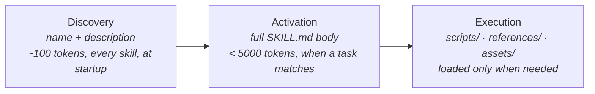

# Agent Skills (SKILL.md)

**Contract layer** — a [standard](index.md), not a product. Agent Skills is *"a lightweight, open format for extending AI agent capabilities with specialized knowledge and workflows."* A skill is a folder containing a `SKILL.md` file, and the format is what lets a skill written once load in any *"skills-compatible agent"*. It is the format almost every framework in this wiki ships its capabilities in, and the format [[artifact-skill-doc]] describes.



## The format

A skill is a directory whose name matches the skill's `name`:

```
skill-name/
├── SKILL.md          # Required: metadata + instructions
├── scripts/          # Optional: executable code
├── references/       # Optional: documentation
├── assets/           # Optional: templates, resources
└── ...               # Any additional files or directories
```

`SKILL.md` is YAML frontmatter followed by a Markdown body. The spec defines six frontmatter fields:

| Field | Required | Constraint |
|---|---|---|
| `name` | yes | 1–64 chars; lowercase `a-z`, `0-9`, and hyphens; no leading, trailing, or doubled hyphen; must match the parent directory |
| `description` | yes | 1–1024 chars; *"what the skill does and when to use it"*, with the keywords an agent will match on |
| `license` | no | a licence name or a bundled licence file |
| `compatibility` | no | ≤500 chars of environment requirements (*"Designed for Claude Code (or similar products)"*, *"Requires git, docker, jq"*); *"most skills do not need"* it |
| `metadata` | no | a string-to-string map for anything the spec does not define, with keys *"reasonably unique to avoid accidental conflicts"* |
| `allowed-tools` | no, **experimental** | a space-separated list of pre-approved tools (`Bash(git:*) Read`); support varies by agent |

The body has *"no format restrictions"*. The spec recommends step-by-step instructions, input/output examples, and edge cases; keeping `SKILL.md` under 500 lines; moving detail into `references/` files that are each kept focused; and keeping file references **one level deep** from `SKILL.md`. The `skills-ref` reference library validates a skill (`skills-ref validate ./my-skill`) against the frontmatter and naming rules.

## Progressive disclosure is the point

The format is built around one loading discipline, stated as three stages: **discovery** (the agent loads only `name` and `description` for every skill at startup), **activation** (the full body loads when a task matches the description), and **execution** (bundled scripts and references load only as the instructions call for them). *"Agents can keep many skills on hand with only a small context footprint."*

That makes the `description` field the whole trigger surface: a skill that is never matched is never read. It is why the wiki's skill-writing capabilities spend most of their effort on descriptions. [[sp-writing-skills]] demands *when-to-use-only* descriptions, and [[mp-writing-for-agents]] treats the description as a **context pointer** whose wording, not its target, decides when the material is reached. The standard is the contract-side form of [[pattern-context-engineering]].

## Governance

Agent Skills *"was originally developed by Anthropic, released as an open standard, and has been adopted by a growing number of agent products"*, and is *"open to contributions from the broader ecosystem"* through the `agentskills/agentskills` GitHub repository and a Discord. The specification publishes **no version number or date**, so this page tracks it by capture date. There is no stated deprecation policy.

## Adoption (`conforms_to:` backlinks)

The agentskills.io client showcase lists **46** adopting products. Every paged harness is among them.

**Harnesses:**

- [[claude-code]] — description-triggered `SKILL.md` units, the reference implementation's home.
- [[opencode]] — configurable skills.
- [[pi]] — skills under `~/.pi/agent/skills/` or `.pi/skills/`, invoked as `/skill:name`.
- [[factory-droid]] — skills via `/skills` and `/create-skill`, kept distinct from the `AGENTS.md` briefing.

**Frameworks** — each ships its capabilities as `SKILL.md` units:

- [[superpowers]] — the one framework whose own skill-authoring guide cites the spec by URL for its required fields ([[sp-writing-skills]]).
- [[addy-agent-skills]] — 24 skills, `SKILL.md` as entry point with references loaded on demand.
- [[bmad]] — agents and workflows both expressed as `bmad-*` skills.
- [[bm-skills]]
- [[builder-skills]]
- [[gstack]]
- [[matt-pocock-skills]]
- [[nano-spec]] — a single `.claude/skills/nano-spec/SKILL.md`.
- [[pstack]]

**Runtimes:**

- [[bernstein]] — role prompts are *"progressive-disclosure capability packs"*: a directory with `SKILL.md` plus optional `references/`, `scripts/`, `assets/`, with only the name+description index injected at spawn.
- [[sssf]] — the runtime *is* a skill directory: `SKILL.md` holds the hard rules and routing, with `references/` and `scripts/` beside it.
- [[warp-factories]] — factory skills are `SKILL.md` directories in the factory definition, shared under `skills/` or scoped to one agent under `agents/<name>/skills/`; the Warp Agent harness reads the same layout from `.agents/skills/` and the other vendors' skill directories.

**Registries:**

- [[tessl]] — its skill review runs *"deterministic checks that the skill follows the Agent Skills specification: line count, frontmatter, schema, licence, and metadata"*, and `skill import` promotes a loose `SKILL.md` into a versioned bundle.

**Artifacts:**

- [[artifact-skill-doc]] — the artifact type this standard specifies.

**Not yet paged** (from the showcase): Codex, Cursor, GitHub Copilot, VS Code, Gemini CLI, Amp, Goose, Junie, OpenHands, Roo Code, Kiro, Letta, OpenClaw, and 29 others. Four of the wiki's harness ingest queue (Codex, Cursor, Copilot, Gemini CLI) are on the list.

## Where conformance is loose

The edges above record documented adoption, not validator passes. The spec defines six top-level fields and offers `metadata` for everything else, but the frameworks here routinely put harness-specific keys at the top level instead: Claude Code's `disable-model-invocation` across [[matt-pocock-skills]], and Cursor's `mode: true` (with `reminder` / `icon` / `color`) and `paths:` auto-attach across [[pstack]]. The captured spec does not say whether unknown top-level keys are invalid, and how `skills-ref` treats them is not recorded here. In practice, the portable core is `name` + `description` + directory layout, and the rest is per-harness dialect, which is why [[matt-pocock-skills]] ships a separate `agents/openai.yaml` beside each `SKILL.md` for Codex rather than encoding Codex's settings in the spec's fields.

## Relationship to other standards

- [[std-agents-md]] is the complementary half of the same move. `AGENTS.md` is the always-loaded project briefing; a skill is the on-demand procedure. [[tessl]] packages the same split as *rules* (always) vs *skills* (when relevant).
- [[std-mcp]] lists **Skills over MCP** as an extension: skills *"discovered and consumed through MCP"*. [[bernstein]] already does this in its own way, serving skill bodies through a `load_skill` MCP tool.

## See Also
- [Standard layer](index.md) — the adoption matrix across all three standards.
- [[artifact-skill-doc]] — the artifact this format specifies.
- [[artifact-capability-bundle]] — the versioned package a skill ships inside once a registry distributes it.
- [[sp-writing-skills]] · [[mp-writing-for-agents]] — the two frameworks' theories of writing a good skill to this format.
- [[pattern-context-engineering]] — the technique progressive disclosure implements.
