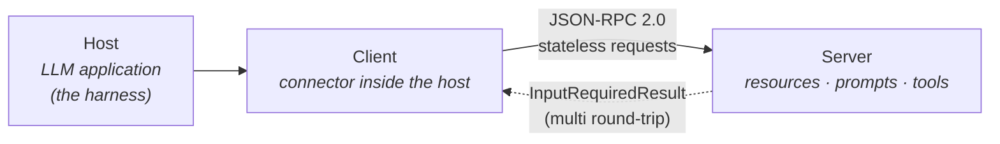

# Model Context Protocol (MCP)

**Contract layer** — a [standard](index.md), not a product. MCP is *"an open protocol that enables seamless integration between LLM applications and external data sources and tools"*, modelled on the Language Server Protocol: as LSP standardised how editors gain language support, MCP *"standardizes how to integrate additional context and tools into the ecosystem of AI applications."* The current revision is **2026-07-28**. It is the only `protocol` standard in the wiki: where [[std-agent-skills]] and [[std-agents-md]] are files an agent reads, MCP is a live connection to a running server.

## The protocol

- **Roles.** A **host** is the LLM application that initiates connections; a **client** is the connector inside it; a **server** provides context and capabilities. In this wiki's terms, the harness is the host.
- **Base protocol.** JSON-RPC 2.0, with **stateless, self-contained requests** and **per-request capability negotiation**. There is no initialisation handshake and no protocol-level session: every request carries its protocol version and client capabilities in `_meta`, clients identify themselves per request, and servers per result. A server MUST implement `server/discover` to advertise its versions, capabilities, and identity. Servers needing cross-call state mint explicit handles and pass them as ordinary tool arguments.
- **Server features.** **Resources** (context and data for the user or the model), **prompts** (templated messages and workflows for users), and **tools** (functions for the model to execute).
- **Client features.** **Elicitation**: server-initiated requests for more information from the user.
- **Multi round-trip requests.** A server that needs more input returns an `InputRequiredResult` naming what it needs; the client retries the original request with the answers. Every result carries a `resultType` (`complete` or `input_required`).
- **Change notifications.** One long-lived `subscriptions/listen` stream, to which a client opts in per notification type (tool, prompt, or resource list changes; resource subscriptions).
- **Caching.** List and read results carry `ttlMs` and `cacheScope`, and servers SHOULD return `tools/list` in a deterministic order *"to enable client-side caching and improve LLM prompt cache hit rates."*
- **Extensions.** Opt-in, negotiated, and outside the core: **Tasks** (long-running operations with polling and durable handles), **Skills over MCP** (agent-workflow instructions discovered and consumed through MCP), and **MCP Apps** (interactive UI rendered inline).
- **Deprecated, still functional.** Roots, Sampling, and Logging; the HTTP+SSE transport (use Streamable HTTP); and OAuth Dynamic Client Registration (use Client ID Metadata Documents).

## Security model

MCP *"cannot enforce these security principles at the protocol level"*, so it states them as obligations on implementors. **User consent and control** (users explicitly consent to all data access and operations), **data privacy** (hosts get consent before exposing user data to servers), and **tool safety** (*"tools represent arbitrary code execution"*; hosts get consent before invoking any tool, and tool descriptions and annotations *"should be considered untrusted, unless obtained from a trusted server"*). In practice the consent burden lands on the host, which means on the harness's permission model ([[pattern-edit-guardrails]]).

## Governance

MCP is *"Model Context Protocol a Series of LF Projects, LLC"*, with specifications under Apache 2.0. Technical governance is hierarchical: Lead Maintainers (a BDFL role, currently David Soria Parra and Den Delimarsky), Core Maintainers, Maintainers, and Contributors, together forming the MCP Steering Group. *"Membership in the technical governance process is for individuals, not companies."* Changes go through **Specification Enhancement Proposals (SEPs)**, now PR-based. A **feature lifecycle policy** defines Active, Deprecated, and Removed states with a minimum twelve-month deprecation window. Revisions are named by release date. Of the three standards paged, MCP has by far the most formal process: a versioned spec, a changelog, a deprecation registry, and named maintainers.

## Adoption (`conforms_to:` backlinks)

Edges here require an **endpoint** — a client or a server. Tools that only call whatever MCP servers the harness exposes are listed in prose below.

**Harnesses** (MCP clients):

- [[claude-code]] — local and remote servers, loadable on demand.
- [[opencode]] — MCP servers supported.
- [[factory-droid]] — the deepest client: 40+ pre-configured servers with OAuth flows, managed by `droid mcp add` / `/mcp`.

**Registries:**

- [[tessl]] — the integration *is* an MCP server. [[tessl-mcp]]'s `tessl mcp start` is one stdio server written into every agent's config, so installed context reaches the agent as tools. That is how one integration covers nine harnesses ([harness matrix](../harness/index.md)).

**Stores:**

- [[beads]] — ships `beads-mcp` on PyPI, and [[beads-prime]] detects an MCP server and shrinks its own context injection from ~1–2k tokens to ~50.

**Runtimes:**

- [[bernstein]] — runs an MCP server (`bernstein.mcp.server`) whose `load_skill` tool serves skill bodies on demand, injects MCP config into spawned Claude Code agents, and lists MCP in `core/protocols/` beside A2A and ACP.
- [[gh-aw]] — runs each declared MCP server (`mcp-servers:` in workflow frontmatter) in an isolated container behind an MCP Gateway, and reaches GitHub through the GitHub MCP server.
- [[warp-factories]] — ships the **Factory MCP**, a remote streamable-HTTP server (`https://app.warp.dev/api/v1/mcp/factory`, OAuth browser sign-in or an agent API key) through which any MCP client sends work to a factory, pulls a task down to work locally, messages its foreman, and validates factory definitions; factory agents also take MCP servers from the definition (`mcpServers`, by Warp ID, stdio command, or URL). The docs flag the scope: *"Factory MCP has no read-only or per-factory scopes."*

**The absence: pi.** [[pi]] deliberately keeps MCP **out of core**; it is available only through a TypeScript extension. It is the one paged harness without an edge, by design rather than by lag, and it is the clearest statement in the wiki that a harness can treat a widely adopted standard as optional.

**Consumers, not endpoints** (prose only, per the endpoint rule): [[addy-browser-testing]] drives Chrome DevTools MCP; [[pstack-why]] discovers available MCP servers at run time and fans out investigators across them; [[builder-skills]] operates Agent-Native apps through Dispatch MCP ([[builder-an]]); [[warren]] has MCP support on its roadmap (agents declaring `mcp_servers` in prompt frontmatter), not yet shipped.

## Relationship to other standards

- [[std-agent-skills]] — the **Skills over MCP** extension would carry skills over this protocol, and [[bernstein]]'s `load_skill` tool already does something similar. If the extension is widely adopted, a skill would become something a server offers rather than a file in the repo, which is the same move [[tessl]] makes commercially.
- [[std-agents-md]] — the standing-instructions file; MCP is the live-tools channel beside it.

## See Also
- [Standard layer](index.md) — the adoption matrix across all three standards.
- [[pattern-context-engineering]] — MCP is the contract-side form of loading context on demand.
- [Harness layer](../harness/index.md) — the MCP row of the harness matrix.
- [[topic-harness-engineering]] — MCP among the harness-side machinery that loads guides into the window.

## Version history

### 2026-07-28 (released 2026-07-28; ingested 2026-10-11)
First revision ingested. Changes from the previous revision, 2025-11-25:
- Made the protocol stateless: removed the `initialize` handshake and protocol-level sessions (`Mcp-Session-Id`); version and capabilities now travel on every request; added `server/discover`.
- Replaced server-initiated requests (`roots/list`, `sampling/createMessage`, `elicitation/create`) with the multi round-trip request pattern and a required `resultType` on all results.
- Replaced the HTTP GET endpoint and resource subscribe/unsubscribe with a single `subscriptions/listen` stream; removed SSE resumability, `ping`, and `logging/setLevel`.
- Moved experimental tasks out of core into the `io.modelcontextprotocol/tasks` extension, and added an `extensions` capability field.
- Added cacheable list results (`ttlMs`, `cacheScope`) and deterministic `tools/list` ordering.
- Deprecated Roots, Sampling, Logging, the HTTP+SSE transport, and Dynamic Client Registration.
- Adopted the feature lifecycle and deprecation policy and the PR-based SEP workflow.
